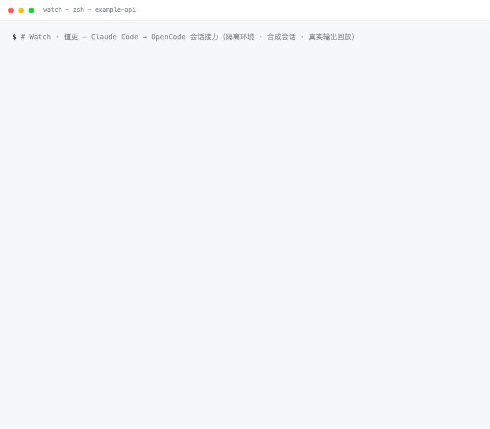

<div align="center">
  
  <h1>Watch · 值更</h1>
  <p><b>Relieving the watch. The voyage never stalls.</b></p>
  <a href="https://github.com/can4hou6joeng4/Watch/stargazers"></a>
  <a href="https://github.com/can4hou6joeng4/Watch/releases"></a>
  <a href="LICENSE"></a>
  
  <br>
  <a href="README.md">中文</a> · Website <a href="https://relay.bobochang.cn/en/">relay.bobochang.cn/en</a> · Related <a href="https://github.com/can4hou6joeng4/Homeport">Homeport</a>
</div>

## Why

When the current agent hits its limit, the context window fills up, or an investigation stalls and you want to switch tools, the conclusions, failed attempts and tool history all stay behind in the old tool. Restating that context is expensive, and it is easy to drop a constraint that mattered.

Watch does one thing: **carry the saved session record and the working directory into a target tool so the same work continues.**

The steps are on the site [guides](https://relay.bobochang.cn/en/#guides): [Claude Code limit to Codex](https://relay.bobochang.cn/en/guides/claude-code-limit-to-codex/), [context window versus usage limit](https://relay.bobochang.cn/en/guides/context-limit-vs-usage-limit-handoff/), [OpenCode and SQLite isolation](https://relay.bobochang.cn/en/guides/opencode-handover-sqlite-isolation/), and [Opus 5.5 and the five-hour limit](https://relay.bobochang.cn/en/guides/opus-5-5-five-hour-limit/).

It does not provide models, bypass usage limits, replace native agent chat, or move permissions, credentials and plugins by default. What it transfers is the recorded session, not the model's unrecorded internal state. Today the implementation is centred on CLI sessions and terminal resume; the product direction includes validated desktop entry points, but **official interoperability does not mean Watch has integrated it**.

### Latest release ([v0.1.97](https://github.com/can4hou6joeng4/Watch/releases/tag/v0.1.97))

`watch usage` now discloses a missing grok content file even when sidecar usage is still readable.

v0.1.96 added counter-evidence for bad content lines, Codex compaction records and zero-byte content files, but a deleted content file still hits the early `missing` return in `usageContentFileProblem()` when `usage !== null`. The report showed the sidecar usage total without a warning or `contentProblem`. This release folds `missing` into the same disclosure tier as zero-byte, non-file and unreadable states; the total and `totalExcluded` do not change.

- **No silent deletion**: when grok `updates.jsonl` still carries usage but `chat_history.jsonl` is gone, `warnings` and `byProvider[].contentProblem` say the conversation is lost, the usage is still counted, and a backup restore is the next step.
- **No accounting change**: usage really was read, so the total, `totalExcluded` and empty-session classification stay unchanged; healthy sessions gain no fields or warnings.
- **Validation scope**: 1 new isolated check, 18/18 with the r179 / r180 / Codex compaction cases, 2233 full isolated tests with zero failures and zero skips, plus typecheck, desktop build, 16/16 site tests and the share-image digest check. No native-client acceptance claim is added.

### Previous release ([v0.1.96](https://github.com/can4hou6joeng4/Watch/releases/tag/v0.1.96))

`watch usage` now requires content-side evidence before calling a parsed 0-turn session empty.

v0.1.95 classified a 0-turn parse as an empty session, but 0 turns alone does not prove the session was empty: a truncated grok `chat_history.jsonl` still parses to 0 turns, and a Codex rollout reduced to `session_meta + compacted` (the pre-compaction history may be gone) does too. Both were reported as normal new sessions. In the opposite direction, a zero-byte grok content file whose sidecar `updates.jsonl` still carries usage skipped the whole content check, so the report showed a total without a single warning.

- **Content bad lines first**: for sidecar usage providers, `chat_history.jsonl` is scanned separately; bad lines stay in `byProvider[].contentBadLines`, are not called an empty session and are not described as "no conversation".
- **Compaction as counter-evidence**: a Codex log with only compaction records gets a `zeroTurnProblem` from the adapter, surfaced in `warnings` and `byProvider[].zeroTurnProblem`; the summary body is not copied.
- **Content loss separate from usage**: readable sidecar usage still counts toward the total, but an empty or unusable content file now appears in `warnings` and `byProvider[].contentProblem`; `totalExcluded` and the total are unchanged.
- **Legitimate empty sessions unaffected**: `watch new codex / grok / opencode` still counts in `totalEmptySessions`; healthy sessions gain no new warnings; text mode lists the three cases separately after the total.

- **Validation scope**: 4 new isolated checks (grok bad content lines, grok content loss with healthy sidecar usage, Codex compaction records, healthy counterexample) pass 26/26 together with usage and compaction cases; the full isolated regression passes 2232 tests with zero failures and zero skips; typecheck and desktop build pass. No native-client acceptance claim is added: no native GUI or model was started this round.

### Previous release ([v0.1.95](https://github.com/can4hou6joeng4/Watch/releases/tag/v0.1.95))

`watch usage` now separates a 0-turn empty session from a session that has content but no recorded usage.

`sessionUsage` returns null for both: a legitimate empty session created by `watch new codex / grok / opencode` (0 turns), and a session with conversation but no native usage records. They were both counted into `totalMissingUsage`, so a freshly created chain was reported as `1 session without usage data`, reading like a statistics gap. grok was worse: the sidecar `updates.jsonl` of a new empty session is itself zero bytes, and the sidecar check ran first, so the report said the usage source is empty and the content was lost, describing a normal new session as data loss.

- **Empty first**: when the main session file exists, is not zero bytes and parses to 0 turns, it is recorded as an empty session (the new `totalEmptySessions` and `byProvider[].emptySession`) instead of `totalMissingUsage`.
- **Sidecar check after**: an empty sidecar is the normal shape of an empty session and no longer reports data loss; sessions with content still get the original `updates.jsonl` sidecar checks.
- **No merge, no false alarm**: a session with one or more turns but no usage records (such as the claude / pi placeholder user) still counts as missing usage; a file whose lines are all unparsable keeps its bad-line count and the not-read wording instead of becoming an empty session; a parse failure likewise keeps the old wording.

- **Validation scope**: 3 new isolated checks (codex / grok empty-session classification and text, the claude placeholder counterexample) pass 94/94 together with the usage-related cases; the full isolated regression passes 2225 tests with zero failures and zero skips; typecheck, desktop build, the four site test files (16/16) and the share-image render/digest checks pass. No native-client acceptance claim is added: no native GUI or model was started this round.

### Previous release ([v0.1.94](https://github.com/can4hou6joeng4/Watch/releases/tag/v0.1.94))

`watch new` now reports the turn count its session actually parses to.

The empty-chain branch used to hard-code `turnCount: 0` for `createEmptySession`, but the claude and pi implementations write a placeholder user message. For the same freshly created session, `new --json` said 0 turns while the chain tip in `chain list` (`chains[].tip.turns`) and `status` (`chainTipTurns`) said 1, giving two answers for one fact. codex, grok and opencode only write a rollout header or an empty session, where 0 was already correct.

- **Parsed, not assumed**: `new` parses the created session once, so `--json` `turnCount` matches the chain-tip counts from `chain list` and `status`.
- **0 turns stated plainly**: text mode prints a 0-turn parse note with an empty session instead of a plain zero count, plus a line saying this is normal for a new session and resume opens it ready to chat.
- **No zero stand-in**: if the parse fails, `--json` omits `turnCount` and a warning says the content cannot be read, so the already-created session is not reported as failed.

- **Validation scope**: 3 new isolated checks (claude / pi turn counts matching the chain tip, codex 0 turns and its text note) pass 30/30 together with the new / JSON-contract cases; the full isolated regression passes 2222 tests with zero failures and zero skips; typecheck, desktop build, the four site test files (16/16) and the share-image render/digest checks pass. No native-client acceptance claim is added: no native GUI or model was started this round.

### Previous release ([v0.1.93](https://github.com/can4hou6joeng4/Watch/releases/tag/v0.1.93))

The chain-tip row in `watch chain list` now shows its turn count, consistent with `status`.

`status` has reported a 0-turn chain tip and shown its turn count since v0.1.89 and v0.1.90, and v0.1.92 closed the same gap in `doctor`; but the `chain list` tip row only said whether the file exists, is missing or cannot be read. With several chains, there was no way to tell which tip still has content and which sits on an empty session.

- **With content**: the row ends with `-> claude:<id> (N turns)`, and `chains[].tip.turns` carries the same number in `--json`.
- **0 turns**: it reads as a 0-turn parse note with an empty session, not as a plain zero count, and an active chain gets an extra warning that resume opens an empty session.
- **No stand-in**: a zero-byte or unreadable tip carries no turn count (`turns` is absent) and keeps its existing unreadable marker; a parse failure also carries no count, leaving that case to the doctor content-parse warning and to open / switch errors.

- **Validation scope**: 3 new isolated checks (content, 0 turns, zero bytes) pass 18/18 together with the chain-related cases; the full isolated regression passes 2219 tests with zero failures and zero skips; typecheck, desktop build, the four site test files and the share-image checks pass. No native-client acceptance claim is added: no native GUI or model was started this round.

### Previous release ([v0.1.92](https://github.com/can4hou6joeng4/Watch/releases/tag/v0.1.92))

`watch doctor` now discloses a readable 0-turn chain tip the same way `status` does.

v0.1.89 and v0.1.90 taught `status` to report a 0-turn chain tip and show its turn count, but the troubleshooting entry point still told another story: chains created by `watch new` have no source session, so content reconciliation skipped them entirely and doctor reported everything as fine; chains with a source only said the tip is missing N records, which is the wording for content drift.

- **New `emptyTips`**: doctor reports a tip that exists, reads fine yet parses to 0 turns as its own category, with `chainName`, `provider`, `sessionId` and `filePath` under `store.emptyTips` in `--json`.
- **Summary and per-chain rows**: the text summary counts "N chain tips are empty (0 turns)" and each row names the `provider:sessionId` plus the next step; a tip just created by `watch new` is noted as normal before any conversation.
- **No more false drift**: a 0-turn tip with a source now reads as "the next switch will succeed but open an empty session" instead of being recorded in `driftedPairs`.
- **Same exit-code convention**: an empty tip is a warning, not a hard failure, so the default exit code stays 0 and only `--strict` turns it red, like every other doctor warning.

- **Validation scope**: 3 new isolated checks (a chain without a source, a chain with a source, and a healthy tip as the counter-example) pass 62/62 together with the doctor and status cases; the full isolated regression passes 2216 tests with zero failures and zero skips; typecheck, desktop build, the four site test files and the share-image checks pass. No native-client acceptance claim is added: no native GUI or model was started this round.

### Previous release ([v0.1.91](https://github.com/can4hou6joeng4/Watch/releases/tag/v0.1.91))

v0.1.91 adds a bilingual guide on [why resume opens an empty session and how to detect and recover 0-turn sessions](https://relay.bobochang.cn/en/guides/empty-session-resume-check/). Versions v0.1.84 through v0.1.90 filled in the 0-turn disclosures across `open`, `switch`, `new` and `status`; this release turns the detection rules and recovery paths into a standalone guide.

- **Two kinds of empty**: a readable 0-turn file (a legitimate empty session from `watch new`, or only a placeholder header left) versus a zero-byte file (killed process, full disk, half a write). Codex stores attribution in the first rollout line, so truncating to zero bytes also breaks lookup.
- **Reading the disclosures**: start from the chain-tip row in `watch status` (a turn count, or a 0-turn note), which maps to `chainTipTurns` and `chainTipEmpty` in `--json`, plus `notes` and `resumeTargetEmpty` from `switch`.
- **Three recovery paths**: restore from backup and resume, rebind with `watch adopt <provider> --session <id>`, or start another chain with `watch chain new <name>`. Watch does not rebuild history and never deletes or repairs a zero-byte file on its own.

- **Validation scope**: two new pages, zh and en, with sitemap, `llms.txt` and the IndexNow URL list updated; the four site test files pass 16/16, the full isolated regression passes 2213 tests with zero failures and zero skips, and typecheck, desktop build and share-image checks pass. No native-client acceptance claim is added.

### Previous release ([v0.1.90](https://github.com/can4hou6joeng4/Watch/releases/tag/v0.1.90))

v0.1.90 adds the turn count to the chain-tip row in `watch status`. v0.1.89 made `status` disclose a readable 0-turn chain tip; this version also shows the turn count from the same `parse`, so the remaining content of the chain tip is visible at a glance instead of requiring a `switch` or opening the native client.

- **With content**: the chain-tip row reads as a chain tip with N turns.
- **0 turns**: it still reads as a 0-turn parse note pointing at the warning above, not as a plain zero count.
- **No stand-in**: a zero-byte tip and a parse failure carry no turn count; the `chainTipTurns` field in `--json` exists only when the `parse` succeeds (`undefined` means it did not parse), and no zero is used as a substitute.

- **Validation scope**: 3 new isolated checks (a tip with content showing its turn count, 0 turns phrased as a note rather than a count, a zero-byte tip without a count) pass 63/63 together with `cli-status-*`, `cli-doctor*`, `cli-store-reason-*`, `doctor-*` and other status and doctor cases; the full isolated regression passes 2213 tests with zero failures and zero skips; typecheck, desktop build, the four site test files (16/16), and the share-image checks pass. No native-client acceptance claim is added.

### Previous release ([v0.1.89](https://github.com/can4hou6joeng4/Watch/releases/tag/v0.1.89))

v0.1.89 closes the 0-turn chain-tip gap in `watch status`. The chain-tip check only asked whether the file exists, is a regular file, has a confirmable state, and is readable. A readable tip that parses to 0 turns, such as a legitimate empty session from `watch new codex` / `watch new grok`, or content cleared with only a placeholder header left, was still marked as the chain tip and recommended to the user, and copying its resume command opened an empty session. After v0.1.84 through v0.1.88 covered the `open`, `switch` and `new` paths, `status` was the last entry that called a session your chain tip without checking its content.

- That case now names the 0-turn parse and the possibility that content was cleared in `warnings`, offers opening it in the native client to check or restoring the file from backup, and adds a `chainTipEmpty` flag to the JSON result.
- Text mode marks the chain-tip row with a note pointing at the warning above.
- A zero-byte tip stays covered by the existing empty-file warning with no extra line; a parse failure does not enter this case, since format damage is reported by the `open` / `switch` prechecks.

- **Validation scope**: 3 new isolated checks (readable 0-turn tip, healthy-tip counterexample, zero-byte tip without the extra line) pass 60/60 together with `cli-status-*`, `cli-doctor*`, `cli-store-reason-*`, `doctor-*` and other status and doctor cases; the full isolated regression passes 2210 tests with zero failures and zero skips; typecheck, desktop build, the four site test files (16/16), and the share-image checks pass. No native-client acceptance claim is added.

### Previous release ([v0.1.88](https://github.com/can4hou6joeng4/Watch/releases/tag/v0.1.88))

v0.1.88 closes the result-note gap when `watch switch` merges content into an empty target session. When the target parses to 0 turns while the file is readable and not zero bytes, `switch` merged the source content but only reported how many turns were handed over, so the user could not tell that those turns are now the whole session, nor where to look if it should have older history.

- That case now adds a result note (`notes`, not a degradation warning): the merged turns are the entire content of the session, and if it should have older history, restore the file from backup first (Watch does not rebuild history for you). Creating an empty session with `watch new` and switching into it is the normal first-chain path, so it does not raise a degradation warning every time.
- `--json` gains a `notes` field, printed to stdout in text mode; `warnings` keeps its meaning.
- A zero-byte target stays covered by the existing empty-file warning with no extra note; a target that already has content or a zero-increment switch emits nothing.

- **Validation scope**: 3 new isolated checks (readable 0-turn target, counterexample with a non-empty target, zero-byte target without the extra note) pass 113/113 together with r169, r170, `cli-switch-*`, `cli-new-*`, `handoff` and other switch, new and handoff cases; the full isolated regression passes 2207 tests with zero failures and zero skips; typecheck, desktop build, the four site test files (16/16), and the share-image checks pass. No native-client acceptance claim is added.

### Previous release ([v0.1.87](https://github.com/can4hou6joeng4/Watch/releases/tag/v0.1.87))

v0.1.87 closes the empty-session gap when `watch new` finds the chain tip already on the target provider. `new` refuses to create another session and answers that the existing one is ready to resume. That line only checked whether the file exists, is readable, and stopped mid-turn; it never checked whether the session has content. A legitimate empty session from `watch new codex` or `watch new grok`, or content cleared with only a placeholder header left, parses to 0 turns, yet the answer said it is ready to resume, and opening it shows nothing.

- That case now names the 0-turn parse and the possibility that content was cleared, offers opening it in the native client to check or restoring the file from backup, and keeps the switch-to-the-other-side suggestion.
- A tip with turns keeps the plain ready-to-resume wording; a tip stopped mid-turn still reports the unfinished turn first. Neither adds the 0-turn line or makes a false empty-session claim.
- Same rule as the `open` work in v0.1.84 and the `switch` work in v0.1.86: a readable file is never described as content-is-lost.

- **Validation scope**: 3 new isolated checks (readable 0-turn tip, counterexample with a healthy tip, mid-turn tip without the extra line) pass 87/87 together with r169, r168, `cli-new-*`, `cli-switch-*`, `handoff` and other new and switch cases; the full isolated regression passes 2204 tests with zero failures and zero skips; typecheck, desktop build, the four site test files (16/16) and the share-image check pass. No native-client acceptance claim is added.

### Previous release ([v0.1.86](https://github.com/can4hou6joeng4/Watch/releases/tag/v0.1.86))

v0.1.86 closes the empty-session gap in the `switch` fallback that says the session is ready to open. When there is no source to hand over and the chain tip already sits on the target provider, `switch` only prints one conclusion line plus a resume command. But that tip session may parse to 0 turns — a legitimate empty session from `watch new codex` or `watch new grok`, or content cleared with only a placeholder header left. The file is readable, yet the conclusion says it is ready to open, and opening it shows nothing.

- That case now names the 0-turn parse and the possibility that content was cleared, offers opening it in the native client to check or restoring the file from backup, and changes the conclusion to say the resume opens an empty session (reason in the warning above).
- A zero-byte tip still only reports the empty session file, without this extra line; a tip with turns keeps the plain ready-to-open wording and no extra warning.
- Same rule as the `open` work in v0.1.84 and the `switch` rejection in v0.1.85: a readable file is never described as content-is-lost, and `--json` carries a `resumeTargetEmpty` flag.

- **Validation scope**: 3 new isolated checks (readable 0-turn tip, counterexample with a healthy tip, zero-byte tip without the extra line) pass 119/119 together with `cli-switch-*`, `cli-zero-byte-tip-session`, `cli-new-at-tip-unfinished`, `switch-empty-chain-tip`, r156, r164, r168 and other switch and chain-tip cases; the full isolated regression passes 2201 tests with zero failures and zero skips; typecheck, desktop build, the four site test files (16/16) and the share-image check pass. No native-client acceptance claim is added.

### Previous release ([v0.1.85](https://github.com/can4hou6joeng4/Watch/releases/tag/v0.1.85))

v0.1.85 closes the last silent 0-turn path in `switch`. When the source session parses to 0 turns and there is no existing target session to carry over, `switch` refuses the handoff, but that error used to separate only zero-byte files from sessions with no content: a readable file parsing to 0 turns (a legitimate empty session from `watch new`, or content cleared with only a placeholder header left) got a single no content to hand over line and no next step.

- That case now names the 0-turn parse and the possibility that content was cleared, and offers two paths: open it in the native client to check, or restore the file from backup (Watch does not rebuild history for you). The `watch new <target>` suggestion for starting fresh is kept.
- A zero-byte source still says plainly that the session file is empty and only offers backup restore, instead of sending you to look for something that is already gone. Neither case describes a readable file as content-is-lost.
- The same release fixes a site regression: the v0.1.84 release overwrote the Chinese homepage `quickIntro` with English and dropped five fields (`requirements`, `cli`, `copyAll` and two more), which rendered as `undefined` on the live site. Both intros and all fields are restored.

- **Validation scope**: 3 new isolated checks (readable 0-turn source, zero-byte source, counterexample with a healthy source) pass 36/36 together with `cli-switch-*`, `handoff-zero-rewrite-preserves-dest`, r156, r164 and other switch cases; the full isolated regression passes 2198 tests with zero failures and zero skips; typecheck, desktop build, the four site test files (16/16) and the share-image check pass. No native-client acceptance claim is added.

### Previous release ([v0.1.84](https://github.com/can4hou6joeng4/Watch/releases/tag/v0.1.84))

v0.1.84 completes the 0-turn readable-session disclosure in `open`. Plain `open <id>`, the `open <id> --to <same provider>` fast path, and the rejection from `open <id> --to <other provider>` used to distinguish only zero-byte files; a readable file that parses to 0 turns (a legitimate empty session from `watch new`, or content cleared with only a placeholder header left) got no explanation, leaving a resume that looks completely normal or a bare no content to transfer message:

- Plain open and `--to` the same provider now name the 0-turn parse with nothing to continue, say the resumed session is empty, and offer opening it to check or restoring from backup; `--check` consumes the same diagnostics, so preflight says it before execution.
- The `--to` another provider error keeps the no content to transfer (0 turns) conclusion while separating a freshly created empty session from cleared content, and offers opening it to check or restoring from backup.
- Non-zero-byte files are never described as zero-byte or content-is-lost; healthy sessions with turns do not get this warning.

- **Validation scope**: 4 new isolated checks (plain open, `--to` same provider with `--check`, `--to` another provider, healthy counterexample) pass 115/115 together with r165, `cli-open-*`, `open.test` and other open cases; the full isolated regression passes 2195 tests with zero failures and zero skips; typecheck, desktop build, site build and share-image checks pass. No native-client acceptance claim is added.

### Previous release ([v0.1.83](https://github.com/can4hou6joeng4/Watch/releases/tag/v0.1.83))

v0.1.83 closes the empty-session disclosure gap in `adopt`. `adopt` only writes the chain record and never reports a turn count; binding a session whose file is readable but parses to 0 turns (a legitimate empty session from `watch new`, or content cleared with only a placeholder header left) still printed a successful bind plus a resume command, with no way to see the resumed session is empty:

- The warnings now name the 0-turn parse, say the resumed session is empty, and offer opening it to check, restoring from backup, or rebinding with `watch adopt … --session <another session id>`.
- Zero-byte files are split from unreadable ones: an empty file opens fine and only lost its content, so it is no longer described as a permission problem or given a resume-will-fail claim.
- The `unchanged` no-op path (the session was already bound) no longer says the chain record was written; the wording follows whether this run actually wrote anything.

- **Validation scope**: 3 new isolated checks (0-turn readable session, zero-byte session, rebind to another 0-turn session) pass 19/19 together with the 10 existing `cli-adopt-*` cases; the full isolated regression passes 2191 tests with zero failures and zero skips; typecheck, desktop build, site build and share-image checks pass. No native-client acceptance claim is added.

### Previous release ([v0.1.82](https://github.com/can4hou6joeng4/Watch/releases/tag/v0.1.82))

v0.1.82 closes the 0-turn disclosure gap in `open <target> --from <source>`. That path only distinguished zero-byte files before; when the file is not zero bytes but parses to 0 turns (a legitimate empty session from `watch new`, or content cleared with only a placeholder header left), the zero-increment branch used to word it as everything from the source is already in the target, while nothing was merged at all:

- A 0-turn source is now named as parsed 0 turns with nothing to merge; the note says nothing was written and the target was not modified, and offers opening the session to check, restoring from backup, or rechecking the `--from` session id.
- A 0-turn target now gets a note saying the N merged turns are its entire content, with restore-from-backup advice if it should have had older history. When the source is empty and the target is zero-byte, the warning says nothing was written instead of the contradictory line that only the source content was merged.
- Healthy empty sessions are still never called zero-byte or content-is-lost, matching the existing rule that a legitimate 0-turn session must not raise that warning.

- **Validation scope**: 3 new isolated checks (0-turn source, 0-turn target, and a 0-turn source with a zero-byte target) pass 100/100 together with `cli-open-zero-byte-session`, `open-from-process-events`, `open.test`, `cli-resume-target-unfinished`, `r63-opencode-revert` and other open cases (the 3 in r165 are included); the full isolated regression passes 2188 tests with zero failures and zero skips; typecheck, desktop build, site build and share-image checks pass. This adds no native-client acceptance claim.

### Previous release ([v0.1.81](https://github.com/can4hou6joeng4/Watch/releases/tag/v0.1.81))

v0.1.81 closes a silent success in the zero-increment branch of `switch`. When the source session parsed to 0 turns (a legitimate empty session from `watch new`, or content cleared with only a placeholder header left) and the chain already had a reusable target, it used to return `ok:true` with `turnCount:0` and no warnings at all, and text mode even printed handed off X to Y (0 turns) as if a real handoff had happened:

- It now names the source session as parsed 0 turns with no conversation to carry, says only the chain tip moved and the target session was not modified, and offers opening the session to check, restoring from backup, or rebinding with `watch adopt ... --session <another session id>`. When both sides are zero-byte, each side is named, including that the resume opens an empty session.
- The text conclusion becomes switched to X (chain tip updated; ...); already-up-to-date and an empty source no longer share one sentence. JSON adds `zeroIncrementReason` (`source-empty` / `up-to-date`) to distinguish the two zero-increment shapes.

- **Validation scope**: 4 new isolated checks (zero-increment with a 0-turn source in JSON and text, up-to-date in text, and both sides zero-byte) pass 43/43 together with r161 to r164, `cli-switch-*`, `handoff-zero-rewrite-*`, `switch-empty-chain-tip` and `cli-json-contract`; the full isolated regression passes 2185 tests with zero failures and zero skips; typecheck, desktop build, site build and share-image checks pass. This adds no native-client acceptance claim.

### Previous release ([v0.1.80](https://github.com/can4hou6joeng4/Watch/releases/tag/v0.1.80))

v0.1.80 covers the case where the chain-paired target in `open --to` exists and parses but contains no conversation at all (only a rollout header, or cleared content). The content check in decision 1 necessarily failed and open silently fell back to a content match or a new session, while the chain binding still pointed at the empty session and the next `switch` hit it again:

- It now discloses that 0 turns were parsed and offers continuing the session natively to check it, rebinding with `watch adopt ... --session <another session id>`, or starting a new chain.
- The zero-byte next step in `doctor` and `sessions` now says restore from backup first; starting another session is only a fallback and yields a different session, so it no longer suggests reopening repairs the original.

- **Validation scope**: 1 new isolated check (an `open --to` preflight whose chain-paired target is a header-only rollout) passes 110/110 together with r162, r163, `open.test`, doctor, degrade and the zero-byte listing cases; the full isolated regression passes 2181 tests with zero failures and zero skips; typecheck, desktop build, site build and share-image checks pass. The probe is still a single `lstat` with no reading, decompression or modification of `.zst`; this adds no native-client acceptance claim.

### Previous release ([v0.1.79](https://github.com/can4hou6joeng4/Watch/releases/tag/v0.1.79))

v0.1.79 fixes the next step for a zero-byte compressed copy. Versions v0.1.75 through v0.1.78 removed the reopen a session advice from retry messages, but the compressed tier of `sessions --chain` and the `doctor` chain-tip line still carried it. Reopening creates a different session: the chain binding still points at the dead copy and the next `switch` hits it again:

- The `sessions --chain` and `doctor` chain-tip lines now say restore from backup, then rebind with `watch switch ...` or point at another session with `watch adopt ... --session <id>`; the compressed tier gains the rebinding path it was missing.
- When the chain-paired target in `open --to` is a zero-byte plain file, it also adds rebinding with `watch adopt ...` and starting a new chain.

- **Validation scope**: 3 new isolated checks (the `sessions --chain` compressed tier, the `doctor` chain-tip text, and the `open --to` empty paired file) pass 82/82 together with the r157 to r162 checks, `open.test`, `cli-sessions-chain` and the doctor cases; the full isolated regression passes 2180 tests with zero failures and zero skips; typecheck, desktop build, site build and share-image checks pass. The probe is still a single `lstat` with no reading, decompression or modification of `.zst`; this adds no native-client acceptance claim.

### Previous release ([v0.1.78](https://github.com/can4hou6joeng4/Watch/releases/tag/v0.1.78))

v0.1.78 extends the v0.1.77 chain-binding disclosure to two more cases where the chain-paired target in `open --to` is unusable: the file was deleted, or it cannot be read. The diagnostic used to say only that the session was not reused and a content match or new session would be used. But `open` does not write chain records, so the chain still points at the unusable session and the next `switch` hits it again:

- Except for an intact compressed copy, which can be reused after re-expansion, it now adds that the chain binding still points there, that this run does not change the chain record, and that a later switch will fall back to it.
- The next step depends on the cause: a missing or unreadable file gets fix the cause above, then retry; a zero-byte compressed copy gets restore from backup, then retry. Both include rebinding with `watch adopt ...` and starting a new chain.

- **Validation scope**: 1 new isolated check (an `open --to` preflight whose chain-paired target was deleted) passes 73/73 together with the 15 checks from r157 to r160 and `open.test`; the full isolated regression passes 2177 tests with zero failures and zero skips; typecheck, desktop build, site build and share-image checks pass. The probe is still a single `lstat` with no reading, decompression or modification of `.zst`; this adds no native-client acceptance claim.

### Previous release ([v0.1.77](https://github.com/can4hou6joeng4/Watch/releases/tag/v0.1.77))

v0.1.77 completes the disclosure when the chain-paired target in `open --to` has only a zero-byte `.jsonl.zst`. The diagnostic used to say only that the session was not reused and a content match or new session would be used. But `open` does not write chain records, so the binding still points at the dead copy and the next `switch` hits it again. The `pairedEmpty` branch for a zero-byte plain file already said this; the compressed tier was missing it:

- A zero-byte compressed copy now adds that the chain binding still points at it, that this run does not change the chain record, and that a later switch will hit it again, together with restore from backup and retry, rebinding with `watch adopt ...`, or starting a new chain.
- An intact compressed copy does not add this: once the native client re-expands it, the next `switch` can reuse the same on-chain session.

- **Validation scope**: 1 new isolated check (an `open --to` preflight whose chain-paired target is a zero-byte compressed copy) passes with the 14 checks from r157, r158 and r159, 15/15 in total; the full isolated regression passes 2176 tests with zero failures and zero skips; typecheck, desktop build, site build and share-image checks pass. The probe is still a single `lstat` with no reading, decompression or modification of `.zst`; this adds no native-client acceptance claim.

### Previous release ([v0.1.76](https://github.com/can4hou6joeng4/Watch/releases/tag/v0.1.76))

v0.1.76 routes the restore-from-backup-then-retry step for zero-byte compressed copies through the seven remaining call sites. v0.1.75 only fixed the `switch` already-at-target branch and the same-provider branch of `watch chain new`; other sites still appended retry or rerun watch doctor directly to the shared advice. With a zero-byte copy, starting a new session produces a different session and restores neither the original path nor the chain binding, so the retry hits the same failure again:

- The pre-write guard message and hint, the `status` tip, the zero-result tip, `switch` source parsing, the `doctor` tip, `doctor` source reconciliation and the `chain list` tip now all use the new `compressedRetryAdvice(copy, retry)`.
- A zero-byte copy gets restore from backup, then retry (or then rerun watch doctor); an intact copy still gets let it re-expand, then retry. Sites that do not retry the same operation, such as `open --to`, `chainUsage` and rows that switch to a new session, keep their existing advice.

- **Validation scope**: 4 new isolated checks (both helper tiers, doctor source reconciliation, `switch` source parsing and the chain list tip) pass together with the 10 assertions from r157 and r158; the full isolated regression passes 2175 tests with zero failures and zero skips; typecheck, desktop build, site build and share-image checks pass. The probe is still a single `lstat` with no reading, decompression or modification of `.zst`; this adds no native-client acceptance claim.

### Previous release ([v0.1.75](https://github.com/can4hou6joeng4/Watch/releases/tag/v0.1.75))

v0.1.75 fixes the next step v0.1.74 gave when the chain tip already belongs to the target provider. The `switch` already-at-target warning and the same-provider branch of `watch chain new` reused the shared advice "restore from backup or start a new session, then retry" for a zero-byte compressed copy. But the chain still points at that copy, starting a new session does not change the chain record, and the retry hits the same failure every time. `compressedCopy()` now returns a structured `kind: 'intact' | 'empty'`, so call sites no longer infer the tier from wording:

- `watch chain new` for the tip's provider: a zero-byte copy now says "restore from backup and try again, or start a new chain with watch chain new <new name>"; an intact copy still says to let it re-expand first, then retry or start a new chain.
- The `switch` already-at-target resume warning follows the same split: a zero-byte copy offers "restore from backup and try again, or rebind with watch adopt ..., or start a new chain", and drops the retry path that cannot succeed.
- Every other call site (`status`, `chain list`, `doctor`, parse paths and so on) keeps its advice: their next step is not an immediate retry of the same chain, so starting a new session remains a valid rebuild.

- **Validation scope**: 2 new isolated checks (chain new, empty and intact tiers) pass together with the 8 assertions from r157; the full isolated regression passes 2171 tests with zero failures and zero skips. The probe is still a single `lstat` with no reading, decompression or modification of `.zst`; this adds no native-client acceptance claim.

### Previous release ([v0.1.74](https://github.com/can4hou6joeng4/Watch/releases/tag/v0.1.74))

v0.1.74 adds the zero-byte compressed-copy tier. v0.1.73 made `switch`, `status`, `chain list`, `doctor`, `adopt` and Codex lookup probe the sibling `.jsonl.zst` first, but counted only non-empty regular files as compressed copies. A zero-byte `.zst` was silently treated as absent, so those paths fell back to "the file no longer exists" or told you to continue the session in Codex so it re-expands, which cannot return content from an empty copy. `sessionFilePresence()` now records it as `emptyCompressed`, and both the wording and the next step say the content is lost:

- The shared note reads "only a 0-byte sibling compressed copy remains ... (content lost, re-expanding cannot recover it)", and the next step is "restore from backup or start a new session" instead of "let it re-expand".
- The five parse and reuse paths in `switch`, `status`, `chain list` (both tips and bound-but-unlisted sessions), `doctor` (`brokenTips` gains `compressedEmpty`, and the summary and per-chain line count zero-byte copies separately), `chainUsage` and the `open --to` diagnostics all use the same tier.
- A `HandoffBlockedError` from the pre-write guard can now carry its own `hint`: under the same `target_missing`, a deleted original, an intact compressed copy and a zero-byte copy need different next steps, so the CLI and `open` `blocked.hint` no longer fall back to "no longer exists".
- Codex `unattributable` gains a `compressed-empty` kind: an empty `adopt` result says "adopt after restoring from backup" while keeping the new-session alternative, and lookup no longer promises that the session will re-expand.

- **Validation scope**: all 8 new isolated checks pass (presence and wording, two `switch` paths, `chainUsage`, the pre-write guard hint, `adopt` zero results, Codex lookup and four CLI channels); the full isolated regression passes 2169 tests with zero failures and zero skips; typecheck, desktop build, site build and share-image checks pass. The probe is still a single `lstat` with no reading, decompression or modification of `.zst`; this adds no native-client acceptance claim.

### Previous release ([v0.1.73](https://github.com/can4hou6joeng4/Watch/releases/tag/v0.1.73))

v0.1.73 closes the gap on the main `switch` paths. v0.1.72 recognised `.jsonl.zst` only in the zero-result branch, while the common `switch` goes through the chain-paired target, the mtime fallback, already-at-target and source parsing. Those paths still called "original file absent, sibling `.zst` present" a missing file and silently rebound. They now probe `sessionFilePresence()` first, as does chain-pair reuse in `open --to`:

- When the target exists only as a compressed copy, the warning says it was compressed and that this run creates a new session to carry the content, with the next step of letting the native client re-expand it. Already-at-target no longer tells you to repair the file; a source that exists only as `.zst` no longer produces a "no longer exists" error.
- `chainUsage` now reaches the compressed wording for Codex too: `sessionUsage` throws on a missing file instead of returning null, so the catch branch checks presence.
- `doctor` broken tips store `compressedPath`, so the per-chain line prints the `.zst` that actually exists, not the absent `.jsonl`; a TOCTOU in the recheck now yields unknown instead of missing.
- `adopt` zero results are split by structured `kinds` (`damaged` / `compressed`): compressed copies get "adopt after re-expanding", damaged attribution gets "adopt after restoring" with the new-session alternative, and mixed counts say both. Advice text is no longer matched by substring.
- A `.zst` counts only when it is a non-empty regular file, and the wording says "if this is Codex local-thread compression and the copy is intact". Codex lookup now records name-matching symlinked rollouts or date directories as diagnostics and says it cannot confirm the session exists, instead of a clean "not found".
- The `open` found-unreadable headline adds "restore from backup or start a new session" for zero-byte files.

- **Validation scope**: all 10 new isolated checks pass, covering three `switch` paths, `chainUsage`, three `adopt` tiers, an empty `.zst`, symlink lookup and the `open` headline; the final full isolated regression passes 2161 tests with zero failures and zero skips; typecheck, desktop build, site build and share-image checks pass. The `.zst` probe is still a single `lstat` with no reading, decompression or modification; code-block and native-client acceptance boundaries are unchanged.

### Previous release ([v0.1.72](https://github.com/can4hou6joeng4/Watch/releases/tag/v0.1.72))

v0.1.72 fixes how a session that exists only as a Codex compressed copy is described across the chain. Codex compresses idle rollouts into a sibling `.jsonl.zst` and removes the plain copy; `status`, `switch`, `chain list` and `doctor` previously only stat'ed the original path and reported it as a missing file, with rebinding as the next step. `sessionFilePresence()` now probes the sibling `.zst` once in read-only mode when the original is absent (no decompression, no changes). On a hit it says the file was compressed by Codex and still exists, with the next step of continuing the session in Codex so it re-expands to `.jsonl`:

- `status` warnings, the `switch` / `new` chain-tip refusal, `chain list` tips (new `error`) and `doctor` `brokenTips` (new `compressed`) all describe the compressed copy; the doctor summary counts it separately as a chain tip that exists only as a Codex compressed copy instead of a missing file.
- `sessions --chain` separates "only a compressed copy remains" from "file no longer exists".
- The global lookup walk now uses `lstat` and recognizes regular files only: symlinks (including dangling ones) are no longer treated as plain copies or as rollouts, matching the list side's `Dirent.isFile()` behaviour.
- The same round fixes mixed-count advice: when a bad header and a compressed copy are counted together, Watch no longer calls the damaged file intact, and `adopt` / `open` no longer pair compressed guidance with contradictory "restore from backup" or "start a new session" advice.

- **Validation scope**: all 11 new isolated checks pass (8 wording checks plus 3 compressed-copy presence checks); related Codex and disclosure-channel regressions also pass. Final full isolated regression: 2151 passing, zero failures and zero skips. Typecheck, desktop build, site build and share-image checks pass. The `.zst` probe is a single `lstat`; the file is never read, decompressed or modified, and compressed content is still not read.

### Previous release ([v0.1.71](https://github.com/can4hou6joeng4/Watch/releases/tag/v0.1.71))

v0.1.71 fixes how Kimi workspace-group read faults are disclosed. Kimi stores sessions under `sessions/<workspaceId>/<sessionId>/agents/main/wire.jsonl`. When a group directory could not be read (permissions revoked, a file occupying the path, or a directory that lists but cannot stat its sessions), the unattributable count used to skip it silently. Now:

- Group faults are reported as separate locations: `unattributable` entries gain a `locations` field and wording, so one group is not counted as one session file.
- Lists no longer fail entirely because an unrelated group is unreadable (index-driven entries still list); only when the group for this working directory is unreadable and nothing can be listed does Watch refuse the no-sessions conclusion and name the group.
- When the index file is gone but session directories remain, lists and ID lookup no longer report absence; ID lookup reports an incomplete result.

- **Validation scope**: all 10 new isolated checks pass, covering group faults, root-directory faults, a missing index, path occupation, and the CLI plus doctor channels; another 104 Kimi and disclosure-channel checks pass. Final full isolated regression: 2140 passing, zero failures and zero skips. Typecheck, desktop build, site build and share-image checks pass. Only regular-file path faults are recognized; symlink and device types are not covered. With a healthy index Watch reads only group directory entries, not per-session stats.

### Previous release ([v0.1.70](https://github.com/can4hou6joeng4/Watch/releases/tag/v0.1.70))

v0.1.70 discloses compressed Codex sessions. Codex's `local_thread_store_compression` compresses rollouts idle for seven days into `.jsonl.zst` and removes the plain copy (currently UnderDevelopment and off by default upstream). Watch previously scanned only `.jsonl`, so such sessions were silently treated as absent: missing from lists and `recent`, and `open <id>` reported no match. Global ID lookup now reports "found but unreadable in this version" when it hits a compressed copy. Lists and `doctor` count it under `unattributable` with a compressed-format explanation and the next step: continuing the session in Codex re-expands it to `.jsonl`. When a plain copy exists in the same directory, native precedence applies and only `.jsonl` is read without double counting. Watch never reads, changes or deletes the `.zst` file.

- **Validation scope**: all 10 new isolated checks pass, 6 of which failed against the previous implementation; another 110 related Codex and disclosure-channel checks pass. Final full isolated regression: 2130 passing, zero failures and zero skips. Typecheck, desktop build, site build and share-image checks pass. Only regular-file compressed copies are recognized; symlink and device types are not covered, and compressed content is still not read.

### Previous release ([v0.1.69](https://github.com/can4hou6joeng4/Watch/releases/tag/v0.1.69))

v0.1.69 discloses regular files occupying Codex date-directory paths. Scans previously kept only directory entries, silently filtering out a file at `sessions/2026`, `2026/11` or `2026/11/15`. Lists could appear empty and global ID lookup could report no match. Lists now report an incomplete scan and name the obstructed path. Automatic selection and ID lookup report uncertainty when no readable candidate exists; a readable candidate remains usable with failed-location counts and selection-scope disclosure. `sessions` includes `unavailable` and the reason, while `doctor` reports a hard failure.

- **Validation scope**: all 12 new isolated checks pass, 10 of which failed against the previous implementation. The 16 earlier automatic-selection disclosure checks also pass. Coverage includes year/month/day obstructions, combined counts, healthy and missing-directory counterexamples, CLI output and control-character escaping. Final full isolated regression: 2120 passing, zero failures and zero skips. Typecheck, desktop build, site build and share-image checks pass. Only regular files matching existing date-name rules are classified as obstructions. No obstructing file is changed or deleted; non-date files remain ignored, and symlink or device-type obstructions are not covered. No real agent history or credentials were read, no native client was launched and no model request was made. This adds no native resume acceptance claim.

### Previous release ([v0.1.68](https://github.com/can4hou6joeng4/Watch/releases/tag/v0.1.68))

v0.1.68 reads Pi's `sessionDir` setting. Watch previously recognized only environment overrides, missing sessions in configured directories and creating new files in the wrong location. Lists, creation, preflight and `doctor` now read the project's `.pi/settings.json` for the given working directory, then fall back to global `<agent-dir>/settings.json`. A project key overrides the global value, including an empty string that restores the default; the environment variable takes priority. Explicit directories store files directly. Native `~` and `file://` paths are supported, whitespace is preserved, and ambiguous relative paths are rejected. Invalid JSON, non-string values and unreadable or non-directory paths report an error instead of silently returning zero sessions. Reading creates no settings file or lock.

- **Known limits**: a per-run `--session-dir` remains invisible. Global ID lookup has no working directory, so it reads global settings and the default directory but cannot discover a project-only override. Such sessions can be bound with `watch adopt pi --session <id> --cwd <absolute-project-path>`. Watch rejects settings parse failures where native Pi warns and ignores the layer, avoiding a silent scan or write in the wrong directory.
- **Validation scope**: all 22 new isolated checks pass. Of the initial 16 checks, 13 failed against the previous implementation; additional checks cover settings path faults, reads without lock creation, falsy overrides, BOM, URL case sensitivity and structured disclosure of global lookup failures. Final full isolated regression: 2108 passing, zero failures and zero skips. Typecheck, desktop build, site build and share-image checks pass. No real agent history or credentials were read, no native client was launched and no model request was made. This adds no native resume acceptance claim.

### Previous release ([v0.1.67](https://github.com/can4hou6joeng4/Watch/releases/tag/v0.1.67))

v0.1.67 preserves incomplete-scan diagnostics when Codex automatically selects a session. If an earlier rollout header or date directory cannot be read but an older readable candidate is found, the result now includes the number of failed locations, a sample path and recovery advice. It states that the candidate is newest among readable sessions and may not be newest overall. `adopt` narrows its selection label; `status` and `switch` carry the warning. All four `watch prompt` profiles include the selection scope in the document and degraded findings, so it remains visible after copying. Candidate selection, existing chain bindings and failure when no candidate can be found remain unchanged. Missing header content keeps the existing attribution disclosure; known older files that were not read add no selection warning.

- **Validation scope**: 16 new isolated checks, 13 of which failed against the previous implementation because disclosure was missing; all pass after the fix. They cover file/day-directory permission faults, combined counts, automatic adoption, status, switching, existing bindings, all prompt profiles, and text/JSON output. Full isolated regression: 2086 passing, zero failures and zero skips. Typecheck and desktop build pass. No real agent history or credentials were read, no native client was launched and no model request was made. This adds no native resume acceptance claim.

### Previous release ([v0.1.66](https://github.com/can4hou6joeng4/Watch/releases/tag/v0.1.66))

v0.1.66 corrects directory-fault advice for the Codex official import target. When a regular file occupies an ancestor of the target path, `ENOTDIR` now identifies a non-directory path component and suggests restoring the directory structure or correcting `CODEX_HOME`. Previously this branch claimed Codex had not been run yet and suggested starting it to create the directory. Explicit directory overrides already detected this fault in their initial check; this fix covers the subsequent target check, including a directory changed after that initial check passed. Actual `ENOENT` keeps the first-use advice, and existing directory and target-lock protections remain in effect.

- **Validation scope**: 11 new isolated checks cover missing paths, file targets, file ancestors, control characters in paths, healthy targets, CLI JSON/text output, and a directory replaced during version checking without creating an import journal or target lock. Four failed against the previous implementation; all 44 related checks pass after the fix. The latest full isolated baseline remains 2059 checks for v0.1.65; the full suite was not rerun this round. No real agent history or credentials were read, no native client was launched and no model request was made. This adds no native resume acceptance claim.

### Previous release ([v0.1.65](https://github.com/can4hou6joeng4/Watch/releases/tag/v0.1.65))

v0.1.65 reports directory faults for Claude, Kimi, Pi and Grok as structured blocks during transfer preflight. Previously, `open --to --check` could return `writable:true` even when a file occupied the target data root. It now returns `writable:false` and `<provider>_data_dir_unusable`, sharing the reason and next step with actual transfer and `doctor`. An empty-chain `new` also runs adapter preflight. Kimi creation checks both its data root and `sessions` subdirectory before starting the CLI, preventing a possible model request before that directory fault is discovered. Missing directories remain first use, and the check creates nothing. Pi's dedicated session-directory priority is preserved.

- **Validation scope**: 30 new isolated checks cover default roots, session subdirectories, explicit directories, missing-directory counterexamples, agreement across CLI preflight/transfer/diagnostics, creation on empty and existing chains, switching, unchanged source bytes and handoff records, no fake Kimi invocation and Pi directory priority. CLI preflight false positives for all four providers were reproduced against the previous implementation. Full isolated regression: 2059 passing, zero failures and zero skips. Typecheck, desktop build, site build and share-image checks pass. The checks do not establish write permission, writer-lock status or project leaf-directory usability. No real agent history or credentials were read, no native client was launched and no model request was made. This adds no native resume acceptance claim.

### Previous release ([v0.1.64](https://github.com/can4hou6joeng4/Watch/releases/tag/v0.1.64))

v0.1.64 extends the default data-directory path type check to the other five providers. Without the directory environment variables, when Claude's `~/.claude`, Kimi's `~/.kimi-code`, Pi's `~/.pi`, Grok's `~/.grok` or OpenCode's `~/.local/share/opencode` is occupied by a regular file, `sessions` / `recent` now list that provider under `unavailable` with the reason and path, and `doctor` reports `count:null` per provider and exits 1; these failures were previously treated as "nothing was ever discussed here". Directories that do not exist yet remain first use and are created by the first write; the check reads `stat` only and creates nothing. Those data-root faults fail before native creation. In that release Kimi could still check the `sessions` subdirectory after starting the CLI; v0.1.65 moves that check earlier. That release also lacked `preflight` / `writeLimit` for four providers, so `open --to --check` did not report the directory fault early; v0.1.65 adds those checks.

- **Validation scope**: 11 new isolated checks cover list and lookup for the five obstructed default roots, CLI disclosure when all five fail at once, a missing-root counterexample and first-time creation for four providers; 6 failed against the previous implementation. Full isolated regression: 2029 passing, zero failures and zero skips. Typecheck, desktop build, site build and share-image checks pass. The check reads path types only and does not establish write permission or the writer lock. No real agent history or credentials were read, no native client was launched and no model request was made. This adds no native resume acceptance claim.

### Previous release ([v0.1.63](https://github.com/can4hou6joeng4/Watch/releases/tag/v0.1.63))

v0.1.63 extends the Codex data-directory path type check to the default location. Without `CODEX_HOME`, when the default `~/.codex` or its `sessions` subdirectory is occupied by a regular file, Watch previously showed zero sessions, reported healthy diagnostics and passed preflight, failing only at write time. Preflight, diagnostics and session lists now return `codex_home_unusable` and name the occupied path. Directories that do not exist yet are still treated as first use and created by the first write; the read-only check creates nothing. Configuration read failures now suggest checking the file and its parent directory's permissions, path and file type first; only TOML syntax errors suggest rebuilding the configuration. A directory failure while acquiring the writer lock now reports the directory cause instead of being classified as held by another writer.

- **Validation scope**: 15 new isolated checks cover preflight, diagnostics, lists and creation under three obstruction scenarios, four first-use counterexamples, two permission failures and two directory failures while acquiring the writer lock; 10 failed against the previous implementation, and the other 5 are counterexamples for existing behaviour or added coverage. Full isolated regression: 2018 passing, zero failures and zero skips. Typecheck, desktop build, site build and share-image checks pass. The check reads path types only and does not establish write permission or the writer lock; the year, month and day levels under `sessions` remain unchecked. No real agent history or credentials were read, no native client was launched and no model request was made. This adds no native resume acceptance claim.

### Previous release ([v0.1.62](https://github.com/can4hou6joeng4/Watch/releases/tag/v0.1.62))

v0.1.62 separates Codex directory failures from configuration errors. A relative `CODEX_HOME`, missing directory, file at the path or non-directory ancestor now returns `codex_home_unusable` in preflight and diagnostics, with advice to fix the variable or restore the data directory. These failures no longer ask users to rebuild a configuration file. TOML syntax and configuration read failures retain their own codes. `doctor` probes session lists and write capability separately: a failed list keeps `count:null` while still showing the write restriction and next step.

- **Validation scope**: 11 new isolated checks cover four directory failures, shared preflight and diagnostic results, CLI advice, and counterexamples for missing configuration, invalid TOML and configuration read failures; 8 failed against the previous implementation. Full isolated regression: 2003 passing, zero failures and zero skips. Typecheck, desktop build, site build and share-image checks pass. No real agent history or credentials were read, no native client was launched and no model request was made. This adds no native resume acceptance claim.

### Previous release ([v0.1.61](https://github.com/can4hou6joeng4/Watch/releases/tag/v0.1.61))

v0.1.61 fixes directory configuration failures displayed as zero sessions. All six directory variables now receive a read-only path type check: a file at the configured path, or an ancestor occupied by a file, reports the variable and the path failure. Claude, Grok, Kimi and Pi previously treated this `ENOTDIR` as absent history; Codex also reported an obstructed ancestor as a missing directory. Aggregate lists now disclose these failures through `unavailable` and `warnings`. Missing directories retain each provider's existing rules; the shared check creates no directory.

- **Validation scope**: 15 new isolated checks cover non-directory values and ancestors for all six variables, CLI aggregate warnings, valid and missing paths, and control-character escaping. Full isolated regression: 1992 passing, zero failures and zero skips. Typecheck, desktop build, site build and share-image checks pass. No real agent history or model was used. Path type checks do not establish write permissions, native resume or cross-platform client acceptance.

### Previous release ([v0.1.60](https://github.com/can4hou6joeng4/Watch/releases/tag/v0.1.60))

v0.1.60 fixes the layout of explicit custom Pi session directories. Pinned upstream `SessionManager.create(cwd, sessionDir)` stores files directly in the specified directory; only the default location groups them by project. Watch added an extra encoded-cwd directory, missing native sessions and writing new sessions into the wrong subdirectory. It now scans and creates files directly under `PI_CODING_AGENT_SESSION_DIR`, filtering a shared directory by the cwd in each session header. Lookup by ID also handles flat files. Old Watch project subdirectories remain readable, with native flat files preferred for duplicate IDs; old files are neither moved nor rewritten. Damaged headers or unknown cwd values disclose an incomplete list.

- **Validation scope**: 9 new isolated checks cover flat reading, creation and lookup, project filtering, legacy groups, de-duplication, damaged headers and CLI `sessions` / `open`. Full isolated regression: 1977 passing, zero failures and zero skips. Typecheck, desktop build, site build and share-image checks pass. No native Pi client or model was run; per-run `--session-dir` and the `sessionDir` setting remain unread.

### Previous release ([v0.1.59](https://github.com/can4hou6joeng4/Watch/releases/tag/v0.1.59))

v0.1.59 rejects data-directory settings that change meaning with the working directory. `CLAUDE_CONFIG_DIR`, `CODEX_HOME`, `GROK_HOME`, `KIMI_CODE_HOME`, `PI_CODING_AGENT_DIR` and `PI_CODING_AGENT_SESSION_DIR` now require full absolute paths; Pi still expands `~` / `~/` under its native rules (`~\` also works on Windows). Watch and the native CLI can run in different working directories, so relative values could send scans, writes and the Codex writer lock to different locations. Errors name the variable and explain how to fix it; aggregate lists disclose them through `unavailable` and `warnings`. Unset variables and empty strings still use the defaults, while whitespace in a path is preserved rather than trimmed only by Watch.

- **Validation scope**: 16 new isolated checks cover all six variables, path whitespace, Pi expansion, CLI aggregate warnings, rejection before session writes and native process launch, and rejection before an official import journal is created. Full isolated regression: 1968 passing, zero failures and zero skips. Typecheck, desktop build, site build and share-image checks pass. Synthetic-directory checks do not establish native-client acceptance.
- **Limitation in that release (fixed in v0.1.60)**: explicit custom Pi session directories store native files directly, while v0.1.59 still looked in project subdirectories. The earlier grouped fixtures did not establish support for the native layout.

### Previous release ([v0.1.58](https://github.com/can4hou6joeng4/Watch/releases/tag/v0.1.58))

v0.1.58 supports Kimi's `KIMI_CODE_HOME`. Kimi's official source states the data directory priority is `KIMI_CODE_HOME` > `~/.kimi-code`. Watch only joined `homedir()`, so it could miss custom-directory sessions or fail to locate a session registered by the native CLI after creation. That release made the sessions root, index reads and lookup after creation follow the variable; the native Kimi CLI still registers the index. v0.1.59 further requires absolute paths and preserves path whitespace, replacing the earlier trim / resolve behavior.

- **Validation scope**: 3 new isolated checks; the CLI-level case reproduces a failure against the previous implementation (`sessions` returned `providers: []`). Full isolated regression: 1952 passing, zero failures and zero skips. These are synthetic-directory checks; the native client was not run.

### Previous release ([v0.1.57](https://github.com/can4hou6joeng4/Watch/releases/tag/v0.1.57))

v0.1.57 supports Pi's directory environment variables. Pi's official docs state the config directory defaults to `~/.pi/agent` and can be overridden by `PI_CODING_AGENT_DIR`, and session storage defaults to `<agent-dir>/sessions` and can be overridden by `PI_CODING_AGENT_SESSION_DIR`. Watch only joined `homedir()`, so users with the variables set saw no sessions, and new sessions were written where the native client does not read. `piAgentDirFrom()` / `piSessionsRootFrom()` now resolve both and expand `~`; a per-run `--session-dir` and the `sessionDir` setting remain invisible, a known limitation.

- **Validation scope**: 4 new isolated checks; the CLI-level case reproduces a failure against the previous implementation (`sessions` returned `providers: []`). Full isolated regression: 1949 passing, zero failures and zero skips. These are synthetic-directory checks; the native client was not run.

### Previous release ([v0.1.56](https://github.com/can4hou6joeng4/Watch/releases/tag/v0.1.56))

v0.1.56 completes the error semantics for a misconfigured `CODEX_HOME`. Official Codex fails outright when the variable points at a missing path or a non-directory, while the previous Watch release treated it as "no sessions" and `sessions` quietly returned an empty list. `codexDir()` now validates a non-empty variable first: missing, unreadable or not-a-directory all report the variable name, path and reason; per-provider aggregating commands such as `sessions` record it in `unavailable` and `warnings`, without hiding other providers or letting a configuration mistake look like "nothing was ever discussed here".

- **Validation scope**: 4 new isolated checks; the CLI-level case reproduces a failure against the previous implementation (`CODEX_HOME` pointing at a missing directory returned `{ok:true, providers:[]}` with no warning). Full isolated regression: 1945 passing, zero failures and zero skips. These are synthetic-directory checks; the native client was not run.

### Previous release ([v0.1.55](https://github.com/can4hou6joeng4/Watch/releases/tag/v0.1.55))

v0.1.55 supports `CODEX_HOME`. Codex's official `find_codex_home()` states the data directory can be set through this variable and defaults to `~/.codex`. The direct-file Codex adapter was pinned to `~/.codex` (only the official import read it), so users with the variable set saw no sessions in `sessions` / `recent` / `doctor`, and new rollouts plus the writer lock landed where the native client does not read. `codexHomeDirFrom()` now resolves it consistently (empty means unset), and session scanning, creation, preflight config reads and the writer lock path follow it.

- **Validation scope**: 3 new isolated checks; the CLI-level case reproduces a failure against the old implementation (`sessions` returned `providers: []`, listing none of the custom-directory sessions). Full isolated regression: 1941 passing, zero failures and zero skips. These are synthetic-directory checks; the native client was not run.

### Previous release ([v0.1.54](https://github.com/can4hou6joeng4/Watch/releases/tag/v0.1.54))

v0.1.54 supports `CLAUDE_CONFIG_DIR`. Claude Code's official docs state it overrides `~/.claude`: settings, session history and plugins are stored there instead. Watch only joined `homedir()`, so users with the variable set saw no sessions in `sessions` / `recent` / `doctor`, and new sessions were written into `~/.claude`, which the native client does not read. Claude's projects root and the Codex official import's "source session elsewhere" scan now follow it (falling back to `~/.claude` when unset or blank).

- **Validation scope**: 2 new isolated checks; the CLI-level case reproduces a failure against the old implementation (no Claude session listed). Full isolated regression: 1938 passing, zero failures and zero skips. These are synthetic-directory checks; the native client was not run.

### Previous release ([v0.1.53](https://github.com/can4hou6joeng4/Watch/releases/tag/v0.1.53))

v0.1.53 supports `GROK_HOME`. Grok's built-in docs state that `GROK_HOME` overrides `~/.grok`, but Watch only looked at `homedir()`: users with `GROK_HOME` set saw no sessions in `sessions`, and new sessions were written into `~/.grok`, which the native client does not read. The sessions root and the written `summary.grok_home` now follow `GROK_HOME` (falling back to `~/.grok` when unset or blank).

- **Validation scope**: 3 new isolated checks; the CLI-level case reproduces a failure against the old implementation (`sessions` could not see the session under `GROK_HOME`; expected `sid-env`, got nothing). Full isolated regression: 1936 passing, zero failures and zero skips. These are synthetic-directory checks; the native client was not run.

### Previous release ([v0.1.52](https://github.com/can4hou6joeng4/Watch/releases/tag/v0.1.52))

v0.1.52 contains two small fixes. `appendFileAtomic` now decides whether the last newline is missing by reading the last byte of its private copy instead of the source file: if the source is rewritten between `stat` and `copyFile`, the old code decided based on content that no longer matched what was copied. The disclosure for unattributable Grok groups now uses the same noun-phrase shape as other providers, reading "(the .cwd file inside the group that records the original path is missing or damaged)".

- **Validation scope**: 3 new CLI-level checks cover listing a long-path group through `sessions`, unattributable groups reaching `sessions` `warnings` / `unattributable` and `doctor` `storage`; 31 atomic-write and Grok unit checks pass. Full isolated regression: 1933 passing, zero failures and zero skips. All are synthetic-directory checks; the native client was not run.

### Previous release ([v0.1.51](https://github.com/can4hou6joeng4/Watch/releases/tag/v0.1.51))

v0.1.51 fixes session discovery for long Grok working directories. Grok groups sessions by the URL encoding of the working directory; when that encoded name exceeds 255 bytes it switches to a "slug + hash" group name and records the original path in a `.cwd` file inside the group. Deep non-ASCII paths cross that line easily (each CJK character is 9 encoded bytes), while Watch only knew the single `encodeURIComponent` name: listing and creating sessions hit `ENAMETOOLONG`, and sessions in slug groups could not be found by id.

- A group now counts as this directory when its decoded name equals the directory or its `.cwd` records the directory; groups are merged and de-duplicated by session id, and new sessions prefer an existing group. The slug/hash algorithm is not public, so Watch does not guess: a long path with no native group is refused, with a note to start grok once in that directory first.
- `.cwd` is treated as untrusted input: `lstat` must show a regular file (a symlink could point at a FIFO and hang the command forever), size is capped at 4 KB, and the content must be an absolute path without control characters.
- Groups that cannot be attributed are no longer reported as "this directory has no sessions": an empty list reports an error, and when there are usable groups the count and reason are disclosed in `sessions` / `recent` / `status` / `doctor`.
- **Validation scope**: 22 new isolated checks (10 reproduced failures against the old implementation, 10 more from independent review: same session id in several groups, `.cwd` symlink / FIFO / permissions, unreadable summary, de-duplication, unattributable disclosure). Full isolated regression: 1930 passing, zero failures and zero skips. All are synthetic-directory checks; the native client was not run to create a long-path session.

### Previous release ([v0.1.50](https://github.com/can4hou6joeng4/Watch/releases/tag/v0.1.50))

v0.1.50 fixes writes to read-only session files: appending to a 0444 file failed with `EACCES` because the temporary copy inherited 0444 before being opened for append, and rewriting a 0200 (write-only) file could not verify its temporary copy. Temporary copies are now created or adjusted to 0600 first, and the source permission bits are restored after verification and before publication. The Kimi index `sessionDir` checks for absolute paths and control characters now also cover directory listing, lookup by id and a write-time fallback, so `handoff` cannot send a relative path into the process working directory. "The index has records but none usable" is no longer reported as "the index has no record".

- **Validation scope**: 7 new isolated checks; 2 of the 3 atomic-write cases reproduce failures against the old implementation (read-only append, write-only rewrite verification), and the 4 Kimi cases cover rejecting relative paths in listing and lookup, the write fallback and the error wording. Full isolated regression: 1908 passing, zero failures and zero skips. These are synthetic-file checks; the native client was not run. A 0200 source cannot be appended because `copyFile` cannot read it — that is the permission itself, and Watch does not bypass it by changing source permissions.

### Previous release ([v0.1.49](https://github.com/can4hou6joeng4/Watch/releases/tag/v0.1.49))

v0.1.49 hardens the Kimi session-creation index lookup after an independent review: unparsable index lines are counted and disclosed, and only a readable index without bad lines may report that it has no record of the session. `sessionDir` must be absolute and free of NUL, so a damaged or hand-edited index cannot point the later truncation at a same-named file under the process cwd. An occupied rule-derived path now also reports the index read failure, and session ids in error messages are escaped.

- **Validation scope**: 8 new isolated checks, 3 of which reproduce failures before the fix (undisclosed bad lines, relative-path/NUL acceptance, a lost index reason when the rule-derived path is occupied); 40-character truncation, UNC, root and empty-string encoding samples were added, and a fake `kimi` script on PATH covers the `start()` path for the first time. Full isolated regression: 1901 passing, zero failures and zero skips. These are synthetic-file checks; the real Kimi CLI and native client were not run.

### Previous release ([v0.1.48](https://github.com/can4hou6joeng4/Watch/releases/tag/v0.1.48))

v0.1.48 continues the Kimi session-creation fix: when the session file recorded in the index cannot be read (permissions, I/O) or the entry is stale (directory removed), the error now names that indexed path and the concrete reason instead of describing an unreadable entry as absent from both locations. The error also lists the rule-derived path, any index read failure, and every candidate entry the index held.

- **Validation scope**: 2 new isolated checks (unreadable indexed path, stale index entry), both failing before the fix and passing after. Full isolated regression: 1893 passing, zero failures and zero skips. These are synthetic-file checks; the Kimi CLI and native client were not run.

### Previous release ([v0.1.47](https://github.com/can4hou6joeng4/Watch/releases/tag/v0.1.47))

v0.1.47 fixes Kimi workspace directory encoding: names such as `my_app`, `my project`, `--x--`, Windows backslash paths and paths with a trailing slash previously produced a different directory than Kimi Code, so a newly created session's `wire.jsonl` could not be found at the expected path. The encoding now follows the upstream rule (runs of special characters become one hyphen, leading and trailing hyphens are trimmed, and the hash covers the normalized path). After creating a session, Watch uses the `sessionDir` recorded in `session_index.jsonl` first, falls back to the rule-derived directory only when the index has no entry, and otherwise reports both paths instead of claiming success.

- **Validation scope**: the encoding assertions reproduce 8 of 11 sample failures against the old implementation; 6 new isolated checks cover normalization, index priority, missing index, both locations missing, and an unreadable index. Full isolated regression: 1891 passing, zero failures and zero skips. These are synthetic-file checks; the Kimi CLI and native client were not run.

### Previous release ([v0.1.46](https://github.com/can4hou6joeng4/Watch/releases/tag/v0.1.46))

v0.1.46 aligns Pi project directory encoding with its native rules, including backslashes and drive colons in Windows paths, and colons or backslashes in POSIX filenames. Previously, these paths could hide existing sessions from listings or place new sessions outside the directory used by the native client. New sessions use native directories; reading also supports directories created by older Watch versions on POSIX, while preserving the original working directory in the session header.

- **Validation scope**: 15 new isolated checks; 11 reproduce failures in the old implementation and all pass after the fix. They cover drive letters, mixed separators, UNC paths, native-directory reading, new-session writing and legacy-directory compatibility, plus an exact check of a tool result longer than 10,000 characters. Full isolated regression: 1885 passing, zero failures and zero skips. These are local synthetic-file checks, not Windows or native Pi client acceptance.

### Previous release ([v0.1.45](https://github.com/can4hou6joeng4/Watch/releases/tag/v0.1.45))

v0.1.45 fixes backup-link overwrites during session writes. Copying directly to an existing `.bak` symbolic or hard link could overwrite an unrelated file; a dangling symbolic link could also create its referent unexpectedly. Replacement and append now share an independent temporary backup, sync it and replace the `.bak` directory entry, preserving the single-generation backup and source permission bits. A backup publication failure prevents replacement of the main session file.

- **Validation scope**: 13 new isolated synthetic-file regressions cover symbolic links, hard links, dangling links, backup publication failures, long filenames and permission compatibility across both write paths. Six of the first eight tests reproduce the failure before the fix and pass afterward. Four additional review regressions were also verified red then green; `ENOENT` from a temporary backup stage no longer gets treated as a new file. Full isolated regression: 1870 passing, zero failures and zero skips; all 93 focused checks, typecheck, desktop build and 14 site regressions pass. No real agent history or native client is used.

### Previous release ([v0.1.44](https://github.com/can4hou6joeng4/Watch/releases/tag/v0.1.44))

v0.1.44 updates development, build and research tooling to address known advisories in the existing lockfiles: `fast-xml-parser` 5.12.1, `wrangler` 4.162.0, `vite` 7.3.8, and transitive `source-map-js` 1.2.2. Both dependency trees report zero advisories in this `npm audit` check. This reflects the advisory database at the time of checking and does not establish the absence of all vulnerabilities. The Node ≥ 22.13 requirement is unchanged.

- **Validation scope**: full isolated regression: 1857 passing, zero failures and zero skips. All 21 focused RSS, keyword-research and packaging regressions, 14 site regressions, typecheck, desktop build and a Wrangler version launch without credentials pass. The locked core runtime entries for `smol-toml`, `tsx` and `esbuild` remain unchanged. No native-client or model-continuation acceptance claim is added.

### Previous release ([v0.1.43](https://github.com/can4hou6joeng4/Watch/releases/tag/v0.1.43))

v0.1.43 fixes credential selection for Codex execution subprocesses. The old line scanner treated `api_key` / `base_url` from unselected providers as top-level defaults and could read fake fields inside multiline text. Selection now reuses the same parsed TOML document, reads the actual selected provider table, and falls back only to actual top-level fields for older configs. Provider names containing dots, quoted table names, string escapes and comments follow TOML semantics; numbers and booleans are not coerced into environment variables. Existing environment variables retain their priority.

- **Validation scope**: six new isolated regressions use a synthetic CLI to check the values actually delivered to the subprocess. Five fail against the previous implementation and pass after the fix. Full isolated regression: 1857 passing; all 51 focused checks, typecheck, desktop build and 14 site regressions pass. Tests output only a match result, never keys, and call no real Codex CLI or model.

### Previous release ([v0.1.42](https://github.com/can4hou6joeng4/Watch/releases/tag/v0.1.42))

v0.1.42 fixes custom Codex providers being silently written as `openai`. Configuration now follows TOML semantics, including valid single-quoted and triple-quoted strings, escapes and quoted keys. Only the actual top-level `model_provider` is used; matching text inside multiline strings or nested tables cannot replace it. Invalid syntax, a wrong field type or an empty value makes preflight, `watch doctor` and writing report `codex_config_invalid` and refuse the write. Errors do not echo configuration contents. A missing config or an unset field in valid TOML still uses the default. Desktop installers include the pinned parser and its license, and bundle checks reject missing or mismatched dependencies.

- **Validation scope**: six new configuration regressions and two packaging regressions reproduce the failures before the fixes. Resources copied according to the Tauri mapping start the CLI and parse TOML from an independent directory. Full isolated regression: 1851 passing; typecheck, desktop build, 14 site regressions and eight Rust tests on the local host pass. All checks use synthetic data and isolated environments; no native-client or model-continuation acceptance claim is added.

### Previous release ([v0.1.41](https://github.com/can4hou6joeng4/Watch/releases/tag/v0.1.41))

v0.1.41 makes `watch doctor` detect Codex configuration read failures before a handoff. When permissions or a path problem prevent reading `~/.codex/config.toml`, diagnostics now show the write restriction, its cause and a repair hint, and include the fault in `warnings`: ordinary mode exits 0, while `--strict` exits 1 so scripts can catch it. Diagnostics and handoff preflight share the same check; a readable or not-yet-created config does not raise a false alarm. OpenCode 2.x read-only support remains visible in the report without making strict mode fail for that known limitation.

- **Validation scope**: two new synthetic regressions cover unreadable-config diagnostics, text warnings and strict-mode exit codes, plus normal behavior for readable and missing configs. The fault-warning test was verified red before the fix and green after it; existing OpenCode read-only tests pass. Full isolated regression: 1843 passing, with no native CLI or model started.

### Previous release ([v0.1.40](https://github.com/can4hou6joeng4/Watch/releases/tag/v0.1.40))

v0.1.40 makes the Codex precheck agree with the write path about whether the config can be read. v0.1.39 made the write path fail closed when `~/.codex/config.toml` could not be read, but `codexAdapter.preflight()` never touched the config, so `watch open <id> --to codex --check` said "writable" and the real run then refused — and the whole point of `--check` is knowing before you click. The precheck now probes with the same `readModelProvider()` first and throws `PreflightBlockedError` (`code: codex_config_unreadable`) when it cannot read the file, with a reason worded from the same source as the write path; the check sits before the `darwin` early return, so it applies everywhere (config readability is platform-independent — only the writer lock and Desktop process parts are macOS-specific). A missing file still means "never configured" and does not block.

- **Validation scope**: three new regressions (a `chmod 000` config rejects with code, reason and hint all present; a missing `config.toml` does not block; a readable config is not falsely rejected), with the first red once the check is removed; an isolated-HOME end-to-end run also shows `--check` and the real write returning the same `codex_config_unreadable`. Full isolated regression: 1841 passing. Everything uses synthetic files, with no native CLI or model started.

### Previous release ([v0.1.39](https://github.com/can4hou6joeng4/Watch/releases/tag/v0.1.39))

v0.1.39 fixes a silent substitution on the Codex write path: when `~/.codex/config.toml` could not be read, it used to be treated as "no `model_provider` configured", writing `openai` into the new rollout's `session_meta.model_provider` while the user was told the handoff succeeded — so the target session's provider disagreed with the native config. Only a missing file (`ENOENT` / `ENOTDIR`) now means "not configured, so Codex's own openai default applies"; every other read failure (permissions, path occupied by a directory, I/O) is tiered by errno, reported in Chinese, and fails closed stating that nothing was written. The same round makes `codexEnv()`'s credential parsing read `config.toml` once: it used to read one copy while swallowing errors and then call `readModelProvider()` to read the same file again, so a change in between could parse credentials from one provider section while naming another.

- **Validation scope**: five new synthetic regressions (a `chmod 000` config.toml rejects the write and creates no session directory, a path occupied by a same-named directory is rejected by tier, a missing config.toml still writes `openai` successfully, a custom provider lands in `session_meta` without matching sub-tables, and an absent top-level key falls back to the default), with the first two red before the fix; the full isolated suite is at 1838 passing. Everything uses synthetic files, with no native CLI or model started.

### Previous release ([v0.1.38](https://github.com/can4hou6joeng4/Watch/releases/tag/v0.1.38))

v0.1.38 fixes the "file too large" message. The v0.1.37 notes described Node's whole-file read limit as "`Invalid string length` with no `code`"; on Node 24 it is in fact an `Error` with `code: ERR_STRING_TOO_LONG` (the bare `RangeError` is a separate path). So on the write paths (the pi / grok / kimi append branches), an oversized session surfaced as "read failed (ERR_STRING_TOO_LONG)" — readers could not tell the file was intact, could not guess that the next step is streaming instead of repairing the file, and the raw code meant nothing. `describePathReadFailureReason()` and `describeSessionReadFailureReason()` now translate it to "file too large for a single read (the file is not corrupt)" and "session file is too large for a single read (the file itself is intact, not damaged)", and also recognise a bare `RangeError: Invalid string length` with no `code`.

- **Validation scope**: a fourth regression (both error shapes become Chinese, with no raw English message or bare error code, while ordinary errno tiers stay unchanged) and the full isolated suite at 1833 passing; everything uses synthetic files, with no native CLI or model started.

v0.1.37 stops the Codex append path from reading an existing rollout whole. Before appending, `importTurnsToCodex()` needs only two facts — whether the target is still there, and whether it is a legacy `event_msg`-only timeline — but it used to read the entire rollout into one string to get them. Beyond the V8 string limit (about 512 MB, the same family as the previous patches), `readFile` throws an oversized-read error, so an intact large session was reported as "failed to read the existing Codex session file" and the append was refused. `isLegacyEventMsgRollout()` now takes a line iterator directly, so scanning and detection are both streaming; legacy timelines are still rejected fail-closed, and read failures are still tiered by errno and state that nothing was written.

- **Validation scope**: three new synthetic-file regressions (a 1 MB single-line existing rollout appends normally with its old history preserved byte for byte, the iterator and string entry points agree, and a target occupied by a same-named directory is rejected with a Chinese reason and no tmp / bak left behind) and the full isolated suite at 1832 passing; everything uses synthetic files, with no native CLI or model started.

v0.1.36 fixes summary overwrites on the Grok write path: `readSummary()` used to be `readFile(...).catch(() => '')`, collapsing "cannot read it" (permissions, path occupied by a same-named file) and "there is no summary" into the same `null`. `importTurnsToGrok()` then rebuilt a summary from that `null` and atomically overwrote the file — native `generated_title`, `next_trace_turn`, creation time and other fields were silently replaced, while the chat and updates logs were already written, so users only saw "handoff succeeded". The write path now treats only `ENOENT` (old session directories genuinely have no summary) as rebuildable and throws a Chinese reason for any other read failure; the existing summary is also read **before any write**, so an unreadable summary rejects the whole handoff instead of leaving chat changed and the summary stale.

- **Validation scope**: three new synthetic-file regressions and the full isolated suite at 1829 passing; this patch adds no native-client or model-continuation acceptance claim.

v0.1.35 closes the last two "read a whole session file for a few head fields" cases in the same family. Codex identity detection (`detectCodexIdentity()`) reads the first 20 `session_meta` lines of the five newest rollouts; it used to read each file whole and then `slice(0, 20)`. Above the V8 string limit it throws `Invalid string length`, an error with no `code`, which the `catch { continue }` swallowed — identity fell back to the default originator, written sessions no longer matched the native resume picker, and the whole run still looked successful. It now streams line by line and stops after 20 lines. The official import's `continued-in` pre-check is the same: the source is a Claude session file (695 MB at the largest local sample), and a large session was reported as "cannot read the source session" during the pre-check itself, sending users to repair an intact path; `scanContinuedInRecords()` now takes a line iterator and still looks only at backgrounding records, never at conversation content.

v0.1.34 extends "don't read whole sessions into memory" to the remaining four providers: Pi, Grok, Codex and Kimi now parse sessions and read usage line by line. They used to read the whole file with `readFile` and then `split('\n')`; above the V8 string limit (about 512 MB) that throws `Invalid string length`, an error with no `code`, so a perfectly good large session was reported as unreadable. Peak memory now drops from the whole file to one line; Kimi's wire.jsonl logs every streaming delta, so long sessions can reach hundreds of MB — the most realistic case. Usage reads stream too and wrap the whole iteration in `try/catch`, so a mid-read failure still reports a Chinese reason. List previews (Kimi and Codex) stop at the first user message instead of reading a whole file for 80 characters; Kimi's zero-byte sessions are still reported as lost content. Codex's legacy-format append guard (`isLegacyEventMsgRollout()`) is async now, with the same criterion and fail-closed behavior.

v0.1.33 extends the same fix to Pi: working-directory detection no longer reads the whole session file (62 MB at the largest local sample) and instead reads only the 64 KB head, avoiding the V8 string limit without reading an entire file for one field. Diagnostics follow the actual coverage as well: when the first record alone exceeds the window they say that only the 64 KB head was checked and the file continues beyond it, instead of claiming the first parsable record has no cwd field. A non-empty file that decodes to no characters is reported separately rather than as zero bytes.

v0.1.32 corrects the diagnostics for Claude working-directory detection. Previously the code answered "no cwd field in the first 60 lines" whether the file had three lines or the 64 KB head window held a single line — reporting an unchecked range as a missing field. Diagnostics now follow the actual coverage: complete small files report their real line count, files longer than 60 lines state that the remainder was not parsed, truncated windows say the file is larger, and a first record exceeding the window is reported as having no complete line in it. The zero-byte check is also fixed: only a real zero-byte read is "content lost", while a non-empty file that decodes to nothing is reported separately instead of being called zero bytes. Codex official import now gives an actionable next step when the window did not cover the cwd.

The following guide corrections were introduced in v0.1.30:

- **Official import steps**: confirmation examples include the required `--experimental` flag. `prepare` saves a local plan, `confirm` acquires the Watch target lock, and `status` reads the local journal. The project-first requirement is scoped to the `--desktop-project` route.
- **OpenCode preflight and resume**: `--check` previews the destination and pending turns and applies layout and revert guards; it does not test write permissions or acquire a SQLite write lock. Verify and use the complete resume command, including its directory change. A cwd record is not a file-access sandbox, and SQLite transactions do not provide row-level write locks.
- **Context and quota**: imported history still consumes destination context; handoff cannot guarantee that saturation is resolved or restore quota. The guides cover waiting for a reset, native compaction and shorter documents exported with `watch prompt`.
- **Validation scope**: guide command contracts, focused site regression and build checks. This patch changes no session conversion logic and adds no native-client or model-continuation acceptance claim.

### Previous release notes

v0.1.31 fixes site date validation across time zones: site dates and the build date use `Asia/Shanghai`, preventing a false future-date rejection when local midnight precedes the CI host's next day. Actual future dates remain blocked. The v0.1.30 website deployed successfully, but its release gate failed on this date mismatch and produced no installers; its tag is preserved.

v0.1.29 fixes the release check order: site icon generation needs React, React DOM and Lucide from the desktop dependencies, so the site check now runs after desktop dependency installation and frontend compilation. v0.1.28 produced no installers because of this ordering error; its AI reading resource and share-image fixes are included here.

v0.1.27 made the HTML follow the version, but the published PNGs still showed v0.1.26: the old `--check` validated templates without checking the generated files. The images are now re-rendered, and site builds reject stale assets.

- **Share image checks (v0.1.28)**: rendering records the version and SHA-256 hashes of both templates and PNGs. `node scripts/media/render-og.mjs --check` and `site:build` verify those records without launching a browser. Run `node scripts/media/render-og.mjs` after changing the version or templates. Both images now include Grok.
- **Versioned AI reading resources (v0.1.28)**: `llms.txt` moves to `scripts/site-content/llms.txt`, with version and date injected during the build. It shares a route decision table with `llms-full.txt`, supplies required import flags, distinguishes the Watch import lock from the native writer lock, and states attachment capabilities per route.
- **Public source links (v0.1.28)**: guides link to the distributed architecture document; validation summaries link to the compatibility document, with an explanation that raw acceptance JSON records remain local.
- **Validation scope**: isolated regression tests, builds and site asset checks. This release adds no native-client or model-continuation acceptance claim.

- **Site versions come from package.json (v0.1.27)**: the three hard-coded spots in `scripts/build-site.mjs` now use the existing `packageVersion`, affecting 10 pages.
- **Share images render from templates (v0.1.27)**: `scripts/media/og-*.html` use a `__WATCH_VERSION__` placeholder, and the new `node scripts/media/render-og.mjs` renders the 1200×630 PNGs from `package.json`; `--check` validates without writing. A PNG never updates with the build, which is why it had stayed at v0.1.1.
- **Trends collector UA follows the version (v0.1.27)**: the `User-Agent` in `scripts/lib/google-trends-rss.mjs` no longer hard-codes `Watch/0.1.1`.
- **Regression**: the site tests assert the hero, footer and applies-to versions plus the share-image template contract; the Trends test asserts the request UA matches the root `package.json`.

- **Post-packaging check mounts the DMG read-only (v0.1.26)**: Tauri deletes the intermediate `Watch.app` after building the DMG, which made the v0.1.25 check hit ENOENT. It now mounts the DMG and inspects the bundled `watch-core`. Both macOS builds run it, and the same checker verifies the target architecture.
- **Installers carry the version file (v0.1.26)**: `bundle.resources` now includes `package.json`. `watch --version` and `doctor`'s `watchVersion` both resolve `src/core/../../package.json`, which previously returned null in a packaged app. The checker also asserts the file exists and that `version` is a string.
- **Intel esbuild dependency (since v0.1.25)**: the x64 build installs `@esbuild/darwin-x64`, fixing the bundle that carried only arm64 binaries. v0.1.25 did not publish successfully, so the fix ships in this release.

- **Resume commands with control characters stop before delivery (v0.1.23)**: covers C0, DEL and C1, including newlines, tabs and ESC. Source ID / directory copying, resume-command copying, the clipboard fallback after launch failure and the official-import copy button share the check, with persistent explanations. Commands from `open` / `switch` / `adopt` / `new` are escaped for display and warnings explain that they cannot be copied directly for execution; raw JSON fields are preserved. Verified with synthetic sessions, isolated PTYs and Rust tests; no native terminal GUI was launched and no native-client acceptance claim is added.

- **PowerShell curly single quotes remain data (v0.1.22)**: covers session IDs in all six resume commands and working directories in CLI and desktop command groups. The character range and doubling semantics were checked against the official parser source; synthetic regressions check the original value and string endpoint. PowerShell is unavailable on the local host, so this release adds no native Windows terminal acceptance.

- **Header IDs and paths render as data (v0.1.21)**: newlines in the three fields become a visible `\n`, and backticks use longer inline-code delimiters. Link syntax stays inside code rather than becoming a clickable field value. The automatic-selection notice remains outside the ID span. This changes only the document display of these three fields; raw JSON fields and the actual working directory retain their original values.

- **Resume commands preserve the original argument (v0.1.20)**: spaces, single quotes, semicolons, dollar signs, backticks and newlines stay within one session ID argument. Desktop cards receive the raw ID and quote it once, preventing quote characters from being passed to the agent through double quoting. The CLI defaults to the host platform; adapter methods also accept an explicit platform for checks. POSIX argument round trips were verified with the system shell; PowerShell output strings were checked without native Windows terminal acceptance.

- **Process-record fences follow the content too (v0.1.19)**: the detail in `renderEvent()` comes from tool arguments or raw commands, so the fence is now `codeFence()` — at least three backticks and strictly longer than the longest backtick run in the content. Clipping happens before the fence is chosen, so a ``` that only appears after clipping cannot break the structure either. The manifest-side `inlineCode()` / `singleLineText()` share the same module, so the three call sites can no longer diverge. Control-character escaping and its counting are unchanged.

- **Tool arguments cannot rewrite the manifest's Markdown structure (v0.1.18)**: inline-code delimiters are longer than the longest backtick run in the content, with padding when the content itself starts or ends with a backtick; fence length for multi-line commands is computed the same way, so a ``` inside a script no longer closes the block early and leaks later lines into the body. Newlines inside single-line entries (paths, commands, workdir) become a visible `\n` and can no longer start a line that imitates "N more files omitted" or fabricates a section. Control characters remain handled by the existing body escaping with counted disclosure; neither mechanism replaces the other.

- **Legacy shell array commands reach the manifest (v0.1.17)**: a non-empty all-string `command` array on the `shell` tool is formatted using the official historical shape (`create_shell_tool` in `rust-v0.20.0`), preserving the quoting boundaries of empty arguments, spaces, single quotes and shell metacharacters; the three-element `bash` / `zsh` / `sh` `-c` / `-lc` form shows the script directly. Only the exact tool name is accepted, same-named arguments on other namespaces and read-only tools are not guessed, and neither `env` nor tool output is copied. Patch paths are extracted only from shell-script wrappers and the direct `apply_patch` form (`[apply_patch, patch-body]`); patch markers inside ordinary argv are data and never claim a file was changed.

- **Direct patches appear in the change manifest (v0.1.16)**: string arguments to `apply_patch` contribute added, deleted and updated paths, plus both paths of a rename, using the existing edit counts. Patch text is not listed as a shell command. The manifest still covers the entire session when `--last` or profile limits trim the transcript. Unreadable paths remain disclosed; when a unified event already carries an explicit failure flag, a multi-file patch counts as one failed call with a warning that files may have changed partially. Read-only tools, same-named tools in other namespaces and result bodies do not trigger this extraction. Result text is never used to guess success or failure.

- **Persisted tool results carry only the preview, with disclosure (v0.1.15)**: detection requires the wrapper at the start of the tool result and a `Full output saved to:` line, so ordinary results quoting the format are not flagged; multiple results merge into one disclosure and the preview text is kept verbatim. The sidecar file is private to the source session's storage, may be cleaned up and becomes invalid on another machine, so Watch does not inline it and does not claim it is recoverable.

- **Accounting counts only what the target can write (v0.1.14)**: `countPairedTurnsMissingEvents()` now uses the target's capabilities (`textEventSupport` / `attachmentSupport`) to count only events the target can write and read back. User-side text, assistant text identical to the body, and unsupported attachment kinds no longer trigger a full rewrite; thinking, tool calls and tool results still count. The `handoff` rewrite decision and the `open --from` / `open --to` missing-event warnings share the same rule, with real write-then-read regressions across all six adapters.

- **Tool-result media keep placeholders and disclosures (v0.1.13)**: images and documents in `tool_result.content` become placeholders such as `[图片：image/png，1234B]` and `[文件：application/pdf，5678B]`; external links are marked as links only, unrecognised blocks keep a bounded type name, and multiple text blocks are joined with newlines. Aggregate counts are disclosed without copying base64 data or URLs, and no attachment is produced. Placeholders travel with the tool result and survive Claude / Codex write-read checks.

- **Earlier bodies remain transferable (v0.1.12)**: within one assistant turn, the last final or phase-less message remains the main body. Earlier bodies retain their source text as marked process events in arrival order, with an aggregate count. Identical messages also survive instead of disappearing when they equal the main body. Modern `response_item` records and the legacy `event_msg` fallback use the same rule.
- **Late stages do not overwrite the final answer (v0.1.12)**: `commentary` / `partial_answer` arriving after an explicit final answer retain marked source text without changing its body, timestamp or completion state. Watch-generated reasoning and tool mirrors are still skipped. Synthetic round trips through Claude / Codex preserve these assistant process events; other targets disclose losses according to their capabilities. Use `watch prompt <source-session-id> --profile full` to view them. Existing targets may not automatically recover historical content. This release adds no native-client or model-continuation acceptance claims.

- **More complete Codex tool records (v0.1.11)**: reads `reasoning.content`, tool `namespace` and `local_shell_call.action.command`. Text in output arrays is joined with newlines; images, audio, encrypted content and unknown items receive placeholders and counted disclosures, without copying those media or encrypted payloads. Calls without IDs receive explicitly disclosed stable synthetic IDs.
- **External context and process markers (v0.1.11)**: named outputs without call IDs are marked as external content injected by Codex and kept outside user message bodies. Upstream web-search, collaboration and image-generation records become marked process text. Unknown `response_item` types and encrypted compaction items receive aggregate disclosures; known bookkeeping items do not trigger false warnings.
- **Conversion limits (v0.1.11)**: synthetic records pass write/read checks across all six adapters. Claude / Codex retain assistant process text; other targets and user-side process text may still omit it, with loss warnings. Unsavable user-side events can still cause repeated full rewrites in chain handoffs. Existing targets do not automatically recover lost event content. This release adds no native-client or model-continuation acceptance claims.

- **Unpaired results no longer vanish or imply completion (v0.1.10)**: Pi / Kimi / Codex / Grok match a unique pending call in log order. Missing IDs, unknown IDs and ambiguous results become marked process text; the aggregate disclosure gives reasons and counts without copying output bodies. Explicit native failure flags remain stated in the marker. Grok's existing replay deduplication remains in place.
- **Late results and repeated handoffs (v0.1.10)**: a result arriving after a user interjection returns to its original call; a result preceding its call is never retroactively treated as completion. Marked output stays on a safe conversation turn near its original position, so new turns do not move old payloads to the tail for another write. User-side process text and process text unsupported by the target may still be omitted, with the existing loss warning; `watch prompt --profile full` shows the source text. Parsing explicitly fails when no safe conversation carrier exists.
- **Codex inline pairs without IDs remain transferable (v0.1.10)**: when a single `command_execution` / `local_shell_call` / `web_search_call` record contains both call and result, Watch synthesizes and discloses a stable ID from its position and content. Synthetic write/read checks pass across all six adapters; this is not new native-client acceptance evidence.

- **Bad-line disclosure no longer goes silent on very large sessions (v0.1.9)**: the scan shared by `open` / `handoff` / `prompt` / `doctor` / `search` / `usage` used to read the whole JSONL file into one string; past V8's string limit (about 512 MB) it threw and the error was swallowed into 0 — parsing had already been streamed, but bad-line disclosure vanished for those sessions. It now streams line by line, and a synthetic 566 MB session reports its truncated tail line.
- **"Could not count" is separated from "no bad lines" (v0.1.9)**: when the scan itself cannot read the file it no longer throws and takes the whole command down, nor returns 0; each entry point reports "bad lines could not be counted" with the next step. `search` does not cache the unknown as 0 and recounts real lines once permissions are restored; `watch usage` and the `watch prompt` usage line mark the total as a lower bound of unknown size.
- **Missing files remain a normal fact (v0.1.9)**: when Grok's `updates.jsonl` does not exist it is still treated as "no bad lines", not as a read failure.
- **Failure flags no longer disappear silently (v0.1.8)**: CLI `open --to codex/grok` (including `--check`), `open --from` and chain handoffs warn with the number of affected results in the actual write payload, without copying error bodies. Incremental writes count only new content; no warning is emitted for a zero-delta operation that writes nothing, a blocked write or a failed write. A chain handoff that rewrites the whole session despite a zero delta still counts the affected results. This disclosure applies to the existing file adapters and does not change the text degradation contract of the official Codex importer.
- **The capability matrix identifies failure-flag support (v0.1.8)**: `watch capabilities --json` adds `toolFailures`: `assistant` for Claude / Pi / Kimi / OpenCode and `none` for Codex / Grok, describing the current writer implementation. Pi now writes `isError` independently for unified results with a missing or empty call ID; this does not establish native-client acceptance of records without IDs.
- **Reused call IDs no longer hide successful edits (v0.1.7)**: native records can reuse an ID after a call finishes. The manifest now pairs results by source and the individual pending call; an earlier failure cannot exclude a later successful edit, and a later failure cannot erase an earlier successful change.
- **Failure does not guarantee unchanged files (v0.1.7)**: patch paths embedded in failed commands are also excluded from the successful-change list, while the command itself stays listed. Failed calls are counted separately in `failedFileWrites`. The disclosure says files may have been partially changed and asks readers to check their actual contents, covering tools that modify some files before failing.
- **Kimi and experimental OpenCode exports retain failures (v0.1.7)**: Kimi wire 1.4/1.5 `result.isError` is now read and written back; missing or `false` values do not imply failure. The experimental OpenCode 1.18.29 official export writes failed results as native `status: "error"`, preserving the reason without stacking display prefixes. This enhanced entry point remains outside the product CLI / UI.
- **Failed tool writes get a separate disclosure (since v0.1.6)**: Claude's `tool_result.is_error`, Pi's `toolResult.isError` and OpenCode's `state.status === "error"` are read; explicitly failed writes are excluded from the successful-change list, disclosed separately, and counted as `failedFileWrites` in `--json`.
- **Failed commands still count as "run" (since v0.1.6)**: a failed test run is execution history the next person needs. The command list keeps these calls; older records without native failure flags are never classified by guessing from result text.
- **The failure flag travels with the session (since v0.1.6)**: supported targets receive `isError` / `is_error` / `status: "error"`, so a Claude → Pi → Claude round trip retains the failure.
- **OpenCode file changes are no longer missed (v0.1.6)**: OpenCode tool arguments are camelCase (`filePath` / `oldString` / `newString`) while the manifest only recognised snake_case — every real edit was recorded as a write with an unreadable path, dropping all OpenCode file changes from the manifest and adding a false "this change list may be incomplete" note.
- **Very large sessions are no longer read whole (v0.1.5)**: a Claude session can grow past V8's string limit (about 512 MB), where `readFile(..., 'utf8')` throws `Invalid string length` — and that error carries **no errno code**, so "the file is too big" came out as "the session is broken, fix it first". 2 of 539 sessions on this machine exceed the limit (the largest is 663 MB), and `open` / `watch usage` / session listing all failed on them. cwd probing now reads only the first 64 KB, and parsing, usage, list previews, the pre-append scan and identity probing all stream line by line, taking peak memory from "the whole file" down to "one line"; the 663 MB session now parses 1962 turns in about 3 seconds, and its list preview takes 2 ms.
- **The change manifest ranks commands by frequency (v0.1.5)**: in a long session the same `npm test` runs dozens of times while early commands are one-off exploration. Infrastructure commands that keep running are kept first, and omissions now report **how many calls** were left out, not just how many entries, so the size of the gap is judgeable.
- **A change manifest in `watch prompt` (v0.1.4)**: the default profiles (`minimal` / `standard`) expand no process events at all, so the body held only the user prompts and the final assistant replies — readers saw the assistant's own claim ("fixed X, added Y, tests pass") with nothing to check it against, and no list of which files were actually touched or which commands really ran. Watch now aggregates "files changed (write / edit counts)" and "commands run (with `workdir`)" from tool-call **arguments**, places them before the transcript, and adds a structured `manifest` to `--json`. The manifest covers the **whole session**, so `--last` or profile trimming cannot drop early changes from it.
- **Argument structure only, never text guessing**: a file path must come from an explicit path key or from Codex's fixed patch markers (`*** Update File: ` and friends, including `apply_patch` inside a heredoc); a command must come from `command` / `cmd`. Tool results are checked only for failure flags and call IDs; output bodies are never read, and paths are never scraped out of `summary` — otherwise "read" would be reported as "changed". Read-only tools and look-alike names such as `todo_write` / `write_stdin` are not collected.
- **The manifest discloses its own degradation**: when a known file-writing tool yields no readable path it says the change list may be incomplete; when a cap is hit it reports how many entries and how many calls were omitted; a clean session gets no such section and no extra `findings`.
- **Grok failure records (v0.1.3)**: `turn_completed.stop_reason` (`error` / `cancelled`) and the separate `retry_state` updates (attempt counts, whether retries were exhausted) in `updates.jsonl` were not read at all. They are now aggregated into one disclosure by structure, and raw upstream error text is never copied (the `reason` field carries full upstream URLs). A tail failure now says plainly that the turn ended in failure rather than "may still be generating".
- **No more silent per-turn usage loss (v0.1.3)**: when the Grok log's turn-completion records, records with usage, and parsed assistant turns do not line up, this handoff carries no per-turn usage and says why — instead of leaving every target turn at 0/0 while the note claims the usage was carried over.
- **Failure records get separate disclosures**: recognizes Claude Code's `system/api_error` and `isApiErrorMessage` machine error lines, OpenCode 1.x/2.x `Assistant.error`, Pi's `stopReason: "error" / "aborted"`, and Grok's `stop_reason` / `retry_state`. Claude Code / Pi / Grok aggregate failure categories and counts without copying raw error text; OpenCode retains error types and message text. Machine error lines do not stand in for a final answer, and real output produced before a failure is preserved.
- **`watch prompt`, the summary handoff**: read-only, writes nothing, renders a session as paste-ready Markdown with `--profile`, `--last <n>` and `--since-compact`; with the id omitted it picks the newest readable session in the directory. Trimming is counted, while read failures and recognized degradation are reported.
- **Diagnostics and search**: new `watch doctor` (read-only checks of agents / local store / index / import journals, exit 1 on hard failures), `watch capabilities` (read-write matrix), `search --reset-index`, plus widespread "unreadable is not the same as absent" disclosures.
- **Desktop**: all six target cards (including Grok), pre-write prechecks, holder details and retry when a target is busy, and warning channels on the source and history views.

## Showcase

The images below were generated from synthetic sessions in an isolated environment and show real program output. They are **not native acceptance evidence**.

<table>
<tr>
  <td align="center" colspan="3">
    
    <br><b>CLI handoff</b> · Claude Code → OpenCode
    <br><sub>status → sessions → switch opencode → status, replayed with original timing</sub>
  </td>
</tr>
<tr>
  <td align="center" width="33%" valign="top">
    
    <br><b>Source session</b> · cwd and context lookup
    <br><sub>Session ID, working directory, usage and tool traces</sub>
  </td>
  <td align="center" width="33%" valign="top">
    
    <br><b>Import preview</b> · read-only before confirm
    <br><sub>Desktop project, cwd, CLI version and plan ID</sub>
  </td>
  <td align="center" width="33%" valign="top">
    
    <br><b>Import complete</b> · then open separately
    <br><sub>Target thread is kept; a failed open is only retried, never re-imported</sub>
  </td>
</tr>
<tr>
  <td align="center" width="33%" valign="top">
    
    <br><b>Handoff history</b> · empty state
    <br><sub>This list is the directory's chained handoff history, not an import execution log</sub>
  </td>
  <td align="center" width="33%" valign="top">
    
    <br><b>Supported routes</b> · evidence boundary per direction
    <br><sub>Limited pass / per-route validation / not integrated</sub>
  </td>
  <td align="center" width="33%" valign="top">
    
    <br><b>Dark appearance</b> · light / dark / system
    <br><sub>Preference stored locally</sub>
  </td>
</tr>
</table>

**Comparison with similar tools**

[catchup](https://github.com/wilbeibi/catchup) focuses on transcript handoffs and also provides `fork` and `fork --into`; [cross_agent_session_resumer](https://github.com/Dicklesworthstone/cross_agent_session_resumer) and [session-migrate](https://github.com/xhluca/session-migrate) both provide native session format conversion. Watch offers separate launcher, chained handoff and official Codex import entry points, plus read-only Markdown export and route-specific write protection. Adapter coverage and native validation need to be checked for each tool; see Watch's [architecture](docs/ARCHITECTURE.md) for implementation boundaries and [compatibility records](docs/COMPATIBILITY.md) for direction and version limits.

## Install

Requires a Node that can run `node:sqlite` and tsx (**≥ 22.13**), plus whichever agent CLIs you actually use. The desktop app additionally needs a Rust / Tauri toolchain.

**Desktop installers**: take the current platform's package from [Releases](https://github.com/can4hou6joeng4/Watch/releases). The packaged app still relies on an external Node on the user's machine.

**From source**

```bash
npm install                                  # repository root
npm --prefix desktop install                 # desktop dependencies are separate

npm run watch -- status --json               # use the CLI directly
npm run desktop:dev                          # run the desktop app locally (Vite on 1420)
npm --prefix desktop run build               # build the desktop frontend
cd desktop && npx tauri build                # package the current platform
```

More conventions (code style, test isolation, commit format) are in the [contributing guide](CONTRIBUTING.md).

## Usage

1. Get the session ID from the native agent and paste it into Watch.
2. Check the detected source agent and project directory. **If detection fails, do not simply resume it as another tool.**
3. Continue the original session with the source agent, or hand off to another agent. Selecting a target writes nothing by itself; the target may be a new session, or an existing matching session extended with the delta.
4. Continue in the chosen terminal, or choose "copy command only" and run it yourself. A failed terminal launch falls back to copying.

Common commands (all accept `--json`; success and failure both print a single-line JSON to stdout, diagnostics go to stderr):

```bash
npm run watch -- status --json                  # sessions, chain tip and switch history for this directory
npm run watch -- sessions --json                # native sessions of every agent in this directory
npm run watch -- switch codex                   # hand the chain tip over to Codex, print the resume command
npm run watch -- adopt claude                   # attach an existing Claude session to the chain
npm run watch -- new pi                         # create the other side of the chain (starts a session on an empty chain)
npm run watch -- open <session-id> --json       # resolve the cwd and print a paste-ready command
npm run watch -- open <session-id> --to codex   # transfer that session into a new Codex session
npm run watch -- prompt <session-id> > seed.md  # export a "summary handoff" doc when the target has no adapter
npm run watch -- prompt > seed.md               # omit the id: take the newest readable session in this directory
```

<details>
<summary>All CLI subcommands</summary>
<br>

```text
status   [--cwd <path>] [--chain <id|name>]                  sessions, chain tip and switch history
sessions [--cwd <path>] [--chain <id|name>]                  native sessions per agent in this directory
switch   <provider> [--cwd <path>] [--chain <id|name>]       hand the chain tip to the target provider
adopt    <provider> [--session <id>] [--cwd <path>] [--chain <id|name>]   attach an existing native session
new      <provider> [--cwd <path>] [--chain <id|name>]       create the other side of the chain
chain    list|new|rename|archive|use [--cwd <path>]          manage and select chains
search   <query> [--cwd <path>] [--reset-index]              local full-text search (FTS5); --reset-index clears only the index and vacuums the store (chains untouched)
usage    [--cwd <path>] [--chain <id|name>]                  token usage per session on the chain
recent   [--cwd <path>] [--limit <n>]                        recently resolved sessions (default 8, max 50)
providers                                                    local install detection per agent
capabilities                                                 read/write capability matrix per agent (code facts, no local CLI probing)
doctor   [--cwd <path>] [--strict]                           read-only environment diagnostics (agents / local store / store footprint and index size); exits 1 on hard failures, --strict also fails on warnings
open     <session-id> [--from <id>] [--provider <name>] [--to <provider>] [--check]
prompt   [<session-id>] [--provider <name>] [--profile minimal|standard|verbose|full] [--last <n>] [--since-compact]   summary handoff: render the session as paste-ready Markdown (degraded path, writes nothing)
import-codex  prepare|confirm|status|project-prepare|project-confirm|project-status
```

`--check` is only used with `open ... --to <provider>`: a read-only precheck of whether the target is writable. Nothing is written.

The `usage` total is only the sum of what could be read: failed reads, sessions without a usage field and adapters that do not provide usage are named in the total line. When a session's usage source has unparsable lines, a line under the total says the number is a lower bound, and that session's row is marked the same way — in `--json` this is `totalExcluded` / `totalMissingUsage` / `byProvider[].usageBadLines`.

The same holds for `search`: when a session file has unparsable lines, those lines never reach the index, and the search reports it in `warnings` — including on later runs that reuse the index — instead of just returning no results.

After the write, Watch re-checks the source session file: if you kept talking in the native CLI, or another command appended to that session while the handoff ran, what was transferred is the content as of the moment reading started — `warnings` then says the source changed during the handoff (byte counts before and after) and gives the next step: run the same command again and the new part is appended as a delta (not for a rewritten or truncated source — check that file first). `prompt` re-checks the same way, but it writes nothing, so there is no delta to re-run: if the source changed while the document was being rendered, the **document body** carries a "changed while generating" line saying it reflects the moment reading started and that regenerating produces a new document (this one is not corrected) — stderr does not travel with the document, so this line has to be in it.

When the target has no adapter yet (or that agent's format just drifted and writing back is risky), use `prompt`: it is read-only and renders the session as Markdown whose opening states "this is a summary handoff, not the target agent's native session". `--profile` controls how much is kept, while `--last <n>` keeps only the last n user turns (an explicit window that no longer force-keeps the first turn, and the document says so); `--since-compact` starts rendering from the latest recognizable compaction summary (Claude Code, Pi, Kimi and OpenCode record formats are all recognized; Codex's compacted records and OpenCode 2.x provider-native compactions are only disclosed, not merged into the summary), so the turns that summary already covers are not repeated (the summary itself states which agent generated it and that it is not user speech; when no usable summary exists it does not trim for that reason and the body says so, and any `--last` / profile trimming is stated separately); anything trimmed is counted in the `--json` `findings` and explained on stderr. With the session id omitted, it picks the most recently modified readable session under `--cwd` (the current directory by default), and `--provider` narrows that search to one agent; the document header says the session was auto-picked and `--json` carries `autoPicked: true`. When nothing can be picked it emits no partial document, and "unreadable" is reported separately from "no sessions here". The header's time range states where each endpoint comes from (the start is the first record; the end may be the file's modification time; Grok records carry no per-turn timestamps, so those are derived in order from the session summary's creation time, and anchored to the chat file's modification time when that summary is missing — the header says so, and says that value is not the real per-turn time), and when usage cannot be read or its data source has been emptied, that line gives the reason and says it does not mean the session has no usage, instead of falling back to "no usage record"; when the source has unparsable lines, the number is still printed but marked as a lower bound; when the session file itself has unparsable lines, the header says so and notes that records may be missing; when the source yields zero turns, the body says whether the file is empty (0 bytes, restore from backup) or readable but has nothing to hand off.

</details>

The desktop app has four views — **session handoff, handoff history, supported routes, settings** — with light, dark and system appearance. A browser preview never reads local agent records; "load demo" uses synthetic fixtures without session writes, client launches or model requests.

YOLO is off by default. Enabling it adds no-confirmation flags to the CLI commands it supports, which relaxes the target agent's permissions or sandbox; it is not a desktop permission setting.

**Claude Code → Codex Desktop (official single-session import)**

Nothing is submitted until you explicitly confirm, and the target thread is opened separately after a successful import. To land in a desktop project, the folder must already be added and kept in Codex Desktop, then `--desktop-project` is used at the prepare stage.

```bash
npm run watch -- import-codex prepare <claude-id> --cwd /absolute/project --desktop-project --experimental --json
npm run watch -- import-codex confirm <plan-id> --experimental --json
npm run watch -- import-codex status <plan-id> --json
```

The legacy `project-prepare` / `project-confirm` / `project-status` commands can still inspect or update the app-server `projectId`, but they cannot clear a persisted Desktop `projectless` exclusion and are not a project-list repair. Do not repeatedly remove the project or reimport the same session as a refresh mechanism — that changes the project ID and can leave the target excluded.

## Capabilities and limits

| Entry point | Current status |
|---|---|
| Claude Code, Codex, Kimi, OpenCode, Pi, Grok CLI | Lookup, conversion and resume are implemented, and the six desktop target cards reuse each adapter resume command verbatim; OpenCode supports SQLite session resume with path isolation and native ID fixes, but specific versions and directions still need validation |
| Grok CLI desktop entry | Integrated as the sixth target card (`grok -r <id>`, YOLO `--always-approve`); after writing the native ACP `updates.jsonl`, isolated validation passed `sessions list`, `export` and ACP `session/load`; TUI frames and model continuation remain unverified |
| Codex Desktop | The Claude Code source is wired into the project-first preview, confirm, status and independent open flow; synthetic samples passed a real Watch Tauri click-through and two opens of the same target. The local CodexPilot continuation attempt is still recorded as 503 |
| Claude Desktop Code | The official `/desktop` flow has been investigated; it depends on the current CLI session being saved and flushed, and is neither integrated nor natively validated by Watch |
| OpenCode Web, TUI, IDE | On Darwin arm64 / 1.18.29, official JSON import/export, the read-only server API, Web, a standalone local TUI and an attached TUI all showed the same history in isolated native validation; a single no-tool continuation request produced no reply due to provider 429, so the multi-client enhancement is not integrated. This does not block the existing OpenCode CLI card; the IDE extensions reuse the integrated terminal |
| Antigravity | The 2.0 → CLI official interactive picker has been reviewed but not natively validated; there is no cross-agent import protocol or Watch adapter |

**Historical formats, attachments and tool events may degrade**, and the result reporting still needs work. New files, whole-file replacement and Claude/Codex incremental appends all use same-directory atomic writes and parse-back verification before rename, and the target fingerprint is compared before writing; Codex targets additionally go through `preflight` and a cooperative writer lock. OpenCode reconciles rows in a SQLite transaction, and other providers protect writes according to their own storage format, so coverage is not fully equivalent; **zero damage is not promised**. Watch does not create worktrees automatically, does not move code, and does not guarantee identical behaviour across models.

The official route binds the target directory/configuration and uses a Watch import lock, and **an unrelated running desktop app is not a reason to quit**; the direct-file converters rely on target fingerprints, atomic writes and, for Codex, a cooperative writer lock, so the two routes differ in coverage. Native evidence covers only synthetic fixtures and idle-server coexistence on macOS arm64 with Codex CLI 0.153.4, while the real Tauri click-through additionally binds ChatGPT Desktop 26.903.61454 — neither covers every concurrent workload, other versions, or model continuation.

Opening and continuing are two different states: when a handoff succeeds but the client fails to open, only opening is retried, never the transfer.

## Design

- **TypeScript carries the business logic**; Rust only bridges the CLI and performs system operations that must come from a GUI process.
- **One adapter per agent** (`src/providers/<id>/`); the unified timeline is produced and written back at the adapter boundary.
- **Three write-safety layers**: target fingerprint comparison before writing (TOCTOU), same-directory atomic writes, and parse-back verification before rename.
- **Two official routes stay isolated**: the Codex official import and the OpenCode official enhancement use their own execution journal and target lock instead of the converters above.
- **Degradation must be disclosed**: every "failed but continued" branch is recorded in warnings or findings rather than silently dropping content.

Details and protection gaps are in [architecture and safety boundaries](docs/ARCHITECTURE.md).

## Origin

Coding agents each keep their own session records. Switching tools should be routine, but every switch means restating the background: the earlier conclusions, the attempts that failed, and the constraints already established all stay behind in the old tool — and those are exactly the parts that are hardest to restate.

So Watch does not aggregate, does not proxy, and does not add another chat layer. It tries to make one segment solid: the handoff of "existing record + working directory". Findable first, verifiable next, protected on write, and continuable after delivery.

## Environment and privacy

Session conversion mostly handles local records, but it is **not an entirely offline workflow**: creating a Kimi session invokes its CLI, some Codex execution paths may read authentication configuration and call a model, and the target agent communicates under its own service rules when you continue.

Paths that invoke a native agent require it to be properly authenticated. Validate with a dedicated test session first, and never commit real credentials, chat content or agent databases to the repository.

**Search builds a local index.** `watch search` writes the turn text plus tool-call and tool-result records of agent sessions in the current directory into a full-text index (`messages_fts`) inside `~/.watch/watch.db`, so later searches do not re-parse the files. The index stays on this machine: on Unix the database directory is 0700 and the file is 0600, and Watch does not upload either. `WATCH_DB` relocates the database; deleting the file (with its `-wal` / `-shm`) removes that text, at the cost of losing chains and switch history with it. Sessions you never searched are not indexed.

## Where session files live

| Agent | On disk | Resume |
|---|---|---|
| Claude Code | `~/.claude/projects/<encoded-cwd>/<session-id>.jsonl` | `claude --resume <id>` |
| Codex | `~/.codex/sessions/YYYY/MM/DD/rollout-*.jsonl` | `codex resume <id>` |
| OpenCode | `~/.local/share/opencode/opencode.db` | `opencode -s <id>` |
| Kimi CLI | `~/.kimi-code/sessions/` and `session_index.jsonl` | `kimi -r <id>` |
| Pi | `~/.pi/agent/sessions/` | `pi --session <id>` |
| Grok CLI | `~/.grok/sessions/` | `grok -r <id>` |

Paths follow each CLI's current version. Watch looks a session up by ID and checks the working directory. The difference between a full context window and an account limit is in [context window versus usage limit](https://relay.bobochang.cn/en/guides/context-limit-vs-usage-limit-handoff/). The OpenCode database path and its transaction are in [OpenCode and SQLite isolation](https://relay.bobochang.cn/en/guides/opencode-handover-sqlite-isolation/).

## Documentation

- [Product requirements and implementation plan](docs/PLAN.md): scope and completion criteria.
- [Client compatibility evidence](docs/COMPATIBILITY.md): official sources, implementation status, and local preflight.
- [Architecture and safety boundaries](docs/ARCHITECTURE.md): implementation and gaps.
- [Codex official import guide](docs/import-codex.md): full flow and limits of the experimental route.
- [Contributing guide](CONTRIBUTING.md) (written in Chinese): environment, code style, test isolation and commit format.

## Support

- If Watch is useful to you, a star helps, and so does [sharing it with anyone who keeps switching between agents](https://twitter.com/intent/tweet?url=https://github.com/can4hou6joeng4/Watch&text=Watch%20-%20local%20session%20handoff%20for%20coding%20agents).
- For problems or new routes, open an issue or a PR; please read the [contributing guide](CONTRIBUTING.md) first.

## License

Code and documentation in this repository are released under [MIT](LICENSE).

- Site icons come from [Lucide](https://lucide.dev) (ISC). The agent icons under `site/agents/` and `desktop/public/` are each brand's own asset and are used for identification only.
- Desktop installers bundle `tsx` and `esbuild` (both MIT) into `watch-core`; running the app still requires Node ≥ 22.13 on the user's machine.
- Each agent CLI is bound by its own license and terms of service; Watch does not redistribute their models or credentials.

---

## Related projects

- 🧭 [Homeport](https://github.com/can4hou6joeng4/Homeport) — personal site
- 🐋 [Sonar](https://github.com/can4hou6joeng4/Sonar) — cover-art colour driven iOS music player
- 🚩 [Semaphore](https://github.com/can4hou6joeng4/Semaphore) — local browser ASCII art converter
- 🛟 [Buoy](https://github.com/can4hou6joeng4/Buoy) — AnyRouter multi-account check-in tool
- 🗼 [Beacon](https://github.com/can4hou6joeng4/Beacon) — PDF credential expiry audit
