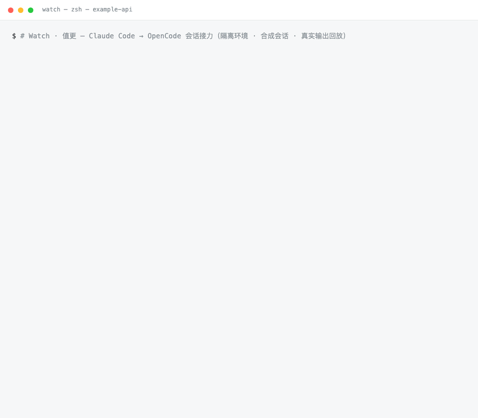
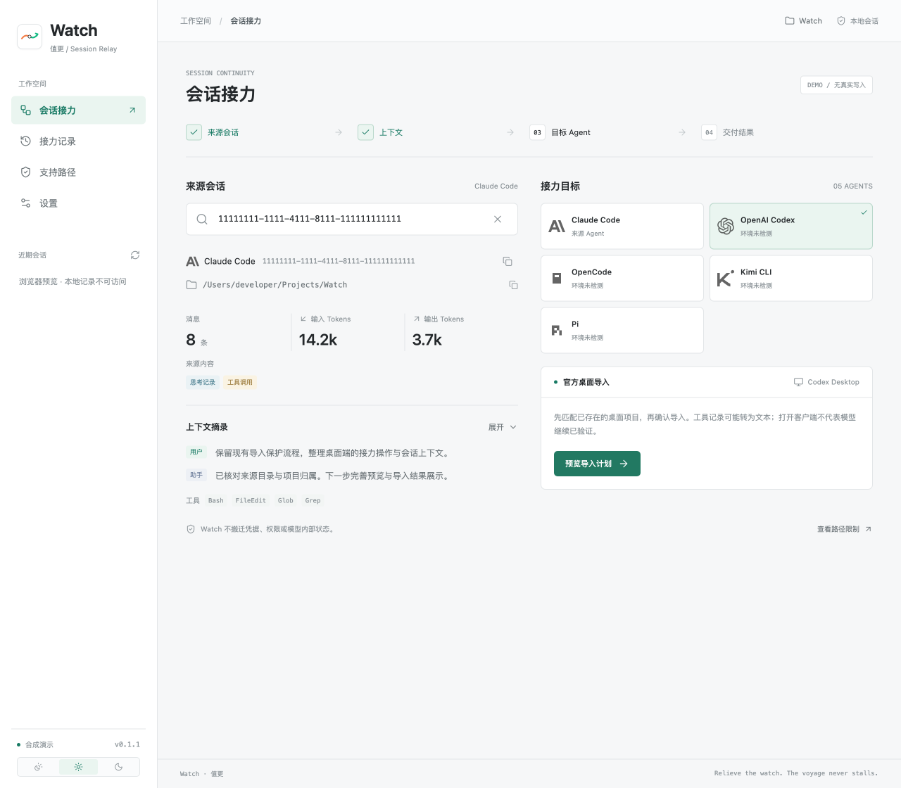
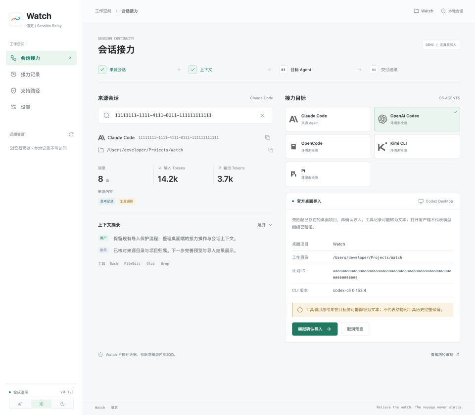
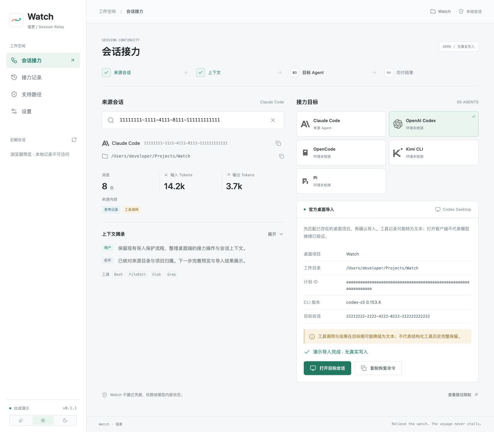
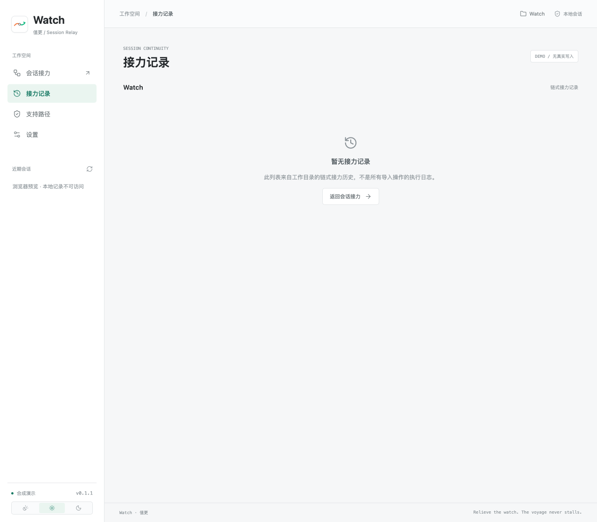
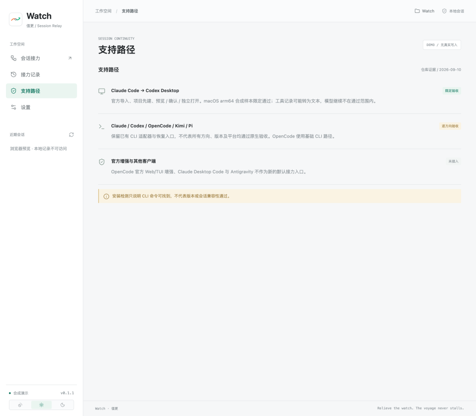
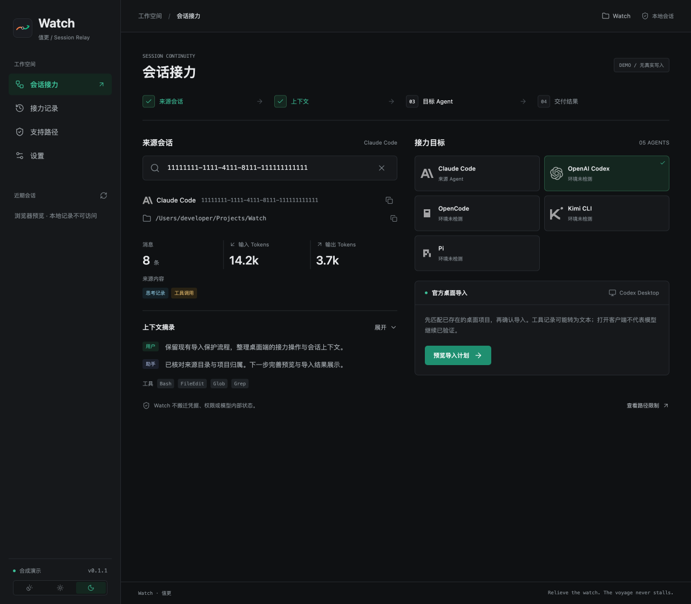

<div align="center">
  
  <h1>Watch · 值更</h1>
  <p><b>Relieving the watch. The voyage never stalls.</b></p>
  <a href="https://github.com/can4hou6joeng4/Watch/stargazers"></a>
  <a href="https://github.com/can4hou6joeng4/Watch/releases"></a>
  <a href="LICENSE"></a>
  
  <br>
  <a href="README.md">中文</a> · Website <a href="https://relay.bobochang.cn/en/">relay.bobochang.cn/en</a> · Related <a href="https://github.com/can4hou6joeng4/Homeport">Homeport</a>
</div>

## Why

When the current agent hits its limit, the context window fills up, or an investigation stalls and you want to switch tools, the conclusions, failed attempts and tool history all stay behind in the old tool. Restating that context is expensive, and it is easy to drop a constraint that mattered.

Watch does one thing: **carry the saved session record and the working directory into a target tool so the same work continues.**

The steps are on the site [guides](https://relay.bobochang.cn/en/#guides): [Claude Code limit to Codex](https://relay.bobochang.cn/en/guides/claude-code-limit-to-codex/), [context window versus usage limit](https://relay.bobochang.cn/en/guides/context-limit-vs-usage-limit-handoff/), [OpenCode and SQLite isolation](https://relay.bobochang.cn/en/guides/opencode-handover-sqlite-isolation/), and [Opus 5.5 and the five-hour limit](https://relay.bobochang.cn/en/guides/opus-5-5-five-hour-limit/).

It does not provide models, bypass usage limits, replace native agent chat, or move permissions, credentials and plugins by default. What it transfers is the recorded session, not the model's unrecorded internal state. Today the implementation is centred on CLI sessions and terminal resume; the product direction includes validated desktop entry points, but **official interoperability does not mean Watch has integrated it**.

### Latest release ([v0.1.5](https://github.com/can4hou6joeng4/Watch/releases/tag/v0.1.5))

v0.1.5 makes very large sessions readable and ranks the change manifest by what is actually useful. Before that, v0.1.4 gave the summary handoff a **change manifest**, and v0.1.3 added Grok failure / abort / retry disclosures, all reported through `error`, `warnings`, `findings` or the handoff document.

- **Very large sessions are no longer read whole (v0.1.5)**: a Claude session can grow past V8's string limit (about 512 MB), where `readFile(..., 'utf8')` throws `Invalid string length` — and that error carries **no errno code**, so "the file is too big" came out as "the session is broken, fix it first". 2 of 539 sessions on this machine exceed the limit (the largest is 663 MB), and `open` / `watch usage` / session listing all failed on them. cwd probing now reads only the first 64 KB, and parsing, usage, list previews, the pre-append scan and identity probing all stream line by line, taking peak memory from "the whole file" down to "one line"; the 663 MB session now parses 1962 turns in about 3 seconds, and its list preview takes 2 ms.
- **The change manifest ranks commands by frequency (v0.1.5)**: in a long session the same `npm test` runs dozens of times while early commands are one-off exploration. Infrastructure commands that keep running are kept first, and omissions now report **how many calls** were left out, not just how many entries, so the size of the gap is judgeable.
- **A change manifest in `watch prompt` (v0.1.4)**: the default profiles (`minimal` / `standard`) expand no process events at all, so the body held only the user prompts and the final assistant replies — readers saw the assistant's own claim ("fixed X, added Y, tests pass") with nothing to check it against, and no list of which files were actually touched or which commands really ran. Watch now aggregates "files changed (write / edit counts)" and "commands run (with `workdir`)" from tool-call **arguments**, places them before the transcript, and adds a structured `manifest` to `--json`. The manifest covers the **whole session**, so `--last` or profile trimming cannot drop early changes from it.
- **Argument structure only, never text guessing**: a file path must come from an explicit path key or from Codex's fixed patch markers (`*** Update File: ` and friends, including `apply_patch` inside a heredoc); a command must come from `command` / `cmd`. Tool output is never read, and paths are never scraped out of `summary` — otherwise "read" would be reported as "changed". Read-only tools and look-alike names such as `todo_write` / `write_stdin` are not collected.
- **The manifest discloses its own degradation**: when a known file-writing tool yields no readable path it says the change list may be incomplete; when a cap is hit it reports how many entries and how many calls were omitted; a clean session gets no such section and no extra `findings`.
- **Grok failure records (v0.1.3)**: `turn_completed.stop_reason` (`error` / `cancelled`) and the separate `retry_state` updates (attempt counts, whether retries were exhausted) in `updates.jsonl` were not read at all. They are now aggregated into one disclosure by structure, and raw upstream error text is never copied (the `reason` field carries full upstream URLs). A tail failure now says plainly that the turn ended in failure rather than "may still be generating".
- **No more silent per-turn usage loss (v0.1.3)**: when the Grok log's turn-completion records, records with usage, and parsed assistant turns do not line up, this handoff carries no per-turn usage and says why — instead of leaving every target turn at 0/0 while the note claims the usage was carried over.
- **Failure records get separate disclosures**: recognizes Claude Code's `system/api_error` and `isApiErrorMessage` machine error lines, OpenCode 1.x/2.x `Assistant.error`, Pi's `stopReason: "error" / "aborted"`, and Grok's `stop_reason` / `retry_state`. Claude Code / Pi / Grok aggregate failure categories and counts without copying raw error text; OpenCode retains error types and message text. Machine error lines do not stand in for a final answer, and real output produced before a failure is preserved.
- **`watch prompt`, the summary handoff**: read-only, writes nothing, renders a session as paste-ready Markdown with `--profile`, `--last <n>` and `--since-compact`; with the id omitted it picks the newest readable session in the directory. Trimming is counted, while read failures and recognized degradation are reported.
- **Diagnostics and search**: new `watch doctor` (read-only checks of agents / local store / index / import journals, exit 1 on hard failures), `watch capabilities` (read-write matrix), `search --reset-index`, plus widespread "unreadable is not the same as absent" disclosures.
- **Desktop**: all six target cards (including Grok), pre-write prechecks, holder details and retry when a target is busy, and warning channels on the source and history views.

## Showcase

The images below were generated from synthetic sessions in an isolated environment and show real program output. They are **not native acceptance evidence**.

<table>
<tr>
  <td align="center" colspan="3">
    
    <br><b>CLI handoff</b> · Claude Code → OpenCode
    <br><sub>status → sessions → switch opencode → status, replayed with original timing</sub>
  </td>
</tr>
<tr>
  <td align="center" width="33%" valign="top">
    
    <br><b>Source session</b> · cwd and context lookup
    <br><sub>Session ID, working directory, usage and tool traces</sub>
  </td>
  <td align="center" width="33%" valign="top">
    
    <br><b>Import preview</b> · read-only before confirm
    <br><sub>Desktop project, cwd, CLI version and plan ID</sub>
  </td>
  <td align="center" width="33%" valign="top">
    
    <br><b>Import complete</b> · then open separately
    <br><sub>Target thread is kept; a failed open is only retried, never re-imported</sub>
  </td>
</tr>
<tr>
  <td align="center" width="33%" valign="top">
    
    <br><b>Handoff history</b> · empty state
    <br><sub>This list is the directory's chained handoff history, not an import execution log</sub>
  </td>
  <td align="center" width="33%" valign="top">
    
    <br><b>Supported routes</b> · evidence boundary per direction
    <br><sub>Limited pass / per-route validation / not integrated</sub>
  </td>
  <td align="center" width="33%" valign="top">
    
    <br><b>Dark appearance</b> · light / dark / system
    <br><sub>Preference stored locally</sub>
  </td>
</tr>
</table>

**Comparison with similar tools**

[catchup](https://github.com/wilbeibi/catchup) focuses on transcript handoffs and also provides `fork` and `fork --into`; [cross_agent_session_resumer](https://github.com/Dicklesworthstone/cross_agent_session_resumer) and [session-migrate](https://github.com/xhluca/session-migrate) both provide native session format conversion. Watch offers separate launcher, chained handoff and official Codex import entry points, plus read-only Markdown export and route-specific write protection. Adapter coverage and native validation need to be checked for each tool; see Watch's [architecture](docs/ARCHITECTURE.md) for implementation boundaries and [compatibility records](docs/COMPATIBILITY.md) for direction and version limits.

## Install

Requires a Node that can run `node:sqlite` and tsx (**≥ 22.13**), plus whichever agent CLIs you actually use. The desktop app additionally needs a Rust / Tauri toolchain.

**Desktop installers**: take the current platform's package from [Releases](https://github.com/can4hou6joeng4/Watch/releases). The packaged app still relies on an external Node on the user's machine.

**From source**

```bash
npm install                                  # repository root
npm --prefix desktop install                 # desktop dependencies are separate

npm run watch -- status --json               # use the CLI directly
npm run desktop:dev                          # run the desktop app locally (Vite on 1420)
npm --prefix desktop run build               # build the desktop frontend
cd desktop && npx tauri build                # package the current platform
```

More conventions (code style, test isolation, commit format) are in the [contributing guide](CONTRIBUTING.md).

## Usage

1. Get the session ID from the native agent and paste it into Watch.
2. Check the detected source agent and project directory. **If detection fails, do not simply resume it as another tool.**
3. Continue the original session with the source agent, or hand off to another agent. Selecting a target writes nothing by itself; the target may be a new session, or an existing matching session extended with the delta.
4. Continue in the chosen terminal, or choose "copy command only" and run it yourself. A failed terminal launch falls back to copying.

Common commands (all accept `--json`; success and failure both print a single-line JSON to stdout, diagnostics go to stderr):

```bash
npm run watch -- status --json                  # sessions, chain tip and switch history for this directory
npm run watch -- sessions --json                # native sessions of every agent in this directory
npm run watch -- switch codex                   # hand the chain tip over to Codex, print the resume command
npm run watch -- adopt claude                   # attach an existing Claude session to the chain
npm run watch -- new pi                         # create the other side of the chain (starts a session on an empty chain)
npm run watch -- open <session-id> --json       # resolve the cwd and print a paste-ready command
npm run watch -- open <session-id> --to codex   # transfer that session into a new Codex session
npm run watch -- prompt <session-id> > seed.md  # export a "summary handoff" doc when the target has no adapter
npm run watch -- prompt > seed.md               # omit the id: take the newest readable session in this directory
```

<details>
<summary>All CLI subcommands</summary>
<br>

```text
status   [--cwd <path>] [--chain <id|name>]                  sessions, chain tip and switch history
sessions [--cwd <path>] [--chain <id|name>]                  native sessions per agent in this directory
switch   <provider> [--cwd <path>] [--chain <id|name>]       hand the chain tip to the target provider
adopt    <provider> [--session <id>] [--cwd <path>] [--chain <id|name>]   attach an existing native session
new      <provider> [--cwd <path>] [--chain <id|name>]       create the other side of the chain
chain    list|new|rename|archive|use [--cwd <path>]          manage and select chains
search   <query> [--cwd <path>] [--reset-index]              local full-text search (FTS5); --reset-index clears only the index and vacuums the store (chains untouched)
usage    [--cwd <path>] [--chain <id|name>]                  token usage per session on the chain
recent   [--cwd <path>] [--limit <n>]                        recently resolved sessions (default 8, max 50)
providers                                                    local install detection per agent
capabilities                                                 read/write capability matrix per agent (code facts, no local CLI probing)
doctor   [--cwd <path>] [--strict]                           read-only environment diagnostics (agents / local store / store footprint and index size); exits 1 on hard failures, --strict also fails on warnings
open     <session-id> [--from <id>] [--provider <name>] [--to <provider>] [--check]
prompt   [<session-id>] [--provider <name>] [--profile minimal|standard|verbose|full] [--last <n>] [--since-compact]   summary handoff: render the session as paste-ready Markdown (degraded path, writes nothing)
import-codex  prepare|confirm|status|project-prepare|project-confirm|project-status
```

`--check` is only used with `open ... --to <provider>`: a read-only precheck of whether the target is writable. Nothing is written.

The `usage` total is only the sum of what could be read: failed reads, sessions without a usage field and adapters that do not provide usage are named in the total line. When a session's usage source has unparsable lines, a line under the total says the number is a lower bound, and that session's row is marked the same way — in `--json` this is `totalExcluded` / `totalMissingUsage` / `byProvider[].usageBadLines`.

The same holds for `search`: when a session file has unparsable lines, those lines never reach the index, and the search reports it in `warnings` — including on later runs that reuse the index — instead of just returning no results.

After the write, Watch re-checks the source session file: if you kept talking in the native CLI, or another command appended to that session while the handoff ran, what was transferred is the content as of the moment reading started — `warnings` then says the source changed during the handoff (byte counts before and after) and gives the next step: run the same command again and the new part is appended as a delta (not for a rewritten or truncated source — check that file first). `prompt` re-checks the same way, but it writes nothing, so there is no delta to re-run: if the source changed while the document was being rendered, the **document body** carries a "changed while generating" line saying it reflects the moment reading started and that regenerating produces a new document (this one is not corrected) — stderr does not travel with the document, so this line has to be in it.

When the target has no adapter yet (or that agent's format just drifted and writing back is risky), use `prompt`: it is read-only and renders the session as Markdown whose opening states "this is a summary handoff, not the target agent's native session". `--profile` controls how much is kept, while `--last <n>` keeps only the last n user turns (an explicit window that no longer force-keeps the first turn, and the document says so); `--since-compact` starts rendering from the latest recognizable compaction summary (Claude Code, Pi, Kimi and OpenCode record formats are all recognized; Codex's compacted records and OpenCode 2.x provider-native compactions are only disclosed, not merged into the summary), so the turns that summary already covers are not repeated (the summary itself states which agent generated it and that it is not user speech; when no usable summary exists it does not trim for that reason and the body says so, and any `--last` / profile trimming is stated separately); anything trimmed is counted in the `--json` `findings` and explained on stderr. With the session id omitted, it picks the most recently modified readable session under `--cwd` (the current directory by default), and `--provider` narrows that search to one agent; the document header says the session was auto-picked and `--json` carries `autoPicked: true`. When nothing can be picked it emits no partial document, and "unreadable" is reported separately from "no sessions here". The header's time range states where each endpoint comes from (the start is the first record; the end may be the file's modification time; Grok records carry no per-turn timestamps, so those are derived in order from the session summary's creation time, and anchored to the chat file's modification time when that summary is missing — the header says so, and says that value is not the real per-turn time), and when usage cannot be read or its data source has been emptied, that line gives the reason and says it does not mean the session has no usage, instead of falling back to "no usage record"; when the source has unparsable lines, the number is still printed but marked as a lower bound; when the session file itself has unparsable lines, the header says so and notes that records may be missing; when the source yields zero turns, the body says whether the file is empty (0 bytes, restore from backup) or readable but has nothing to hand off.

</details>

The desktop app has four views — **session handoff, handoff history, supported routes, settings** — with light, dark and system appearance. A browser preview never reads local agent records; "load demo" uses synthetic fixtures without session writes, client launches or model requests.

YOLO is off by default. Enabling it adds no-confirmation flags to the CLI commands it supports, which relaxes the target agent's permissions or sandbox; it is not a desktop permission setting.

**Claude Code → Codex Desktop (official single-session import)**

Nothing is submitted until you explicitly confirm, and the target thread is opened separately after a successful import. To land in a desktop project, the folder must already be added and kept in Codex Desktop, then `--desktop-project` is used at the prepare stage.

```bash
npm run watch -- import-codex prepare <claude-id> --cwd /absolute/project --desktop-project --experimental --json
npm run watch -- import-codex confirm <plan-id> --experimental --json
npm run watch -- import-codex status <plan-id> --json
```

The legacy `project-prepare` / `project-confirm` / `project-status` commands can still inspect or update the app-server `projectId`, but they cannot clear a persisted Desktop `projectless` exclusion and are not a project-list repair. Do not repeatedly remove the project or reimport the same session as a refresh mechanism — that changes the project ID and can leave the target excluded.

## Capabilities and limits

| Entry point | Current status |
|---|---|
| Claude Code, Codex, Kimi, OpenCode, Pi, Grok CLI | Lookup, conversion and resume are implemented, and the six desktop target cards reuse each adapter resume command verbatim; OpenCode supports SQLite session resume with path isolation and native ID fixes, but specific versions and directions still need validation |
| Grok CLI desktop entry | Integrated as the sixth target card (`grok -r <id>`, YOLO `--always-approve`); after writing the native ACP `updates.jsonl`, isolated validation passed `sessions list`, `export` and ACP `session/load`; TUI frames and model continuation remain unverified |
| Codex Desktop | The Claude Code source is wired into the project-first preview, confirm, status and independent open flow; synthetic samples passed a real Watch Tauri click-through and two opens of the same target. The local CodexPilot continuation attempt is still recorded as 503 |
| Claude Desktop Code | The official `/desktop` flow has been investigated; it depends on the current CLI session being saved and flushed, and is neither integrated nor natively validated by Watch |
| OpenCode Web, TUI, IDE | On Darwin arm64 / 1.18.29, official JSON import/export, the read-only server API, Web, a standalone local TUI and an attached TUI all showed the same history in isolated native validation; a single no-tool continuation request produced no reply due to provider 429, so the multi-client enhancement is not integrated. This does not block the existing OpenCode CLI card; the IDE extensions reuse the integrated terminal |
| Antigravity | The 2.0 → CLI official interactive picker has been reviewed but not natively validated; there is no cross-agent import protocol or Watch adapter |

**Historical formats, attachments and tool events may degrade**, and the result reporting still needs work. New files, whole-file replacement and Claude/Codex incremental appends all use same-directory atomic writes and parse-back verification before rename, and the target fingerprint is compared before writing; Codex targets additionally go through `preflight` and a cooperative writer lock. OpenCode reconciles rows in a SQLite transaction, and other providers protect writes according to their own storage format, so coverage is not fully equivalent; **zero damage is not promised**. Watch does not create worktrees automatically, does not move code, and does not guarantee identical behaviour across models.

The official route binds the target directory/configuration and uses a Watch import lock, and **an unrelated running desktop app is not a reason to quit**; the direct-file converters rely on target fingerprints, atomic writes and, for Codex, a cooperative writer lock, so the two routes differ in coverage. Native evidence covers only synthetic fixtures and idle-server coexistence on macOS arm64 with Codex CLI 0.153.4, while the real Tauri click-through additionally binds ChatGPT Desktop 26.903.61454 — neither covers every concurrent workload, other versions, or model continuation.

Opening and continuing are two different states: when a handoff succeeds but the client fails to open, only opening is retried, never the transfer.

## Design

- **TypeScript carries the business logic**; Rust only bridges the CLI and performs system operations that must come from a GUI process.
- **One adapter per agent** (`src/providers/<id>/`); the unified timeline is produced and written back at the adapter boundary.
- **Three write-safety layers**: target fingerprint comparison before writing (TOCTOU), same-directory atomic writes, and parse-back verification before rename.
- **Two official routes stay isolated**: the Codex official import and the OpenCode official enhancement use their own execution journal and target lock instead of the converters above.
- **Degradation must be disclosed**: every "failed but continued" branch is recorded in warnings or findings rather than silently dropping content.

Details and protection gaps are in [architecture and safety boundaries](docs/ARCHITECTURE.md).

## Origin

Coding agents each keep their own session records. Switching tools should be routine, but every switch means restating the background: the earlier conclusions, the attempts that failed, and the constraints already established all stay behind in the old tool — and those are exactly the parts that are hardest to restate.

So Watch does not aggregate, does not proxy, and does not add another chat layer. It tries to make one segment solid: the handoff of "existing record + working directory". Findable first, verifiable next, protected on write, and continuable after delivery.

## Environment and privacy

Session conversion mostly handles local records, but it is **not an entirely offline workflow**: creating a Kimi session invokes its CLI, some Codex execution paths may read authentication configuration and call a model, and the target agent communicates under its own service rules when you continue.

Paths that invoke a native agent require it to be properly authenticated. Validate with a dedicated test session first, and never commit real credentials, chat content or agent databases to the repository.

**Search builds a local index.** `watch search` writes the turn text plus tool-call and tool-result records of agent sessions in the current directory into a full-text index (`messages_fts`) inside `~/.watch/watch.db`, so later searches do not re-parse the files. The index stays on this machine: on Unix the database directory is 0700 and the file is 0600, and Watch does not upload either. `WATCH_DB` relocates the database; deleting the file (with its `-wal` / `-shm`) removes that text, at the cost of losing chains and switch history with it. Sessions you never searched are not indexed.

## Where session files live

| Agent | On disk | Resume |
|---|---|---|
| Claude Code | `~/.claude/projects/<encoded-cwd>/<session-id>.jsonl` | `claude --resume <id>` |
| Codex | `~/.codex/sessions/YYYY/MM/DD/rollout-*.jsonl` | `codex resume <id>` |
| OpenCode | `~/.local/share/opencode/opencode.db` | `opencode -s <id>` |
| Kimi CLI | `~/.kimi-code/sessions/` and `session_index.jsonl` | `kimi -r <id>` |
| Pi | `~/.pi/agent/sessions/` | `pi --session <id>` |
| Grok CLI | `~/.grok/sessions/` | `grok -r <id>` |

Paths follow each CLI's current version. Watch looks a session up by ID and checks the working directory. The difference between a full context window and an account limit is in [context window versus usage limit](https://relay.bobochang.cn/en/guides/context-limit-vs-usage-limit-handoff/). The OpenCode database path and its transaction are in [OpenCode and SQLite isolation](https://relay.bobochang.cn/en/guides/opencode-handover-sqlite-isolation/).

## Documentation

- [Product requirements and implementation plan](docs/PLAN.md): scope and completion criteria.
- [Client compatibility evidence](docs/COMPATIBILITY.md): official sources, implementation status, and local preflight.
- [Architecture and safety boundaries](docs/ARCHITECTURE.md): implementation and gaps.
- [Codex official import guide](docs/import-codex.md): full flow and limits of the experimental route.
- [Contributing guide](CONTRIBUTING.md) (written in Chinese): environment, code style, test isolation and commit format.

## Support

- If Watch is useful to you, a star helps, and so does [sharing it with anyone who keeps switching between agents](https://twitter.com/intent/tweet?url=https://github.com/can4hou6joeng4/Watch&text=Watch%20-%20local%20session%20handoff%20for%20coding%20agents).
- For problems or new routes, open an issue or a PR; please read the [contributing guide](CONTRIBUTING.md) first.

## License

Code and documentation in this repository are released under [MIT](LICENSE).

- Site icons come from [Lucide](https://lucide.dev) (ISC). The agent icons under `site/agents/` and `desktop/public/` are each brand's own asset and are used for identification only.
- Desktop installers bundle `tsx` and `esbuild` (both MIT) into `watch-core`; running the app still requires Node ≥ 22.13 on the user's machine.
- Each agent CLI is bound by its own license and terms of service; Watch does not redistribute their models or credentials.

---

## Related projects

- 🧭 [Homeport](https://github.com/can4hou6joeng4/Homeport) — personal site
- 🐋 [Sonar](https://github.com/can4hou6joeng4/Sonar) — cover-art colour driven iOS music player
- 🚩 [Semaphore](https://github.com/can4hou6joeng4/Semaphore) — local browser ASCII art converter
- 🛟 [Buoy](https://github.com/can4hou6joeng4/Buoy) — AnyRouter multi-account check-in tool
- 🗼 [Beacon](https://github.com/can4hou6joeng4/Beacon) — PDF credential expiry audit
