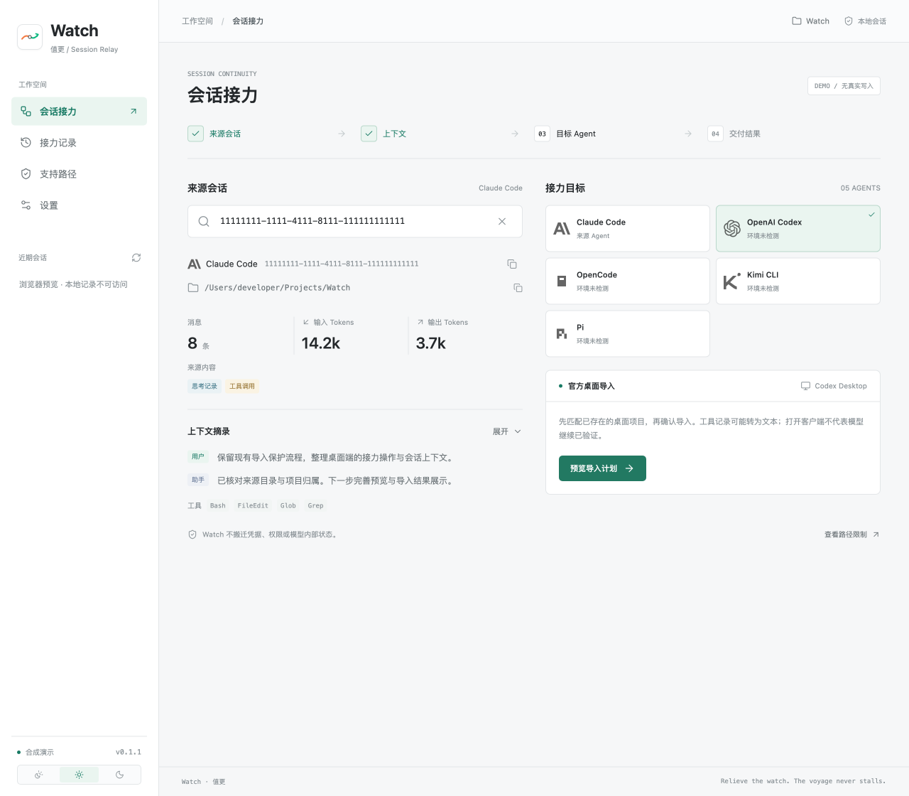
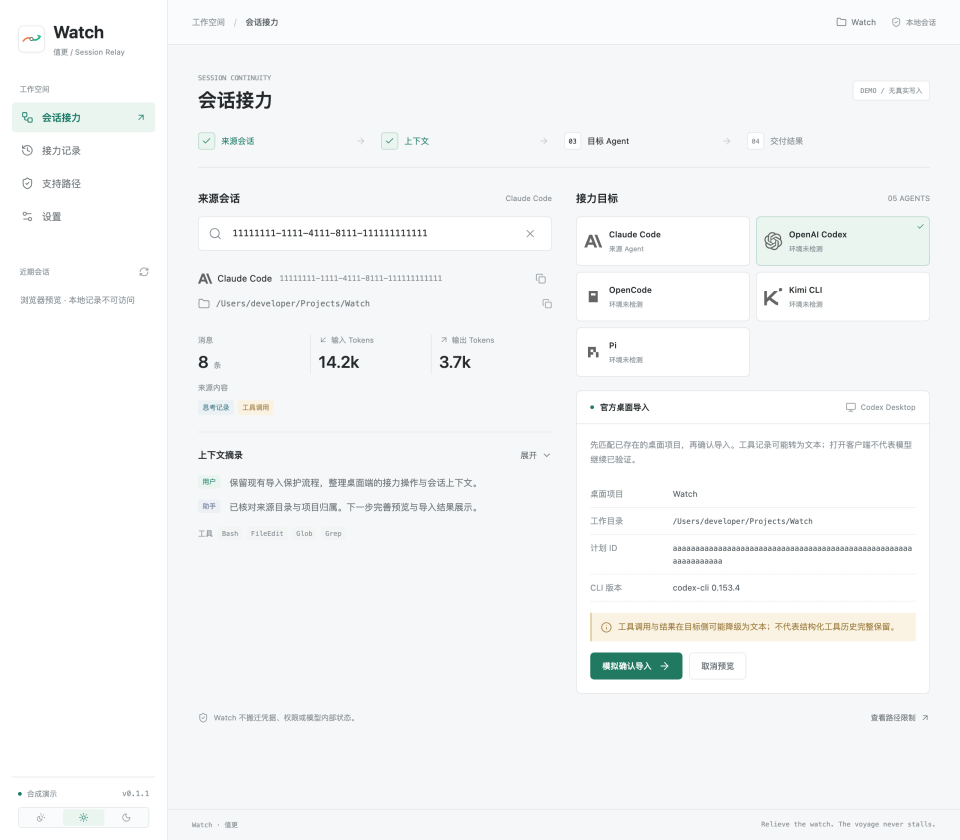
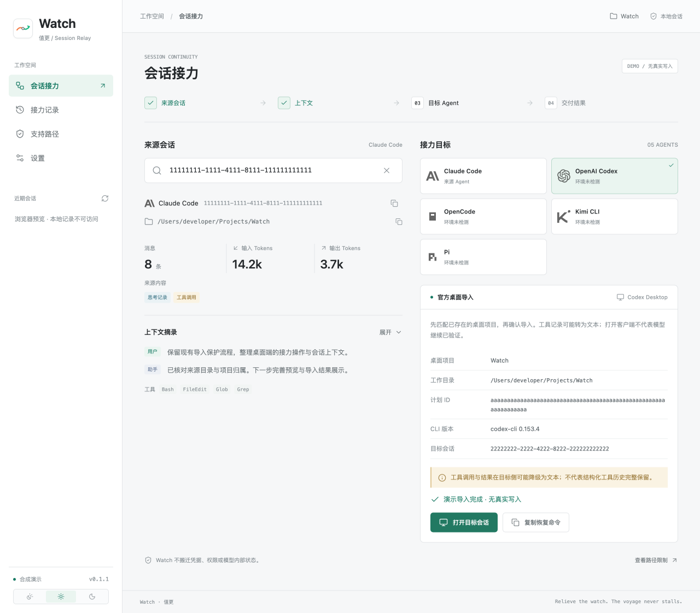
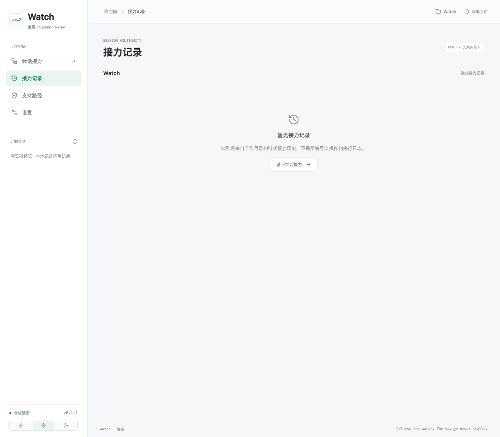
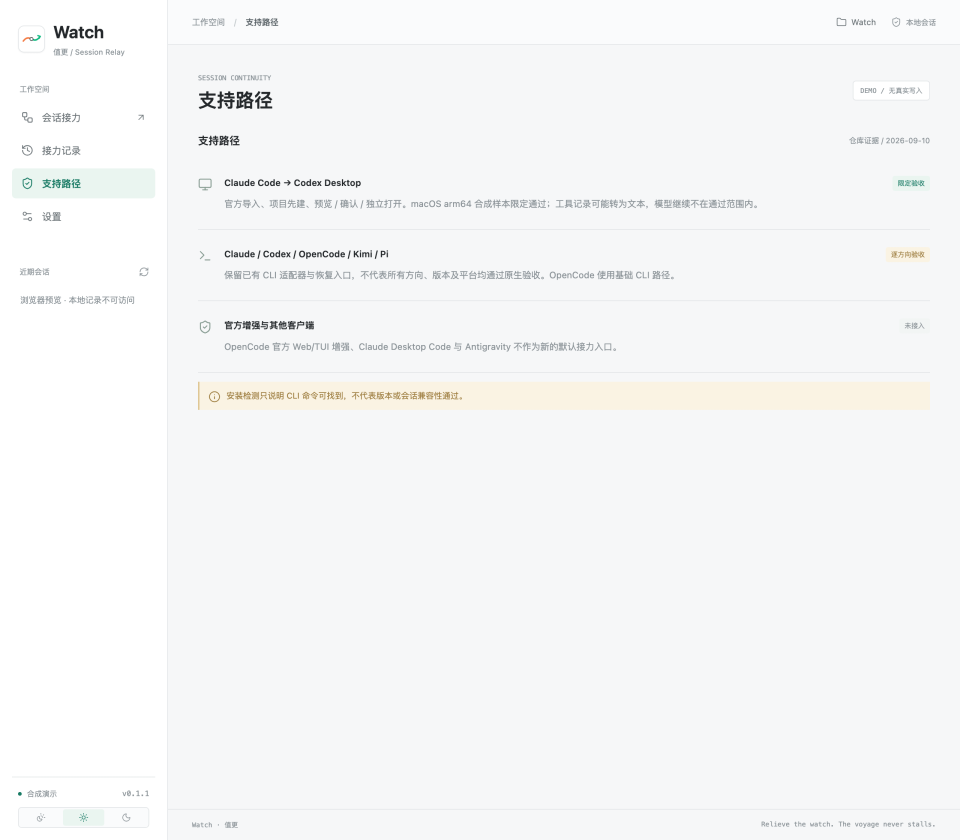
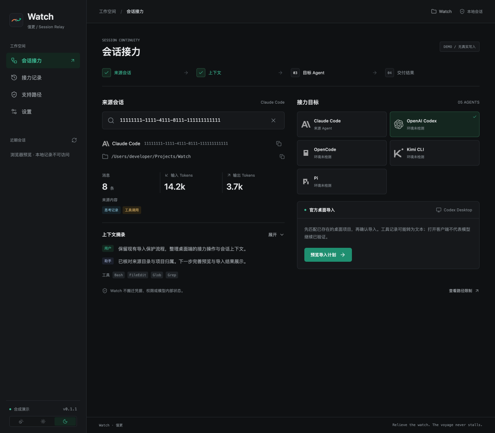

<div align="center">
  
  <h1>Watch · 值更</h1>
  <p><b>Relieving the watch. The voyage never stalls.</b></p>
  <a href="https://github.com/can4hou6joeng4/Watch/stargazers"></a>
  <a href="https://github.com/can4hou6joeng4/Watch/releases"></a>
  <a href="LICENSE"></a>
  
  <br>
  <a href="README.md">中文</a> · Website <a href="https://relay.bobochang.cn/en/">relay.bobochang.cn/en</a> · Related <a href="https://github.com/can4hou6joeng4/Homeport">Homeport</a>
</div>

## Why

When the current agent hits its limit, the context window fills up, or an investigation stalls and you want to switch tools, the conclusions, failed attempts and tool history all stay behind in the old tool. Restating that context is expensive, and it is easy to drop a constraint that mattered.

Watch does one thing: **carry the saved session record and the working directory into a target tool so the same work continues.**

The steps are on the site [guides](https://relay.bobochang.cn/en/#guides): [Claude Code limit to Codex](https://relay.bobochang.cn/en/guides/claude-code-limit-to-codex/), [context window versus usage limit](https://relay.bobochang.cn/en/guides/context-limit-vs-usage-limit-handoff/), [OpenCode and SQLite isolation](https://relay.bobochang.cn/en/guides/opencode-handover-sqlite-isolation/), and [Opus 5.5 and the five-hour limit](https://relay.bobochang.cn/en/guides/opus-5-5-five-hour-limit/).

It does not provide models, bypass usage limits, replace native agent chat, or move permissions, credentials and plugins by default. What it transfers is the recorded session, not the model's unrecorded internal state. Today the implementation is centred on CLI sessions and terminal resume; the product direction includes validated desktop entry points, but **official interoperability does not mean Watch has integrated it**.

### Latest release ([v0.1.44](https://github.com/can4hou6joeng4/Watch/releases/tag/v0.1.44))

v0.1.44 updates development, build and research tooling to address known advisories in the existing lockfiles: `fast-xml-parser` 5.12.1, `wrangler` 4.162.0, `vite` 7.3.8, and transitive `source-map-js` 1.2.2. Both dependency trees report zero advisories in this `npm audit` check. This reflects the advisory database at the time of checking and does not establish the absence of all vulnerabilities. The Node ≥ 22.13 requirement is unchanged.

- **Validation scope**: full isolated regression: 1857 passing, zero failures and zero skips. All 21 focused RSS, keyword-research and packaging regressions, 14 site regressions, typecheck, desktop build and a Wrangler version launch without credentials pass. The locked core runtime entries for `smol-toml`, `tsx` and `esbuild` remain unchanged. No native-client or model-continuation acceptance claim is added.

### Previous release ([v0.1.43](https://github.com/can4hou6joeng4/Watch/releases/tag/v0.1.43))

v0.1.43 fixes credential selection for Codex execution subprocesses. The old line scanner treated `api_key` / `base_url` from unselected providers as top-level defaults and could read fake fields inside multiline text. Selection now reuses the same parsed TOML document, reads the actual selected provider table, and falls back only to actual top-level fields for older configs. Provider names containing dots, quoted table names, string escapes and comments follow TOML semantics; numbers and booleans are not coerced into environment variables. Existing environment variables retain their priority.

- **Validation scope**: six new isolated regressions use a synthetic CLI to check the values actually delivered to the subprocess. Five fail against the previous implementation and pass after the fix. Full isolated regression: 1857 passing; all 51 focused checks, typecheck, desktop build and 14 site regressions pass. Tests output only a match result, never keys, and call no real Codex CLI or model.

### Previous release ([v0.1.42](https://github.com/can4hou6joeng4/Watch/releases/tag/v0.1.42))

v0.1.42 fixes custom Codex providers being silently written as `openai`. Configuration now follows TOML semantics, including valid single-quoted and triple-quoted strings, escapes and quoted keys. Only the actual top-level `model_provider` is used; matching text inside multiline strings or nested tables cannot replace it. Invalid syntax, a wrong field type or an empty value makes preflight, `watch doctor` and writing report `codex_config_invalid` and refuse the write. Errors do not echo configuration contents. A missing config or an unset field in valid TOML still uses the default. Desktop installers include the pinned parser and its license, and bundle checks reject missing or mismatched dependencies.

- **Validation scope**: six new configuration regressions and two packaging regressions reproduce the failures before the fixes. Resources copied according to the Tauri mapping start the CLI and parse TOML from an independent directory. Full isolated regression: 1851 passing; typecheck, desktop build, 14 site regressions and eight Rust tests on the local host pass. All checks use synthetic data and isolated environments; no native-client or model-continuation acceptance claim is added.

### Previous release ([v0.1.41](https://github.com/can4hou6joeng4/Watch/releases/tag/v0.1.41))

v0.1.41 makes `watch doctor` detect Codex configuration read failures before a handoff. When permissions or a path problem prevent reading `~/.codex/config.toml`, diagnostics now show the write restriction, its cause and a repair hint, and include the fault in `warnings`: ordinary mode exits 0, while `--strict` exits 1 so scripts can catch it. Diagnostics and handoff preflight share the same check; a readable or not-yet-created config does not raise a false alarm. OpenCode 2.x read-only support remains visible in the report without making strict mode fail for that known limitation.

- **Validation scope**: two new synthetic regressions cover unreadable-config diagnostics, text warnings and strict-mode exit codes, plus normal behavior for readable and missing configs. The fault-warning test was verified red before the fix and green after it; existing OpenCode read-only tests pass. Full isolated regression: 1843 passing, with no native CLI or model started.

### Previous release ([v0.1.40](https://github.com/can4hou6joeng4/Watch/releases/tag/v0.1.40))

v0.1.40 makes the Codex precheck agree with the write path about whether the config can be read. v0.1.39 made the write path fail closed when `~/.codex/config.toml` could not be read, but `codexAdapter.preflight()` never touched the config, so `watch open <id> --to codex --check` said "writable" and the real run then refused — and the whole point of `--check` is knowing before you click. The precheck now probes with the same `readModelProvider()` first and throws `PreflightBlockedError` (`code: codex_config_unreadable`) when it cannot read the file, with a reason worded from the same source as the write path; the check sits before the `darwin` early return, so it applies everywhere (config readability is platform-independent — only the writer lock and Desktop process parts are macOS-specific). A missing file still means "never configured" and does not block.

- **Validation scope**: three new regressions (a `chmod 000` config rejects with code, reason and hint all present; a missing `config.toml` does not block; a readable config is not falsely rejected), with the first red once the check is removed; an isolated-HOME end-to-end run also shows `--check` and the real write returning the same `codex_config_unreadable`. Full isolated regression: 1841 passing. Everything uses synthetic files, with no native CLI or model started.

### Previous release ([v0.1.39](https://github.com/can4hou6joeng4/Watch/releases/tag/v0.1.39))

v0.1.39 fixes a silent substitution on the Codex write path: when `~/.codex/config.toml` could not be read, it used to be treated as "no `model_provider` configured", writing `openai` into the new rollout's `session_meta.model_provider` while the user was told the handoff succeeded — so the target session's provider disagreed with the native config. Only a missing file (`ENOENT` / `ENOTDIR`) now means "not configured, so Codex's own openai default applies"; every other read failure (permissions, path occupied by a directory, I/O) is tiered by errno, reported in Chinese, and fails closed stating that nothing was written. The same round makes `codexEnv()`'s credential parsing read `config.toml` once: it used to read one copy while swallowing errors and then call `readModelProvider()` to read the same file again, so a change in between could parse credentials from one provider section while naming another.

- **Validation scope**: five new synthetic regressions (a `chmod 000` config.toml rejects the write and creates no session directory, a path occupied by a same-named directory is rejected by tier, a missing config.toml still writes `openai` successfully, a custom provider lands in `session_meta` without matching sub-tables, and an absent top-level key falls back to the default), with the first two red before the fix; the full isolated suite is at 1838 passing. Everything uses synthetic files, with no native CLI or model started.

### Previous release ([v0.1.38](https://github.com/can4hou6joeng4/Watch/releases/tag/v0.1.38))

v0.1.38 fixes the "file too large" message. The v0.1.37 notes described Node's whole-file read limit as "`Invalid string length` with no `code`"; on Node 24 it is in fact an `Error` with `code: ERR_STRING_TOO_LONG` (the bare `RangeError` is a separate path). So on the write paths (the pi / grok / kimi append branches), an oversized session surfaced as "read failed (ERR_STRING_TOO_LONG)" — readers could not tell the file was intact, could not guess that the next step is streaming instead of repairing the file, and the raw code meant nothing. `describePathReadFailureReason()` and `describeSessionReadFailureReason()` now translate it to "file too large for a single read (the file is not corrupt)" and "session file is too large for a single read (the file itself is intact, not damaged)", and also recognise a bare `RangeError: Invalid string length` with no `code`.

- **Validation scope**: a fourth regression (both error shapes become Chinese, with no raw English message or bare error code, while ordinary errno tiers stay unchanged) and the full isolated suite at 1833 passing; everything uses synthetic files, with no native CLI or model started.

v0.1.37 stops the Codex append path from reading an existing rollout whole. Before appending, `importTurnsToCodex()` needs only two facts — whether the target is still there, and whether it is a legacy `event_msg`-only timeline — but it used to read the entire rollout into one string to get them. Beyond the V8 string limit (about 512 MB, the same family as the previous patches), `readFile` throws an oversized-read error, so an intact large session was reported as "failed to read the existing Codex session file" and the append was refused. `isLegacyEventMsgRollout()` now takes a line iterator directly, so scanning and detection are both streaming; legacy timelines are still rejected fail-closed, and read failures are still tiered by errno and state that nothing was written.

- **Validation scope**: three new synthetic-file regressions (a 1 MB single-line existing rollout appends normally with its old history preserved byte for byte, the iterator and string entry points agree, and a target occupied by a same-named directory is rejected with a Chinese reason and no tmp / bak left behind) and the full isolated suite at 1832 passing; everything uses synthetic files, with no native CLI or model started.

v0.1.36 fixes summary overwrites on the Grok write path: `readSummary()` used to be `readFile(...).catch(() => '')`, collapsing "cannot read it" (permissions, path occupied by a same-named file) and "there is no summary" into the same `null`. `importTurnsToGrok()` then rebuilt a summary from that `null` and atomically overwrote the file — native `generated_title`, `next_trace_turn`, creation time and other fields were silently replaced, while the chat and updates logs were already written, so users only saw "handoff succeeded". The write path now treats only `ENOENT` (old session directories genuinely have no summary) as rebuildable and throws a Chinese reason for any other read failure; the existing summary is also read **before any write**, so an unreadable summary rejects the whole handoff instead of leaving chat changed and the summary stale.

- **Validation scope**: three new synthetic-file regressions and the full isolated suite at 1829 passing; this patch adds no native-client or model-continuation acceptance claim.

v0.1.35 closes the last two "read a whole session file for a few head fields" cases in the same family. Codex identity detection (`detectCodexIdentity()`) reads the first 20 `session_meta` lines of the five newest rollouts; it used to read each file whole and then `slice(0, 20)`. Above the V8 string limit it throws `Invalid string length`, an error with no `code`, which the `catch { continue }` swallowed — identity fell back to the default originator, written sessions no longer matched the native resume picker, and the whole run still looked successful. It now streams line by line and stops after 20 lines. The official import's `continued-in` pre-check is the same: the source is a Claude session file (695 MB at the largest local sample), and a large session was reported as "cannot read the source session" during the pre-check itself, sending users to repair an intact path; `scanContinuedInRecords()` now takes a line iterator and still looks only at backgrounding records, never at conversation content.

v0.1.34 extends "don't read whole sessions into memory" to the remaining four providers: Pi, Grok, Codex and Kimi now parse sessions and read usage line by line. They used to read the whole file with `readFile` and then `split('\n')`; above the V8 string limit (about 512 MB) that throws `Invalid string length`, an error with no `code`, so a perfectly good large session was reported as unreadable. Peak memory now drops from the whole file to one line; Kimi's wire.jsonl logs every streaming delta, so long sessions can reach hundreds of MB — the most realistic case. Usage reads stream too and wrap the whole iteration in `try/catch`, so a mid-read failure still reports a Chinese reason. List previews (Kimi and Codex) stop at the first user message instead of reading a whole file for 80 characters; Kimi's zero-byte sessions are still reported as lost content. Codex's legacy-format append guard (`isLegacyEventMsgRollout()`) is async now, with the same criterion and fail-closed behavior.

v0.1.33 extends the same fix to Pi: working-directory detection no longer reads the whole session file (62 MB at the largest local sample) and instead reads only the 64 KB head, avoiding the V8 string limit without reading an entire file for one field. Diagnostics follow the actual coverage as well: when the first record alone exceeds the window they say that only the 64 KB head was checked and the file continues beyond it, instead of claiming the first parsable record has no cwd field. A non-empty file that decodes to no characters is reported separately rather than as zero bytes.

v0.1.32 corrects the diagnostics for Claude working-directory detection. Previously the code answered "no cwd field in the first 60 lines" whether the file had three lines or the 64 KB head window held a single line — reporting an unchecked range as a missing field. Diagnostics now follow the actual coverage: complete small files report their real line count, files longer than 60 lines state that the remainder was not parsed, truncated windows say the file is larger, and a first record exceeding the window is reported as having no complete line in it. The zero-byte check is also fixed: only a real zero-byte read is "content lost", while a non-empty file that decodes to nothing is reported separately instead of being called zero bytes. Codex official import now gives an actionable next step when the window did not cover the cwd.

The following guide corrections were introduced in v0.1.30:

- **Official import steps**: confirmation examples include the required `--experimental` flag. `prepare` saves a local plan, `confirm` acquires the Watch target lock, and `status` reads the local journal. The project-first requirement is scoped to the `--desktop-project` route.
- **OpenCode preflight and resume**: `--check` previews the destination and pending turns and applies layout and revert guards; it does not test write permissions or acquire a SQLite write lock. Verify and use the complete resume command, including its directory change. A cwd record is not a file-access sandbox, and SQLite transactions do not provide row-level write locks.
- **Context and quota**: imported history still consumes destination context; handoff cannot guarantee that saturation is resolved or restore quota. The guides cover waiting for a reset, native compaction and shorter documents exported with `watch prompt`.
- **Validation scope**: guide command contracts, focused site regression and build checks. This patch changes no session conversion logic and adds no native-client or model-continuation acceptance claim.

### Previous release notes

v0.1.31 fixes site date validation across time zones: site dates and the build date use `Asia/Shanghai`, preventing a false future-date rejection when local midnight precedes the CI host's next day. Actual future dates remain blocked. The v0.1.30 website deployed successfully, but its release gate failed on this date mismatch and produced no installers; its tag is preserved.

v0.1.29 fixes the release check order: site icon generation needs React, React DOM and Lucide from the desktop dependencies, so the site check now runs after desktop dependency installation and frontend compilation. v0.1.28 produced no installers because of this ordering error; its AI reading resource and share-image fixes are included here.

v0.1.27 made the HTML follow the version, but the published PNGs still showed v0.1.26: the old `--check` validated templates without checking the generated files. The images are now re-rendered, and site builds reject stale assets.

- **Share image checks (v0.1.28)**: rendering records the version and SHA-256 hashes of both templates and PNGs. `node scripts/media/render-og.mjs --check` and `site:build` verify those records without launching a browser. Run `node scripts/media/render-og.mjs` after changing the version or templates. Both images now include Grok.
- **Versioned AI reading resources (v0.1.28)**: `llms.txt` moves to `scripts/site-content/llms.txt`, with version and date injected during the build. It shares a route decision table with `llms-full.txt`, supplies required import flags, distinguishes the Watch import lock from the native writer lock, and states attachment capabilities per route.
- **Public source links (v0.1.28)**: guides link to the distributed architecture document; validation summaries link to the compatibility document, with an explanation that raw acceptance JSON records remain local.
- **Validation scope**: isolated regression tests, builds and site asset checks. This release adds no native-client or model-continuation acceptance claim.

- **Site versions come from package.json (v0.1.27)**: the three hard-coded spots in `scripts/build-site.mjs` now use the existing `packageVersion`, affecting 10 pages.
- **Share images render from templates (v0.1.27)**: `scripts/media/og-*.html` use a `__WATCH_VERSION__` placeholder, and the new `node scripts/media/render-og.mjs` renders the 1200×630 PNGs from `package.json`; `--check` validates without writing. A PNG never updates with the build, which is why it had stayed at v0.1.1.
- **Trends collector UA follows the version (v0.1.27)**: the `User-Agent` in `scripts/lib/google-trends-rss.mjs` no longer hard-codes `Watch/0.1.1`.
- **Regression**: the site tests assert the hero, footer and applies-to versions plus the share-image template contract; the Trends test asserts the request UA matches the root `package.json`.

- **Post-packaging check mounts the DMG read-only (v0.1.26)**: Tauri deletes the intermediate `Watch.app` after building the DMG, which made the v0.1.25 check hit ENOENT. It now mounts the DMG and inspects the bundled `watch-core`. Both macOS builds run it, and the same checker verifies the target architecture.
- **Installers carry the version file (v0.1.26)**: `bundle.resources` now includes `package.json`. `watch --version` and `doctor`'s `watchVersion` both resolve `src/core/../../package.json`, which previously returned null in a packaged app. The checker also asserts the file exists and that `version` is a string.
- **Intel esbuild dependency (since v0.1.25)**: the x64 build installs `@esbuild/darwin-x64`, fixing the bundle that carried only arm64 binaries. v0.1.25 did not publish successfully, so the fix ships in this release.

- **Resume commands with control characters stop before delivery (v0.1.23)**: covers C0, DEL and C1, including newlines, tabs and ESC. Source ID / directory copying, resume-command copying, the clipboard fallback after launch failure and the official-import copy button share the check, with persistent explanations. Commands from `open` / `switch` / `adopt` / `new` are escaped for display and warnings explain that they cannot be copied directly for execution; raw JSON fields are preserved. Verified with synthetic sessions, isolated PTYs and Rust tests; no native terminal GUI was launched and no native-client acceptance claim is added.

- **PowerShell curly single quotes remain data (v0.1.22)**: covers session IDs in all six resume commands and working directories in CLI and desktop command groups. The character range and doubling semantics were checked against the official parser source; synthetic regressions check the original value and string endpoint. PowerShell is unavailable on the local host, so this release adds no native Windows terminal acceptance.

- **Header IDs and paths render as data (v0.1.21)**: newlines in the three fields become a visible `\n`, and backticks use longer inline-code delimiters. Link syntax stays inside code rather than becoming a clickable field value. The automatic-selection notice remains outside the ID span. This changes only the document display of these three fields; raw JSON fields and the actual working directory retain their original values.

- **Resume commands preserve the original argument (v0.1.20)**: spaces, single quotes, semicolons, dollar signs, backticks and newlines stay within one session ID argument. Desktop cards receive the raw ID and quote it once, preventing quote characters from being passed to the agent through double quoting. The CLI defaults to the host platform; adapter methods also accept an explicit platform for checks. POSIX argument round trips were verified with the system shell; PowerShell output strings were checked without native Windows terminal acceptance.

- **Process-record fences follow the content too (v0.1.19)**: the detail in `renderEvent()` comes from tool arguments or raw commands, so the fence is now `codeFence()` — at least three backticks and strictly longer than the longest backtick run in the content. Clipping happens before the fence is chosen, so a ``` that only appears after clipping cannot break the structure either. The manifest-side `inlineCode()` / `singleLineText()` share the same module, so the three call sites can no longer diverge. Control-character escaping and its counting are unchanged.

- **Tool arguments cannot rewrite the manifest's Markdown structure (v0.1.18)**: inline-code delimiters are longer than the longest backtick run in the content, with padding when the content itself starts or ends with a backtick; fence length for multi-line commands is computed the same way, so a ``` inside a script no longer closes the block early and leaks later lines into the body. Newlines inside single-line entries (paths, commands, workdir) become a visible `\n` and can no longer start a line that imitates "N more files omitted" or fabricates a section. Control characters remain handled by the existing body escaping with counted disclosure; neither mechanism replaces the other.

- **Legacy shell array commands reach the manifest (v0.1.17)**: a non-empty all-string `command` array on the `shell` tool is formatted using the official historical shape (`create_shell_tool` in `rust-v0.20.0`), preserving the quoting boundaries of empty arguments, spaces, single quotes and shell metacharacters; the three-element `bash` / `zsh` / `sh` `-c` / `-lc` form shows the script directly. Only the exact tool name is accepted, same-named arguments on other namespaces and read-only tools are not guessed, and neither `env` nor tool output is copied. Patch paths are extracted only from shell-script wrappers and the direct `apply_patch` form (`[apply_patch, patch-body]`); patch markers inside ordinary argv are data and never claim a file was changed.

- **Direct patches appear in the change manifest (v0.1.16)**: string arguments to `apply_patch` contribute added, deleted and updated paths, plus both paths of a rename, using the existing edit counts. Patch text is not listed as a shell command. The manifest still covers the entire session when `--last` or profile limits trim the transcript. Unreadable paths remain disclosed; when a unified event already carries an explicit failure flag, a multi-file patch counts as one failed call with a warning that files may have changed partially. Read-only tools, same-named tools in other namespaces and result bodies do not trigger this extraction. Result text is never used to guess success or failure.

- **Persisted tool results carry only the preview, with disclosure (v0.1.15)**: detection requires the wrapper at the start of the tool result and a `Full output saved to:` line, so ordinary results quoting the format are not flagged; multiple results merge into one disclosure and the preview text is kept verbatim. The sidecar file is private to the source session's storage, may be cleaned up and becomes invalid on another machine, so Watch does not inline it and does not claim it is recoverable.

- **Accounting counts only what the target can write (v0.1.14)**: `countPairedTurnsMissingEvents()` now uses the target's capabilities (`textEventSupport` / `attachmentSupport`) to count only events the target can write and read back. User-side text, assistant text identical to the body, and unsupported attachment kinds no longer trigger a full rewrite; thinking, tool calls and tool results still count. The `handoff` rewrite decision and the `open --from` / `open --to` missing-event warnings share the same rule, with real write-then-read regressions across all six adapters.

- **Tool-result media keep placeholders and disclosures (v0.1.13)**: images and documents in `tool_result.content` become placeholders such as `[图片：image/png，1234B]` and `[文件：application/pdf，5678B]`; external links are marked as links only, unrecognised blocks keep a bounded type name, and multiple text blocks are joined with newlines. Aggregate counts are disclosed without copying base64 data or URLs, and no attachment is produced. Placeholders travel with the tool result and survive Claude / Codex write-read checks.

- **Earlier bodies remain transferable (v0.1.12)**: within one assistant turn, the last final or phase-less message remains the main body. Earlier bodies retain their source text as marked process events in arrival order, with an aggregate count. Identical messages also survive instead of disappearing when they equal the main body. Modern `response_item` records and the legacy `event_msg` fallback use the same rule.
- **Late stages do not overwrite the final answer (v0.1.12)**: `commentary` / `partial_answer` arriving after an explicit final answer retain marked source text without changing its body, timestamp or completion state. Watch-generated reasoning and tool mirrors are still skipped. Synthetic round trips through Claude / Codex preserve these assistant process events; other targets disclose losses according to their capabilities. Use `watch prompt <source-session-id> --profile full` to view them. Existing targets may not automatically recover historical content. This release adds no native-client or model-continuation acceptance claims.

- **More complete Codex tool records (v0.1.11)**: reads `reasoning.content`, tool `namespace` and `local_shell_call.action.command`. Text in output arrays is joined with newlines; images, audio, encrypted content and unknown items receive placeholders and counted disclosures, without copying those media or encrypted payloads. Calls without IDs receive explicitly disclosed stable synthetic IDs.
- **External context and process markers (v0.1.11)**: named outputs without call IDs are marked as external content injected by Codex and kept outside user message bodies. Upstream web-search, collaboration and image-generation records become marked process text. Unknown `response_item` types and encrypted compaction items receive aggregate disclosures; known bookkeeping items do not trigger false warnings.
- **Conversion limits (v0.1.11)**: synthetic records pass write/read checks across all six adapters. Claude / Codex retain assistant process text; other targets and user-side process text may still omit it, with loss warnings. Unsavable user-side events can still cause repeated full rewrites in chain handoffs. Existing targets do not automatically recover lost event content. This release adds no native-client or model-continuation acceptance claims.

- **Unpaired results no longer vanish or imply completion (v0.1.10)**: Pi / Kimi / Codex / Grok match a unique pending call in log order. Missing IDs, unknown IDs and ambiguous results become marked process text; the aggregate disclosure gives reasons and counts without copying output bodies. Explicit native failure flags remain stated in the marker. Grok's existing replay deduplication remains in place.
- **Late results and repeated handoffs (v0.1.10)**: a result arriving after a user interjection returns to its original call; a result preceding its call is never retroactively treated as completion. Marked output stays on a safe conversation turn near its original position, so new turns do not move old payloads to the tail for another write. User-side process text and process text unsupported by the target may still be omitted, with the existing loss warning; `watch prompt --profile full` shows the source text. Parsing explicitly fails when no safe conversation carrier exists.
- **Codex inline pairs without IDs remain transferable (v0.1.10)**: when a single `command_execution` / `local_shell_call` / `web_search_call` record contains both call and result, Watch synthesizes and discloses a stable ID from its position and content. Synthetic write/read checks pass across all six adapters; this is not new native-client acceptance evidence.

- **Bad-line disclosure no longer goes silent on very large sessions (v0.1.9)**: the scan shared by `open` / `handoff` / `prompt` / `doctor` / `search` / `usage` used to read the whole JSONL file into one string; past V8's string limit (about 512 MB) it threw and the error was swallowed into 0 — parsing had already been streamed, but bad-line disclosure vanished for those sessions. It now streams line by line, and a synthetic 566 MB session reports its truncated tail line.
- **"Could not count" is separated from "no bad lines" (v0.1.9)**: when the scan itself cannot read the file it no longer throws and takes the whole command down, nor returns 0; each entry point reports "bad lines could not be counted" with the next step. `search` does not cache the unknown as 0 and recounts real lines once permissions are restored; `watch usage` and the `watch prompt` usage line mark the total as a lower bound of unknown size.
- **Missing files remain a normal fact (v0.1.9)**: when Grok's `updates.jsonl` does not exist it is still treated as "no bad lines", not as a read failure.
- **Failure flags no longer disappear silently (v0.1.8)**: CLI `open --to codex/grok` (including `--check`), `open --from` and chain handoffs warn with the number of affected results in the actual write payload, without copying error bodies. Incremental writes count only new content; no warning is emitted for a zero-delta operation that writes nothing, a blocked write or a failed write. A chain handoff that rewrites the whole session despite a zero delta still counts the affected results. This disclosure applies to the existing file adapters and does not change the text degradation contract of the official Codex importer.
- **The capability matrix identifies failure-flag support (v0.1.8)**: `watch capabilities --json` adds `toolFailures`: `assistant` for Claude / Pi / Kimi / OpenCode and `none` for Codex / Grok, describing the current writer implementation. Pi now writes `isError` independently for unified results with a missing or empty call ID; this does not establish native-client acceptance of records without IDs.
- **Reused call IDs no longer hide successful edits (v0.1.7)**: native records can reuse an ID after a call finishes. The manifest now pairs results by source and the individual pending call; an earlier failure cannot exclude a later successful edit, and a later failure cannot erase an earlier successful change.
- **Failure does not guarantee unchanged files (v0.1.7)**: patch paths embedded in failed commands are also excluded from the successful-change list, while the command itself stays listed. Failed calls are counted separately in `failedFileWrites`. The disclosure says files may have been partially changed and asks readers to check their actual contents, covering tools that modify some files before failing.
- **Kimi and experimental OpenCode exports retain failures (v0.1.7)**: Kimi wire 1.4/1.5 `result.isError` is now read and written back; missing or `false` values do not imply failure. The experimental OpenCode 1.18.29 official export writes failed results as native `status: "error"`, preserving the reason without stacking display prefixes. This enhanced entry point remains outside the product CLI / UI.
- **Failed tool writes get a separate disclosure (since v0.1.6)**: Claude's `tool_result.is_error`, Pi's `toolResult.isError` and OpenCode's `state.status === "error"` are read; explicitly failed writes are excluded from the successful-change list, disclosed separately, and counted as `failedFileWrites` in `--json`.
- **Failed commands still count as "run" (since v0.1.6)**: a failed test run is execution history the next person needs. The command list keeps these calls; older records without native failure flags are never classified by guessing from result text.
- **The failure flag travels with the session (since v0.1.6)**: supported targets receive `isError` / `is_error` / `status: "error"`, so a Claude → Pi → Claude round trip retains the failure.
- **OpenCode file changes are no longer missed (v0.1.6)**: OpenCode tool arguments are camelCase (`filePath` / `oldString` / `newString`) while the manifest only recognised snake_case — every real edit was recorded as a write with an unreadable path, dropping all OpenCode file changes from the manifest and adding a false "this change list may be incomplete" note.
- **Very large sessions are no longer read whole (v0.1.5)**: a Claude session can grow past V8's string limit (about 512 MB), where `readFile(..., 'utf8')` throws `Invalid string length` — and that error carries **no errno code**, so "the file is too big" came out as "the session is broken, fix it first". 2 of 539 sessions on this machine exceed the limit (the largest is 663 MB), and `open` / `watch usage` / session listing all failed on them. cwd probing now reads only the first 64 KB, and parsing, usage, list previews, the pre-append scan and identity probing all stream line by line, taking peak memory from "the whole file" down to "one line"; the 663 MB session now parses 1962 turns in about 3 seconds, and its list preview takes 2 ms.
- **The change manifest ranks commands by frequency (v0.1.5)**: in a long session the same `npm test` runs dozens of times while early commands are one-off exploration. Infrastructure commands that keep running are kept first, and omissions now report **how many calls** were left out, not just how many entries, so the size of the gap is judgeable.
- **A change manifest in `watch prompt` (v0.1.4)**: the default profiles (`minimal` / `standard`) expand no process events at all, so the body held only the user prompts and the final assistant replies — readers saw the assistant's own claim ("fixed X, added Y, tests pass") with nothing to check it against, and no list of which files were actually touched or which commands really ran. Watch now aggregates "files changed (write / edit counts)" and "commands run (with `workdir`)" from tool-call **arguments**, places them before the transcript, and adds a structured `manifest` to `--json`. The manifest covers the **whole session**, so `--last` or profile trimming cannot drop early changes from it.
- **Argument structure only, never text guessing**: a file path must come from an explicit path key or from Codex's fixed patch markers (`*** Update File: ` and friends, including `apply_patch` inside a heredoc); a command must come from `command` / `cmd`. Tool results are checked only for failure flags and call IDs; output bodies are never read, and paths are never scraped out of `summary` — otherwise "read" would be reported as "changed". Read-only tools and look-alike names such as `todo_write` / `write_stdin` are not collected.
- **The manifest discloses its own degradation**: when a known file-writing tool yields no readable path it says the change list may be incomplete; when a cap is hit it reports how many entries and how many calls were omitted; a clean session gets no such section and no extra `findings`.
- **Grok failure records (v0.1.3)**: `turn_completed.stop_reason` (`error` / `cancelled`) and the separate `retry_state` updates (attempt counts, whether retries were exhausted) in `updates.jsonl` were not read at all. They are now aggregated into one disclosure by structure, and raw upstream error text is never copied (the `reason` field carries full upstream URLs). A tail failure now says plainly that the turn ended in failure rather than "may still be generating".
- **No more silent per-turn usage loss (v0.1.3)**: when the Grok log's turn-completion records, records with usage, and parsed assistant turns do not line up, this handoff carries no per-turn usage and says why — instead of leaving every target turn at 0/0 while the note claims the usage was carried over.
- **Failure records get separate disclosures**: recognizes Claude Code's `system/api_error` and `isApiErrorMessage` machine error lines, OpenCode 1.x/2.x `Assistant.error`, Pi's `stopReason: "error" / "aborted"`, and Grok's `stop_reason` / `retry_state`. Claude Code / Pi / Grok aggregate failure categories and counts without copying raw error text; OpenCode retains error types and message text. Machine error lines do not stand in for a final answer, and real output produced before a failure is preserved.
- **`watch prompt`, the summary handoff**: read-only, writes nothing, renders a session as paste-ready Markdown with `--profile`, `--last <n>` and `--since-compact`; with the id omitted it picks the newest readable session in the directory. Trimming is counted, while read failures and recognized degradation are reported.
- **Diagnostics and search**: new `watch doctor` (read-only checks of agents / local store / index / import journals, exit 1 on hard failures), `watch capabilities` (read-write matrix), `search --reset-index`, plus widespread "unreadable is not the same as absent" disclosures.
- **Desktop**: all six target cards (including Grok), pre-write prechecks, holder details and retry when a target is busy, and warning channels on the source and history views.

## Showcase

The images below were generated from synthetic sessions in an isolated environment and show real program output. They are **not native acceptance evidence**.

<table>
<tr>
  <td align="center" colspan="3">
    
    <br><b>CLI handoff</b> · Claude Code → OpenCode
    <br><sub>status → sessions → switch opencode → status, replayed with original timing</sub>
  </td>
</tr>
<tr>
  <td align="center" width="33%" valign="top">
    
    <br><b>Source session</b> · cwd and context lookup
    <br><sub>Session ID, working directory, usage and tool traces</sub>
  </td>
  <td align="center" width="33%" valign="top">
    
    <br><b>Import preview</b> · read-only before confirm
    <br><sub>Desktop project, cwd, CLI version and plan ID</sub>
  </td>
  <td align="center" width="33%" valign="top">
    
    <br><b>Import complete</b> · then open separately
    <br><sub>Target thread is kept; a failed open is only retried, never re-imported</sub>
  </td>
</tr>
<tr>
  <td align="center" width="33%" valign="top">
    
    <br><b>Handoff history</b> · empty state
    <br><sub>This list is the directory's chained handoff history, not an import execution log</sub>
  </td>
  <td align="center" width="33%" valign="top">
    
    <br><b>Supported routes</b> · evidence boundary per direction
    <br><sub>Limited pass / per-route validation / not integrated</sub>
  </td>
  <td align="center" width="33%" valign="top">
    
    <br><b>Dark appearance</b> · light / dark / system
    <br><sub>Preference stored locally</sub>
  </td>
</tr>
</table>

**Comparison with similar tools**

[catchup](https://github.com/wilbeibi/catchup) focuses on transcript handoffs and also provides `fork` and `fork --into`; [cross_agent_session_resumer](https://github.com/Dicklesworthstone/cross_agent_session_resumer) and [session-migrate](https://github.com/xhluca/session-migrate) both provide native session format conversion. Watch offers separate launcher, chained handoff and official Codex import entry points, plus read-only Markdown export and route-specific write protection. Adapter coverage and native validation need to be checked for each tool; see Watch's [architecture](docs/ARCHITECTURE.md) for implementation boundaries and [compatibility records](docs/COMPATIBILITY.md) for direction and version limits.

## Install

Requires a Node that can run `node:sqlite` and tsx (**≥ 22.13**), plus whichever agent CLIs you actually use. The desktop app additionally needs a Rust / Tauri toolchain.

**Desktop installers**: take the current platform's package from [Releases](https://github.com/can4hou6joeng4/Watch/releases). The packaged app still relies on an external Node on the user's machine.

**From source**

```bash
npm install                                  # repository root
npm --prefix desktop install                 # desktop dependencies are separate

npm run watch -- status --json               # use the CLI directly
npm run desktop:dev                          # run the desktop app locally (Vite on 1420)
npm --prefix desktop run build               # build the desktop frontend
cd desktop && npx tauri build                # package the current platform
```

More conventions (code style, test isolation, commit format) are in the [contributing guide](CONTRIBUTING.md).

## Usage

1. Get the session ID from the native agent and paste it into Watch.
2. Check the detected source agent and project directory. **If detection fails, do not simply resume it as another tool.**
3. Continue the original session with the source agent, or hand off to another agent. Selecting a target writes nothing by itself; the target may be a new session, or an existing matching session extended with the delta.
4. Continue in the chosen terminal, or choose "copy command only" and run it yourself. A failed terminal launch falls back to copying.

Common commands (all accept `--json`; success and failure both print a single-line JSON to stdout, diagnostics go to stderr):

```bash
npm run watch -- status --json                  # sessions, chain tip and switch history for this directory
npm run watch -- sessions --json                # native sessions of every agent in this directory
npm run watch -- switch codex                   # hand the chain tip over to Codex, print the resume command
npm run watch -- adopt claude                   # attach an existing Claude session to the chain
npm run watch -- new pi                         # create the other side of the chain (starts a session on an empty chain)
npm run watch -- open <session-id> --json       # resolve the cwd and print a paste-ready command
npm run watch -- open <session-id> --to codex   # transfer that session into a new Codex session
npm run watch -- prompt <session-id> > seed.md  # export a "summary handoff" doc when the target has no adapter
npm run watch -- prompt > seed.md               # omit the id: take the newest readable session in this directory
```

<details>
<summary>All CLI subcommands</summary>
<br>

```text
status   [--cwd <path>] [--chain <id|name>]                  sessions, chain tip and switch history
sessions [--cwd <path>] [--chain <id|name>]                  native sessions per agent in this directory
switch   <provider> [--cwd <path>] [--chain <id|name>]       hand the chain tip to the target provider
adopt    <provider> [--session <id>] [--cwd <path>] [--chain <id|name>]   attach an existing native session
new      <provider> [--cwd <path>] [--chain <id|name>]       create the other side of the chain
chain    list|new|rename|archive|use [--cwd <path>]          manage and select chains
search   <query> [--cwd <path>] [--reset-index]              local full-text search (FTS5); --reset-index clears only the index and vacuums the store (chains untouched)
usage    [--cwd <path>] [--chain <id|name>]                  token usage per session on the chain
recent   [--cwd <path>] [--limit <n>]                        recently resolved sessions (default 8, max 50)
providers                                                    local install detection per agent
capabilities                                                 read/write capability matrix per agent (code facts, no local CLI probing)
doctor   [--cwd <path>] [--strict]                           read-only environment diagnostics (agents / local store / store footprint and index size); exits 1 on hard failures, --strict also fails on warnings
open     <session-id> [--from <id>] [--provider <name>] [--to <provider>] [--check]
prompt   [<session-id>] [--provider <name>] [--profile minimal|standard|verbose|full] [--last <n>] [--since-compact]   summary handoff: render the session as paste-ready Markdown (degraded path, writes nothing)
import-codex  prepare|confirm|status|project-prepare|project-confirm|project-status
```

`--check` is only used with `open ... --to <provider>`: a read-only precheck of whether the target is writable. Nothing is written.

The `usage` total is only the sum of what could be read: failed reads, sessions without a usage field and adapters that do not provide usage are named in the total line. When a session's usage source has unparsable lines, a line under the total says the number is a lower bound, and that session's row is marked the same way — in `--json` this is `totalExcluded` / `totalMissingUsage` / `byProvider[].usageBadLines`.

The same holds for `search`: when a session file has unparsable lines, those lines never reach the index, and the search reports it in `warnings` — including on later runs that reuse the index — instead of just returning no results.

After the write, Watch re-checks the source session file: if you kept talking in the native CLI, or another command appended to that session while the handoff ran, what was transferred is the content as of the moment reading started — `warnings` then says the source changed during the handoff (byte counts before and after) and gives the next step: run the same command again and the new part is appended as a delta (not for a rewritten or truncated source — check that file first). `prompt` re-checks the same way, but it writes nothing, so there is no delta to re-run: if the source changed while the document was being rendered, the **document body** carries a "changed while generating" line saying it reflects the moment reading started and that regenerating produces a new document (this one is not corrected) — stderr does not travel with the document, so this line has to be in it.

When the target has no adapter yet (or that agent's format just drifted and writing back is risky), use `prompt`: it is read-only and renders the session as Markdown whose opening states "this is a summary handoff, not the target agent's native session". `--profile` controls how much is kept, while `--last <n>` keeps only the last n user turns (an explicit window that no longer force-keeps the first turn, and the document says so); `--since-compact` starts rendering from the latest recognizable compaction summary (Claude Code, Pi, Kimi and OpenCode record formats are all recognized; Codex's compacted records and OpenCode 2.x provider-native compactions are only disclosed, not merged into the summary), so the turns that summary already covers are not repeated (the summary itself states which agent generated it and that it is not user speech; when no usable summary exists it does not trim for that reason and the body says so, and any `--last` / profile trimming is stated separately); anything trimmed is counted in the `--json` `findings` and explained on stderr. With the session id omitted, it picks the most recently modified readable session under `--cwd` (the current directory by default), and `--provider` narrows that search to one agent; the document header says the session was auto-picked and `--json` carries `autoPicked: true`. When nothing can be picked it emits no partial document, and "unreadable" is reported separately from "no sessions here". The header's time range states where each endpoint comes from (the start is the first record; the end may be the file's modification time; Grok records carry no per-turn timestamps, so those are derived in order from the session summary's creation time, and anchored to the chat file's modification time when that summary is missing — the header says so, and says that value is not the real per-turn time), and when usage cannot be read or its data source has been emptied, that line gives the reason and says it does not mean the session has no usage, instead of falling back to "no usage record"; when the source has unparsable lines, the number is still printed but marked as a lower bound; when the session file itself has unparsable lines, the header says so and notes that records may be missing; when the source yields zero turns, the body says whether the file is empty (0 bytes, restore from backup) or readable but has nothing to hand off.

</details>

The desktop app has four views — **session handoff, handoff history, supported routes, settings** — with light, dark and system appearance. A browser preview never reads local agent records; "load demo" uses synthetic fixtures without session writes, client launches or model requests.

YOLO is off by default. Enabling it adds no-confirmation flags to the CLI commands it supports, which relaxes the target agent's permissions or sandbox; it is not a desktop permission setting.

**Claude Code → Codex Desktop (official single-session import)**

Nothing is submitted until you explicitly confirm, and the target thread is opened separately after a successful import. To land in a desktop project, the folder must already be added and kept in Codex Desktop, then `--desktop-project` is used at the prepare stage.

```bash
npm run watch -- import-codex prepare <claude-id> --cwd /absolute/project --desktop-project --experimental --json
npm run watch -- import-codex confirm <plan-id> --experimental --json
npm run watch -- import-codex status <plan-id> --json
```

The legacy `project-prepare` / `project-confirm` / `project-status` commands can still inspect or update the app-server `projectId`, but they cannot clear a persisted Desktop `projectless` exclusion and are not a project-list repair. Do not repeatedly remove the project or reimport the same session as a refresh mechanism — that changes the project ID and can leave the target excluded.

## Capabilities and limits

| Entry point | Current status |
|---|---|
| Claude Code, Codex, Kimi, OpenCode, Pi, Grok CLI | Lookup, conversion and resume are implemented, and the six desktop target cards reuse each adapter resume command verbatim; OpenCode supports SQLite session resume with path isolation and native ID fixes, but specific versions and directions still need validation |
| Grok CLI desktop entry | Integrated as the sixth target card (`grok -r <id>`, YOLO `--always-approve`); after writing the native ACP `updates.jsonl`, isolated validation passed `sessions list`, `export` and ACP `session/load`; TUI frames and model continuation remain unverified |
| Codex Desktop | The Claude Code source is wired into the project-first preview, confirm, status and independent open flow; synthetic samples passed a real Watch Tauri click-through and two opens of the same target. The local CodexPilot continuation attempt is still recorded as 503 |
| Claude Desktop Code | The official `/desktop` flow has been investigated; it depends on the current CLI session being saved and flushed, and is neither integrated nor natively validated by Watch |
| OpenCode Web, TUI, IDE | On Darwin arm64 / 1.18.29, official JSON import/export, the read-only server API, Web, a standalone local TUI and an attached TUI all showed the same history in isolated native validation; a single no-tool continuation request produced no reply due to provider 429, so the multi-client enhancement is not integrated. This does not block the existing OpenCode CLI card; the IDE extensions reuse the integrated terminal |
| Antigravity | The 2.0 → CLI official interactive picker has been reviewed but not natively validated; there is no cross-agent import protocol or Watch adapter |

**Historical formats, attachments and tool events may degrade**, and the result reporting still needs work. New files, whole-file replacement and Claude/Codex incremental appends all use same-directory atomic writes and parse-back verification before rename, and the target fingerprint is compared before writing; Codex targets additionally go through `preflight` and a cooperative writer lock. OpenCode reconciles rows in a SQLite transaction, and other providers protect writes according to their own storage format, so coverage is not fully equivalent; **zero damage is not promised**. Watch does not create worktrees automatically, does not move code, and does not guarantee identical behaviour across models.

The official route binds the target directory/configuration and uses a Watch import lock, and **an unrelated running desktop app is not a reason to quit**; the direct-file converters rely on target fingerprints, atomic writes and, for Codex, a cooperative writer lock, so the two routes differ in coverage. Native evidence covers only synthetic fixtures and idle-server coexistence on macOS arm64 with Codex CLI 0.153.4, while the real Tauri click-through additionally binds ChatGPT Desktop 26.903.61454 — neither covers every concurrent workload, other versions, or model continuation.

Opening and continuing are two different states: when a handoff succeeds but the client fails to open, only opening is retried, never the transfer.

## Design

- **TypeScript carries the business logic**; Rust only bridges the CLI and performs system operations that must come from a GUI process.
- **One adapter per agent** (`src/providers/<id>/`); the unified timeline is produced and written back at the adapter boundary.
- **Three write-safety layers**: target fingerprint comparison before writing (TOCTOU), same-directory atomic writes, and parse-back verification before rename.
- **Two official routes stay isolated**: the Codex official import and the OpenCode official enhancement use their own execution journal and target lock instead of the converters above.
- **Degradation must be disclosed**: every "failed but continued" branch is recorded in warnings or findings rather than silently dropping content.

Details and protection gaps are in [architecture and safety boundaries](docs/ARCHITECTURE.md).

## Origin

Coding agents each keep their own session records. Switching tools should be routine, but every switch means restating the background: the earlier conclusions, the attempts that failed, and the constraints already established all stay behind in the old tool — and those are exactly the parts that are hardest to restate.

So Watch does not aggregate, does not proxy, and does not add another chat layer. It tries to make one segment solid: the handoff of "existing record + working directory". Findable first, verifiable next, protected on write, and continuable after delivery.

## Environment and privacy

Session conversion mostly handles local records, but it is **not an entirely offline workflow**: creating a Kimi session invokes its CLI, some Codex execution paths may read authentication configuration and call a model, and the target agent communicates under its own service rules when you continue.

Paths that invoke a native agent require it to be properly authenticated. Validate with a dedicated test session first, and never commit real credentials, chat content or agent databases to the repository.

**Search builds a local index.** `watch search` writes the turn text plus tool-call and tool-result records of agent sessions in the current directory into a full-text index (`messages_fts`) inside `~/.watch/watch.db`, so later searches do not re-parse the files. The index stays on this machine: on Unix the database directory is 0700 and the file is 0600, and Watch does not upload either. `WATCH_DB` relocates the database; deleting the file (with its `-wal` / `-shm`) removes that text, at the cost of losing chains and switch history with it. Sessions you never searched are not indexed.

## Where session files live

| Agent | On disk | Resume |
|---|---|---|
| Claude Code | `~/.claude/projects/<encoded-cwd>/<session-id>.jsonl` | `claude --resume <id>` |
| Codex | `~/.codex/sessions/YYYY/MM/DD/rollout-*.jsonl` | `codex resume <id>` |
| OpenCode | `~/.local/share/opencode/opencode.db` | `opencode -s <id>` |
| Kimi CLI | `~/.kimi-code/sessions/` and `session_index.jsonl` | `kimi -r <id>` |
| Pi | `~/.pi/agent/sessions/` | `pi --session <id>` |
| Grok CLI | `~/.grok/sessions/` | `grok -r <id>` |

Paths follow each CLI's current version. Watch looks a session up by ID and checks the working directory. The difference between a full context window and an account limit is in [context window versus usage limit](https://relay.bobochang.cn/en/guides/context-limit-vs-usage-limit-handoff/). The OpenCode database path and its transaction are in [OpenCode and SQLite isolation](https://relay.bobochang.cn/en/guides/opencode-handover-sqlite-isolation/).

## Documentation

- [Product requirements and implementation plan](docs/PLAN.md): scope and completion criteria.
- [Client compatibility evidence](docs/COMPATIBILITY.md): official sources, implementation status, and local preflight.
- [Architecture and safety boundaries](docs/ARCHITECTURE.md): implementation and gaps.
- [Codex official import guide](docs/import-codex.md): full flow and limits of the experimental route.
- [Contributing guide](CONTRIBUTING.md) (written in Chinese): environment, code style, test isolation and commit format.

## Support

- If Watch is useful to you, a star helps, and so does [sharing it with anyone who keeps switching between agents](https://twitter.com/intent/tweet?url=https://github.com/can4hou6joeng4/Watch&text=Watch%20-%20local%20session%20handoff%20for%20coding%20agents).
- For problems or new routes, open an issue or a PR; please read the [contributing guide](CONTRIBUTING.md) first.

## License

Code and documentation in this repository are released under [MIT](LICENSE).

- Site icons come from [Lucide](https://lucide.dev) (ISC). The agent icons under `site/agents/` and `desktop/public/` are each brand's own asset and are used for identification only.
- Desktop installers bundle `tsx` and `esbuild` (both MIT) into `watch-core`; running the app still requires Node ≥ 22.13 on the user's machine.
- Each agent CLI is bound by its own license and terms of service; Watch does not redistribute their models or credentials.

---

## Related projects

- 🧭 [Homeport](https://github.com/can4hou6joeng4/Homeport) — personal site
- 🐋 [Sonar](https://github.com/can4hou6joeng4/Sonar) — cover-art colour driven iOS music player
- 🚩 [Semaphore](https://github.com/can4hou6joeng4/Semaphore) — local browser ASCII art converter
- 🛟 [Buoy](https://github.com/can4hou6joeng4/Buoy) — AnyRouter multi-account check-in tool
- 🗼 [Beacon](https://github.com/can4hou6joeng4/Beacon) — PDF credential expiry audit
