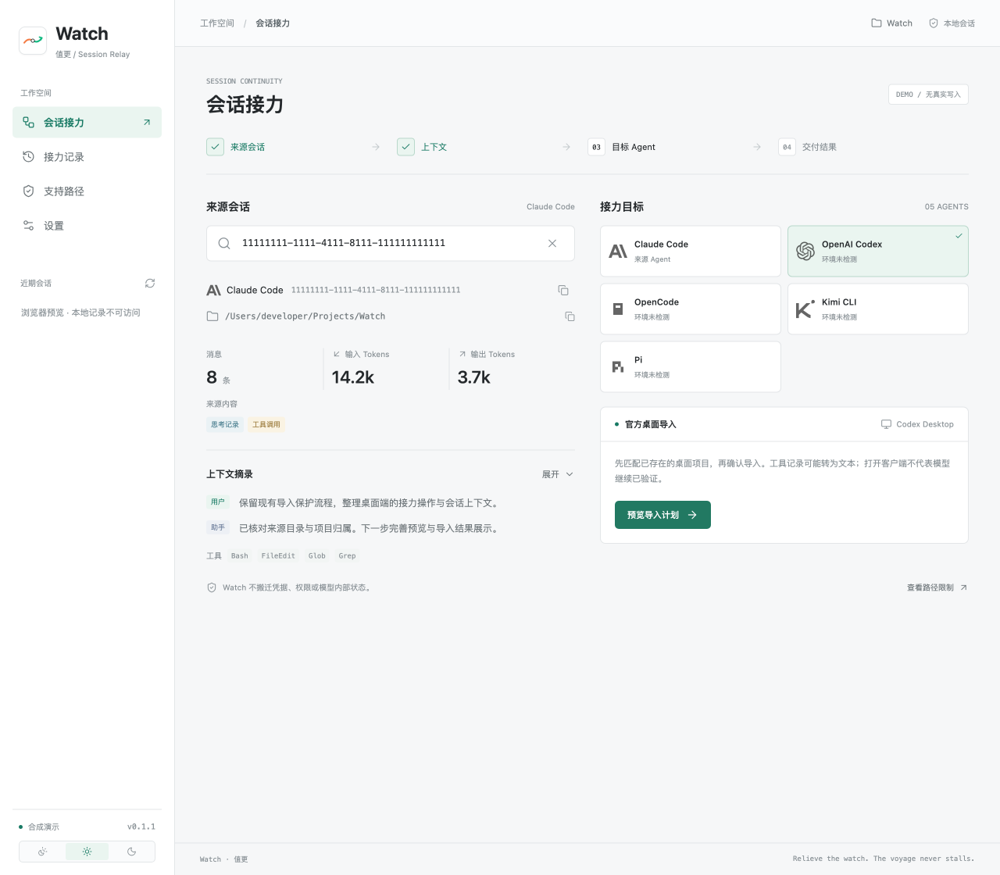
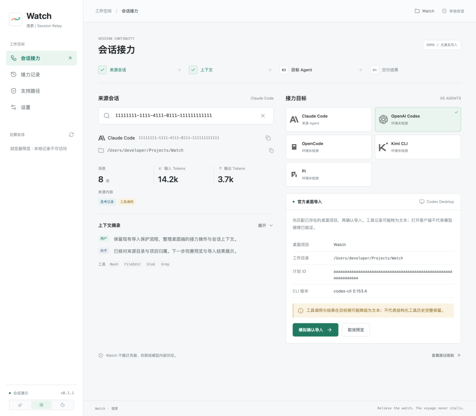
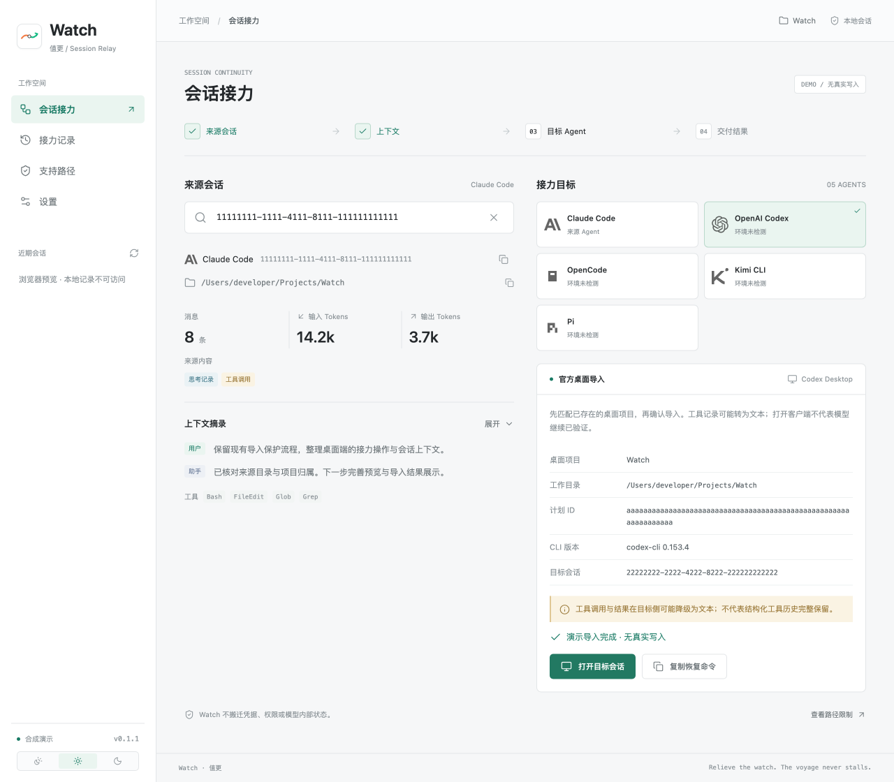
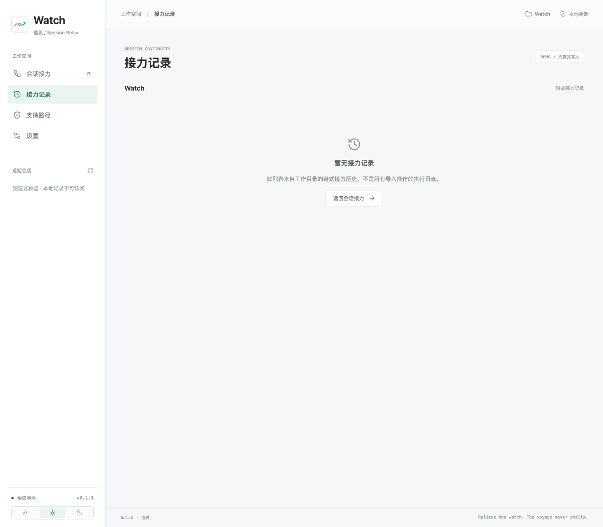
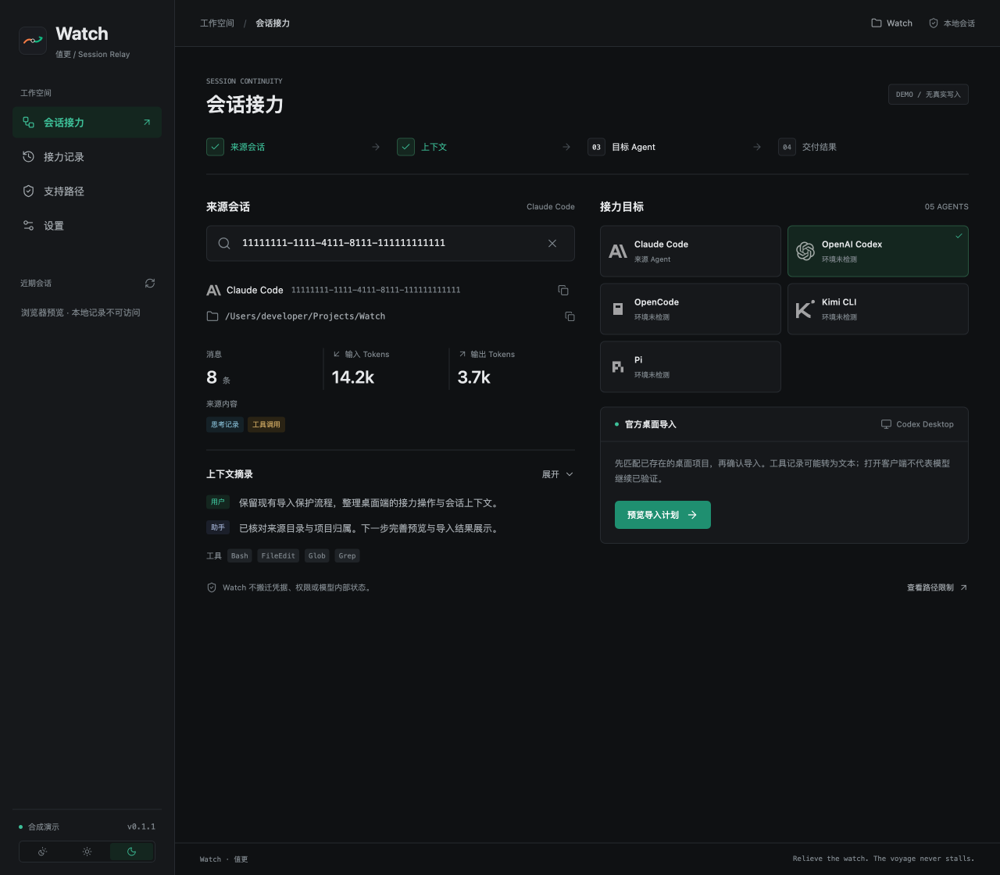

<div align="center">
  
  <h1>Watch · 值更</h1>
  <p><b>Relieving the watch. The voyage never stalls.</b></p>
  <a href="https://github.com/can4hou6joeng4/Watch/stargazers"></a>
  <a href="https://github.com/can4hou6joeng4/Watch/actions/workflows/ci.yml"></a>
  <a href="https://github.com/can4hou6joeng4/Watch/releases"></a>
  <a href="LICENSE"></a>
  
  <br>
  <a href="README.en.md">English</a> · 官网 <a href="https://relay.bobochang.cn/">relay.bobochang.cn</a> · 相关项目 <a href="https://github.com/can4hou6joeng4/Homeport">Homeport</a>
</div>

## 为什么

当当前 Agent 限额用完、上下文满了，或排查停滞想换一家时，已有的结论、失败的尝试和工具轨迹都留在原工具里。重述背景成本高，还容易漏掉关键约束。

Watch 只做一件事：**把已保存的会话记录连同工作目录交到目标工具，让同一项工作继续。**

操作说明在官网 [实操指南](https://relay.bobochang.cn/#guides)：[Claude Code 限额后转入 Codex](https://relay.bobochang.cn/guides/claude-code-limit-to-codex/)、[上下文满与账户限额](https://relay.bobochang.cn/guides/context-limit-vs-usage-limit-handoff/)、[OpenCode 与 SQLite 隔离](https://relay.bobochang.cn/guides/opencode-handover-sqlite-isolation/)、[Opus 5.5 与 5 小时限额](https://relay.bobochang.cn/guides/opus-5-5-five-hour-limit/)、[0 轮空会话的识别与恢复](https://relay.bobochang.cn/guides/empty-session-resume-check/)、[没有适配器时用 watch prompt 交接](https://relay.bobochang.cn/guides/prompt-handoff-without-adapter/)、[Codex 会话只剩 .jsonl.zst 时怎么恢复](https://relay.bobochang.cn/guides/codex-compressed-rollout-recovery/)。

它不提供模型、不绕过配额、不代替原生 Agent 聊天，也不默认搬迁权限、凭据或插件；接力的是已有记录，不是模型未记录的内部状态。当前实现以 CLI 会话与终端恢复为主，产品方向包含经过验证的桌面端入口，但**官方支持互通不等于 Watch 已经集成**。

## 演示

下图为隔离环境中用合成会话生成的真实运行结果，**不是原生验收证据**。

<table>
<tr>
  <td align="center" colspan="3">
    
    <br><b>CLI 接力</b> · Claude Code → OpenCode
    <br><sub>status → sessions → switch opencode → status，按真实时序回放</sub>
  </td>
</tr>
<tr>
  <td align="center" width="33%" valign="top">
    
    <br><b>来源会话</b> · 反查 cwd 与上下文
    <br><sub>会话 ID、工作目录、用量与工具痕迹</sub>
  </td>
  <td align="center" width="33%" valign="top">
    
    <br><b>导入预览</b> · 确认前只读
    <br><sub>桌面项目、工作目录、CLI 版本与计划 ID</sub>
  </td>
  <td align="center" width="33%" valign="top">
    
    <br><b>导入完成</b> · 再独立打开
    <br><sub>目标线程保留，打开失败只重试打开</sub>
  </td>
</tr>
<tr>
  <td align="center" width="33%" valign="top">
    
    <br><b>接力记录</b> · 空态与口径说明
    <br><sub>这是工作目录的链式接力历史，不是导入执行日志</sub>
  </td>
  <td align="center" width="33%" valign="top">
    
    <br><b>支持路径</b> · 逐方向证据边界
    <br><sub>限定验收 / 逐方向验收 / 未接入</sub>
  </td>
  <td align="center" width="33%" valign="top">
    
    <br><b>暗色外观</b> · 亮色 / 暗色 / 跟随系统
    <br><sub>偏好保存在本地</sub>
  </td>
</tr>
</table>

## 安装

CLI 和桌面端运行时都需要 **Node ≥ 22.13**，以及实际使用的 Agent CLI。两份 `package.json` 也用 `engines.node` 声明这个下限，npm 安装时会提前提示版本不匹配；CLI 入口另有自己的版本守卫。

按系统和处理器选择桌面安装包，下载见 [GitHub Releases](https://github.com/can4hou6joeng4/Watch/releases)。

| 平台 | 安装包 |
| --- | --- |
| macOS Apple 芯片 | `*_aarch64.dmg` |
| macOS Intel | `*_x64.dmg` |
| Windows x64 | `*_x64-setup.exe` |
| Debian / Ubuntu amd64 | `*_amd64.deb` |

**从源码运行**。本地运行或打包桌面端时，需要 Rust 和当前平台的 Tauri 构建依赖。

```bash
npm install                                  # 仓库根
npm --prefix desktop install                 # 桌面端依赖另装

npm run watch -- status --json               # 直接使用 CLI
npm run desktop:dev                          # 本地运行桌面端（Vite 在 1420）
npm --prefix desktop run build               # 桌面前端构建
cd desktop && npx tauri build                # 打包当前平台
```

预览官网时，先运行 `npm run site:build`，再运行 `npm run site:preview`。预览服务仅监听 `127.0.0.1`，默认端口为 4173，支持直接打开 `/en/` 和指南地址。

更多约定（代码风格、测试隔离、提交规范）见 [贡献指南](CONTRIBUTING.md)。

## 使用

1. 从原生 Agent 取得会话 ID，粘贴到 Watch。
2. 核对识别出的来源 Agent 和项目目录；**识别失败时不要直接按其他工具恢复**。
3. 选择来源 Agent 继续原会话，或选择另一家执行接力。选择目标本身不会写入；目标可能是新会话，也可能复用匹配的既有会话并补充增量。
4. 使用所选终端继续，或选择「仅复制命令」自行运行。终端打开失败时有复制回退。

常用命令（均支持 `--json`；成功与失败都向 stdout 输出单行 JSON，诊断走 stderr）：

```bash
npm run watch -- status --json                  # 当前目录的会话、链尾与切换历史
npm run watch -- sessions --json                # 该目录下各 Agent 的原生会话
npm run watch -- switch codex                   # 把链尾内容交接给 Codex，输出恢复命令
npm run watch -- adopt claude                   # 把已有 Claude 会话接入链
npm run watch -- new pi                         # 在链上新建另一侧会话（空链时直接起会话）
npm run watch -- open <session-id> --json       # 反查 cwd 并输出可粘贴的打开命令
npm run watch -- open <session-id> --to codex   # 把该会话内容转入 Codex
npm run watch -- prompt <session-id> > seed.md  # 目标工具没有适配器时，导出「摘要交接」文档
npm run watch -- prompt > seed.md               # 省略 id：取本目录按修改时间最新的可读会话
```

<details>
<summary>全部 CLI 子命令</summary>
<br>

```text
status   [--cwd <path>] [--chain <id|name>]                 会话、链尾与切换历史
sessions [--cwd <path>] [--chain <id|name>]                 各 Agent 在该目录的原生会话
switch   <provider> [--cwd <path>] [--chain <id|name>]      链尾内容交接给目标 provider
adopt    <provider> [--session <id>] [--cwd <path>] [--chain <id|name>]   把已有原生会话接入链
new      <provider> [--cwd <path>] [--chain <id|name>]      在链上新建另一侧会话
chain    list|new|rename|archive|use [--cwd <path>]         链的增删改与切换
search   <query> [--cwd <path>] [--reset-index]             本地全文检索（FTS5）；--reset-index 只清索引并压缩库文件（链与切换记录不动）
usage    [--cwd <path>] [--chain <id|name>]                 链上各会话的 token 用量
recent   [--cwd <path>] [--limit <n>]                       近期会话反查记录（默认 8 条，最多 50）
providers                                                   各 Agent 的本机安装检测
capabilities                                                各 Agent 的读写能力矩阵（代码事实，不探测本机 CLI）
doctor   [--cwd <path>] [--strict]                          环境诊断（Agent 检测 / Claude 保留期 / 本地库 / 本地库体积与索引规模 / 导入日志）；不改动原生会话，本地库不存在时会创建 Watch 本地库；发现硬失败时退出码 1，--strict 让警告也算失败
open     <session-id> [--from <id>] [--provider <name>] [--to <provider>] [--check]
prompt   [<session-id>] [--provider <name>] [--profile minimal|standard|verbose|full] [--last <n>] [--since-compact]   摘要交接：把会话渲染成可粘贴的 Markdown（降级方案，不写任何文件）
inspect  <session-id> [--provider <name>] [--json]         只读查看会话元数据与轮次、事件、附件、坏行及披露计数
import-codex  prepare|confirm|status|list|project-prepare|project-confirm|project-status   官方单会话导入（实验性，详见 docs/import-codex.md）
```

`watch --help`（`help` / `-h` 同义）把完整用法打到 stdout 并以 0 退出，可以直接接管道；`--json` 时回单行 `{ ok: true, help }`。参数写错时用法仍走 stderr、退出码 1。`import-codex --help` 同一约定。

</details>

<details>
<summary>CLI 输出参考</summary>
<br>

**`open --to` 预检与计划**

运行 `watch open <session-id> --to <provider> --check --json` 可预览目标与待写入的轮数。规划失败时返回 `ok: false`。规划完成但当前不允许写入时，结果包含 `ok: true`、`writable: false` 和 `blocked`，命令以 1 退出。预检可能创建 Watch 本地数据库或更新会话位置记录，原生会话保持原样。

预检和实际执行的结果共用 `plan`。

- `plan.kind` 表示目标选择方式。`resume` 恢复同一家工具的原会话，`chain` 使用链上配对会话，`reuse` 使用按内容匹配的既有会话，`new` 新建。`plan.turnCount` 是计划写入的轮数。
- `plan.reuseScanIncomplete` 在计划新建且复用扫描不完整时列出原因。`capped` 表示达到列表上限，`candidates-unreadable` 表示有候选会话读不出来，`list-failed` 表示会话列表读取失败，`unattributable` 表示有会话文件因无法归属目录而被跳过。此时新建可能产生重复会话。
- `plan.chainPairSkipped` 在跳过链上配对会话时给出该会话的 ID 和原因。`zero-byte` 表示文件 0 字节，`zero-turns` 表示解析出 0 轮，`unreadable` 表示读取失败，`compressed` / `compressed-empty` 表示只剩压缩副本，`diverged` 表示缺少来源一半或更多轮次。链记录仍指向原配对会话，之后的 `switch` 仍可能选中它。

`inspect` 只对 JSONL 会话统计坏行。`--json` 中，`badLinesStatus` 为 `complete` 时，`badLines` 是完整扫描的计数。`incomplete` 表示扫描未完成，计数是已确认的下界，原因见 `warnings`。SQLite 等不适用的来源返回 `not-applicable`，`badLines` 为 `null`。用量数字同一判据：来源的用量数据源里有无法解析的行时，`--json` 带 `usageBadLines`，文本在数字后括注这只是下界；扫描失败时带 `usageBadLinesScanError`，表示合计可能偏少且无法确认程度。

`inspect --json` 的 `session.storageScope` 为 `session-file`（单会话文件）或 `shared-database`（OpenCode 共享数据库）。`sizeBytes` 和 `modifiedAt` 描述 `filePath` 指向的文件。OpenCode 单条会话的更新时间另见 `session.recordedUpdatedAt`，值缺失或不可用时为 `null`。会话记录的工作目录不可用时，`session.recordedCwdState` 带与 `cwdState` 相同的取值（`missing` / `not-directory` / `denied` / `unknown`，最后一种附 `reason`）；健康目录或会话没有记录目录时不出现。`inspect`、`providers` 与 `capabilities` 都不读 `--cwd`（前者按会话 id 全局反查，后两者与目录无关）；显式给了会在 `warnings` 里说明它没有参与，文本模式打到 stderr。Grok 的记录没有逐轮时间戳，`structure.firstTimestamp` / `lastTimestamp` 是推定值，此时 `--json` 另带 `timeRangeNote` 说明来源，文本输出在时间范围后括注。`structure.timestampedTurns` 是计入时间范围的轮数；部分轮次缺时间戳时，`--json` 另有 `timestampNote` 写明覆盖比例，文本输出同样括注。`structure.events.danglingToolCalls` 统计按 callId 找不到对应结果的工具调用；可能在等待用户审批、仍在运行或已中断，不等于数据丢失，输出只给计数，不给 callId 或工具入参。`structure.events.orphanToolResults` 统计按 callId 找不到对应调用的工具结果（常见于上下文压缩后的残留）；部分来源会把这类结果转成上下文披露而不是孤立结果事件，此时看 `disclosureEvents` 与相关 `warnings`。
`open` / `switch` 的未闭合调用警告会给出 callId 预览，其中的 ESC / 换行等控制字符先转义再显示；`inspect` 文本模式的警告也按同一规则显示，`--json` 保留原值。失败输出、阻断提示与用量 / 坏行说明同样先转义再打印；悬空尾轮的用户文本预览也按此处理。链名、链 id 与会话 id 在 `chain` / `status` 的文本输出里同样转义，`--json` 仍保留原值。

读取 `status --json` 的血缘图时，用 `nodes[].key` 匹配 `edges[].from` 和 `edges[].to`。展示会话身份时用节点里的原始 `provider` 和 `sessionId`。

`doctor --json` 的 `claudeRetention` 报告 Claude Code 用户设置中的保留期，`claudeProjectRetention` 报告项目设置里读到的值：当前目录下的 `.claude/settings.local.json` 与 `.claude/settings.json`，以及在普通 Git 仓库子目录运行时仓库根目录的 `.claude/settings.local.json`（`scope` 为 `repository-local`）。设置路径异常、文件不可读或超过 1 MiB 时，返回 `unknown` 并给出原因。`cleanupPeriodDays` 允许写在任意设置文件里，项目设置可以覆盖用户设置；工作树 / 子模块（`.git` 是文件）、仓库根就是家目录或目录所有权不符时跳过仓库根这一份（工作树的估算因此可能偏保守），`--settings` 与管理设置不在范围内，实际清理期限取决于 Claude Code 加载的全部设置。`doctor` 判断链尾风险时按已探测文件的优先级取会被读取的那一份，而不是取所有文件里的最短值：仓库根的 local 覆盖启动目录的 local，项目 local 覆盖 shared，项目设置再覆盖用户设置；被覆盖的短值不报警，高层设置读不出来时也不拿低层值猜测。若这份保留期显式低于官方默认，而链尾的 Claude Code 会话文件比该天数更旧，`doctor` 会把这条链标成清理风险（按文件最后修改时间估算，不宣称一定会被删除）。`store.created` 为 `true` 表示这次诊断新建了本地库（库文件原本不存在），文本模式的「本地库文件」行同样注明；库已存在时该字段不出现。

`usage` 的合计只是「读得出来的部分之和」：读取失败、没有 usage 字段、适配器不提供用量，都会在合计行括注；某个会话的用量数据源有无法解析的行时，合计后另起一行说明这轮是下界，按会话那一行也会就地标出「这个数是下界」——`--json` 对应 `totalExcluded` / `totalMissingUsage` / `totalEmptySessions` / `unsupported` / `byProvider[].usageBadLines`；合法空会话只进 `totalEmptySessions`，不混进「无 usage 数据」。内容文件有坏行时同样会披露，`byProvider[].contentBadLines` 给出坏行数；旁路文件里已经读到的用量仍会保留在合计里，不会因为内容文件的坏行而消失。内容根本解析不出来时，这条会话按读取失败计入合计（说「内容读取失败」而不是「无 usage 数据」），并在 `--json` 里带 `byProvider[].contentUnreadable: true`——脚本靠字段就能与 `contentProblem` 分开，后者说的是「用量读到了，但内容文件已空 / 缺失 / 不可用，内容已丢失」。只有解析确实为 0 轮时，警告才会说它不能当作空会话；已有轮次时只说明内容可能不完整。

`search` 同理：某条会话的文件里有无法解析的行时，这些行的内容不会进索引，搜索会在 `warnings` 里说明（文件没变、复用索引时也照样说），而不是只回一句「无结果」。`--json` 另有 `coverage`：`sessions` 是本次枚举到的会话总数（0 表示这个目录下没有会话），`capped` 与 `incomplete` 列出撞上列表上限、未完整进入索引的 provider，只在非空时出现——脚本据此区分「没有匹配」与「没搜全」。

`status` / `sessions` / `recent` / `usage` / `search` / `doctor` / `chain list` 的 `--json` 在 `--cwd` 不可用时还带 `cwdState: { state }`（`missing` / `not-directory` / `denied` / `unknown`，最后一种附 `reason`），健康目录不输出该字段。`new --json` 写入成功时也带该字段：会话与链记录**已经写入**，但 `resume` 会在进入该目录时失败——它表示「目录不可用」，不是「操作被阻止」；`chain new` 同理（链记录已写入），`chain rename` / `chain archive` / `chain use` 成功时也带同一字段：链按 `--cwd` 原字符串分组，目录没了照样改得动，但这条链绑在一个不可用的路径上。`switch` / `adopt` 成功时同样带：会话内容已经写进目标 provider 的原生文件、链记录也按该字符串写入，但 `resume` 会在进入目录时失败。`open` / `open --to` / `open --check` 成功时也带：返回的 `cd` 与 `resume` 都已给出，但 `cd` 会在会话记录的工作目录上失败。文本模式的写入口径警告不变。字段与文本模式那条「--cwd 目录不存在…」的警告来自同一次探测：空列表、零命中或 `total: 0` 加 `ok: true` 都不能读成「这个目录没有会话或匹配」，先看 `cwdState` 再下结论。

`sessions --json` 与 `usage --json` 在本地库打不开时另带 `storeAvailable: false`：前者此时只列出原生扫描结果（`--chain` 过滤不生效），后者的 `chain: null` / `byProvider: []` 只表示读不出来。`sessions --json` 在给了 `--chain` 却没用上时（本目录没有这条链、链查询失败或库没打开）另带 `chainFilterApplied: false`——此时 `providers` 是全部会话，不是过滤结果；不带 `--chain` 或过滤已生效时该字段不出现。`status --json` 同样带 `storeAvailable: false`，用来把 `historyAvailable: false` 分成「库没打开」与「库打开但切换历史读失败」两档。`recent --json` 同样带 `storeAvailable: false`，并继续在 `unavailable` 里列出「本地库」；库正常打开时这些命令都不出现 `storeAvailable`。写操作 `new` / `switch` / `adopt` 在库打不开时仍会完成原生会话的写入并返回 `ok: true`，此时同样带 `storeAvailable: false`，表示这次绑定没有写进链记录（后续 `status` / `switch` 不认它）；库打开了但链记录写入抛错时带 `chainRecordFailed: true`。两个字段都只在异常时出现，原因仍在 `warnings` 里。`open`、`open --to` 与 `open --check` 在本地库打不开时照常成功，`--json` 同样带 `storeAvailable: false`：这次反查是全盘扫描，命中也没有写回会话位置映射。`status` / `usage` / `recent` 的 `--json` 始终回显本次使用的 `cwd`（`--cwd` 省略时即进程工作目录），与 sessions / search / doctor 一致。

**交接结果**

- `sourceDrift: { from, to, growth }` 记录交接期间来源文件有变化时的改前、改后字节数与变化方向。写入交接中来源被追加时，再执行同一条命令可补齐增量。来源被改写或截短时，先确认文件完整性。`sourceDriftUnknown` 给出无法确认的原因。要核对当前内容，以原生会话里的最新记录为准。`switch`、`open --from`、`open --to` 和 `prompt` 共用这些字段。
- `targetRecreated: { previousSessionId }` 表示写入前原目标被移走或删除，结果中的会话 ID 指向只包含本次写入内容的新会话。`switch`、`open --from` 和 `open --to` 共用该字段。
- `crossDirectory: { sourceCwd, targetCwd }` 表示 `open --from` 从记录目录不同的来源实际并入了内容，路径保留原值。用这两个路径核对目录改名或会话 ID 选错的情况。
- `unparsableLines: { source?, target? }` 用于 `switch`、`open --from` 和 `open --to`（含 `--check`），每侧为 `{ count, error? }`。来源坏行可能造成交接内容缺失，目标坏行可能让已有内容被重复追加。有 `error` 时，`count` 是已确认的下界。只报告有坏行或扫描失败的一侧。`open --to` 因来源为空而拒绝时，已发现的坏行或扫描错误也会出现在失败结果中。直接 `open <id>` 或用 `--to` 恢复同家会话，在解析出 0 轮时也会通过 `target` 报告这次扫描发现的坏行或错误。
- `contentLoss` 统计目标格式无法保留的内容。`attachments: { images, files }` 对应只保留占位文本的附件，`textEvents` 对应独立过程文本，`toolFailures` 对应工具结果的原生失败标记，`bashControls: { workdirs, timeouts, backgrounds }` 对应 Bash 调用的执行条件。计数与 `warnings` 同源。`--check` 给出预计结果，只列出非零的类别。
- `sourceUnfinished` 记录来源未完成的部分。`danglingToolCalls` 是没有结果的工具调用数。`unansweredTail` 表示最后一条用户消息还没有回复，取值为来源日志标记的 `cancelled` 或 `error`，无法确认时为 `unknown`。
- `targetUnfinished` 使用同样的键，描述恢复命令指向的既有会话，适用于单独 `open <id>`、`open --from`、`open --to` 的同家恢复、链上配对和复用，以及 `switch`。没有结果的调用始终计入，悬空用户消息只在本次没有并入内容时计入。
- `contextDisclosures: { source?, target? }` 分别统计来源与目标去重后的上下文声明，比如压缩记录、转入后台、未识别的记录类型或失败请求。`warnings` 包含对应的文字说明。只列出有声明的一侧。
- `emptySessions: { source?, target? }` 表示 `open` 读取时的空会话。`zero-byte` 表示会话文件 0 字节，`zero-turns` 表示解析出 0 轮。即使 `mergedTurns` 同为 0，也可通过该字段识别空来源。`open --to` 因来源为空而拒绝时，失败结果也包含该字段。
- `pairedTurnsMissingEvents` 统计既有目标中已有同文本回复却缺少可保留来源过程事件的轮数。适用于 `open --from` 及 `open --to` 的链上配对和内容复用。这些轮次按已包含处理。计数为 0 或使用新建目标时省略。

来源逐轮时间是推定值时（当前仅 Grok），`switch`、`open --from` 与 `open --to` 真的写入内容后会在结果说明里写明这一点、来源如何推定以及按原值写入了几轮；零增量但为修复格式整份重写目标时，也按来源轮数披露。`--check` 与同家 resume 没有写入，不带这条说明。

</details>

<details>
<summary><code>prompt</code> 摘要交接参考</summary>
<br>

目标工具还没有适配器（或那家的格式刚漂移、写回有风险）时用 `prompt`：它只读，把会话渲染成一份 Markdown，正文开头就写明「这是摘要交接、不是目标助手的原生会话」。

**选择来源会话**

省略会话 id 时，它在 `--cwd`（默认当前目录）里按修改时间挑最新的一条可读会话，`--provider` 可把范围收窄到一家；文档头部会标明「自动挑选」，`--json` 也会带 `autoPicked: true`——挑不到时不会输出半份文档，读不出来与确实没有会话分开说明。显式给出会话 id 时 `--cwd` 不参与（会话按 id 全局反查，正文来自会话自身记录），给了也会在 `warnings` 里说明这一点。

**裁剪范围**

- `--profile` 控制保留多少内容。
- `--last <n>` 则只保留最近 n 个用户轮（显式窗口，此时不再强制保留首轮，文档里会写明；`--json` 的 `stats.includedUserTurns` 给出实际保留的真实用户轮数，不含压缩摘要锚点，`stats.taskDescription` 取 `kept` / `omitted` / `summarized` / `absent`，与正文「首条任务描述…」同源；`absent` 表示来源本来没有用户轮，不是被裁掉）。
- `--since-compact` 从最近一次可识别的压缩摘要开始渲染（Claude Code、Pi、Kimi、OpenCode 的记录格式都认；Codex 的 compacted 记录与 OpenCode 2.x 的 provider 原生压缩只披露、不并入摘要）——摘要已概括更早的内容，不再重复带上摘要之前的原文（摘要本身标明由哪家生成、不是用户原话；来源没有可用摘要时不按它裁剪，并在正文写明未生效——另有 `--last` / 档位裁剪时也会如实说明还省略了多少轮；`--json` 的 `stats.sinceCompactResult` 取 `off` / `applied` / `unavailable` 区分「没请求 / 找到 / 没找到」，`stats.compactSource` 取 `claude-code` / `opencode` / `pi` / `kimi`，只在 applied 时出现）。

任何被裁剪的部分都会进 `--json` 的 `findings` 并在 stderr 说明。

**时间、用量和读取状态**

头部的时间范围会注明两端各取什么（起点是首条记录，终点可能是文件修改时间；grok 的记录行内没有逐轮时间戳，逐轮时间由 `summary.json` 的创建时间按顺序推定，缺这份摘要时以会话文件的修改时间为锚点，头部括注会写明这一点——那个时间不是逐轮的真实时间；首条记录没有时间戳时，起点取后面第一条有时间戳的记录并照实写出，部分轮次缺时间戳时括注覆盖比例，如「2/3 轮有时间戳」）。`--json` 的 `timeRangeNote`（推定时间的来源）与 `timestampNote`（覆盖比例）和头部括注同源，缺时间戳的轮数另记 `findings` 的 `prompt_turns_without_timestamp`；用量读不出来或用量数据源已被清空时，那一行写的是原因并说明「这不代表来源会话没有用量」，不会一律落回「没有用量记录」；数据源里有无法解析的行时，数字照印但会括注它只是下界；源文件本身有坏行时，正文会另起一行说明「可能缺少这些记录」；来源解析出 0 轮时，正文会说清是 0 字节（需要从备份恢复）还是文件可读但没有可交接的记录。

**工作目录与分支**

文档头还会给出工作目录当前状态、工作树类型与当前分支；仓库子目录会向上找到最近的仓库根并把位置写出。工作目录不可用时，`--json` 另有 `sourceCwd: { state }`（`missing` / `not-directory` / `denied` / `unknown`，后者附 `reason`），健康目录不输出该字段。`--json` 另有结构化 `sourceBranch`（普通仓库根为 `{ branch, repoRoot }`，detached 为 `{ detached: true, repoRoot }`），链接工作树为 `sourceWorktree: { mainWorktree, branch }`；工作树探测失败时给 `sourceWorktreeUnknown: <原因>` 与 `prompt_source_worktree_unreadable` finding，缺省的 `sourceWorktree` 不能读成「不是链接工作树」。

**生成期间的来源变化**

读取前后来源文件的大小或修改时间有变化时，`--json` 返回 `sourceDrift: { from, to, growth }`；量不出来（stat 失败）时另给 `sourceDriftUnknown: <原因>`——没有 `sourceDrift` 可能是没变化，也可能是没能确认，脚本不能把它当成「没变化」。它描述字节数和增长方向，仅凭这个字段无法确认正文包含了哪些记录。

`prompt` 生成期间检测到来源变化时，会在文档正文中写明内容以开始读取时的记录为准。重新运行会生成一份新文档。

**未完成的操作**

`prompt` 交接文档还会在元信息与「继续工作」里披露未闭合的工具调用（整条会话计数，不受档位 / `--last` 裁剪）：可能在等待用户审批、仍在运行或已中断，不是明确失败，不能当成已完成，也不应不核对就重做；`--json` 的 `stats.danglingToolCalls` 与 `findings` 里 `prompt_dangling_tool_calls` 同源。只给计数，不带 callId、入参或结果正文。反方向的缺口同样按整条会话披露：有结果、找不到调用的工具结果可能来自上下文压缩或记录截断，不代表失败，但不能据此重建原有操作顺序；`--json` 对应 `stats.orphanToolResults` 与 `prompt_orphan_tool_results`，也只给计数。

`prompt` 还会披露「最后一条用户消息没有助手回复」的半轮（Ctrl-C、用量耗尽、进程中断或文件截断都可能）；明确标成失败 / 中止的来源会照实写，`--json` 同步给出 `stats.unansweredTail` 与 `prompt_unanswered_tail` finding；原因另见 `stats.unansweredTailReason`（`cancelled` / `error` 为来源明确标记，`unknown` 为无法确认，只在半轮时出现）。判据只在尾部用户轮有实际正文时生效，占位空轮不算。这条消息通常正是要在目标侧继续的任务，不应要求用户重复确认是否接手；只有来源可能已开始执行时才先核对再动手。

明确标记失败的工具调用另有 `failedAttempts`（工具、路径或命令、次数；不复制工具输出），正文也保留「失败与中断」一节；没有失败标记时不输出。

**改动清单与磁盘核对**

正文还会列出会话里写过 / 编辑过的文件与运行过的命令（「改动概览」，不受档位裁剪影响），并对照生成那一刻的磁盘：确定已不在的标注「本次生成时磁盘上已不在」，相对路径没找到或读不出来标注「无法确认」，被补丁删除 / 移走的标注「本次会话里被补丁删除或移走」，会话目录之外的路径只计数、不核对；会话目录不可用或没有记录时，正文直接写明「本次没有核对」，不与「都还在」长得一样。`--json` 的 `manifest.files[].disk` 取值为 `missing` / `unverified` / `removed`（缺省既可能是「都还在」也可能是「没核对」），`manifestDisk: { checked, missing, unverified, outside, removed }` 给出计数，只有会话目录可用、且清单里有文件时才出现。

**凭据遮盖**

这份文档是要复制给另一个助手的，所以会话里**格式固定**的密钥 / 令牌（常见厂商的 API 密钥，GitHub / GitLab / Slack / npm / Hugging Face 令牌，AWS 访问密钥 ID，JWT，PEM / PGP 私钥块），以及四种位置固定的值（`postgres://user:口令@host` 这类连接串里的口令、`X-Api-Key` / `X-Auth-Token` 这类密钥头的值、`Cookie` / `Set-Cookie` 头与 `curl --cookie` 里的 `name=value` 值（保留后续命令参数；请求头或带引号的参数里前一项是变量引用时，也会继续检查后面的 Cookie）、`Authorization` 头的 Bearer / Token / Basic 值）在进入文档前会换成 `[已隐去：种类]`，头部写明种类与个数，`--json` 另给 `credentialsMasked: { total, kinds }`（只有种类与个数）；来源文件不改，原文仍在那里。只认固定格式与固定位置：单独出现的口令、内部地址与没有固定前缀的密钥不会被识别，没有这一行不代表文档里没有敏感内容，转交前仍需自行检查。这一处理只在 `prompt` 生效，`open --to` 等写入原生会话的路径按原记录转入。

</details>

桌面端提供**会话接力 / 接力记录 / 支持路径 / 设置**四个视图，支持亮色、暗色与跟随系统三种外观。浏览器预览不读取本地 Agent 记录；「载入演示」使用合成样本，不写入会话、不启动客户端、不调用模型。

YOLO 默认关闭。开启会在支持的 CLI 命令中加入免确认参数，从而放宽目标 Agent 的权限或沙箱；不应把它当成桌面端的权限设置。

**Claude Code → Codex Desktop（官方单会话导入）**

只有明确确认后才提交，导入成功后再单独打开目标线程。要进入桌面项目，必须先在 Codex Desktop 添加并保留该目录，再在准备阶段使用 `--desktop-project`。

```bash
npm run watch -- import-codex list --json
npm run watch -- import-codex prepare <claude-id> --cwd /absolute/project --desktop-project --experimental --json
npm run watch -- import-codex confirm <plan-id> --experimental --json
npm run watch -- import-codex status <plan-id> --json
```

`list` 只读列出执行日志里的计划与状态（不连 Codex、不写文件）；忘了计划 id 时先用它。

旧 `project-prepare` / `project-confirm` / `project-status` 仍可查看或更新 app-server 的后端 `projectId`，但不能解除 Desktop 已持久化的 `projectless` 排除，因此不是项目列表修复方案。不要通过反复移除项目或重复导入来刷新——这会改变项目 ID，并可能让对象继续处于排除状态。

## 能力与限制

| 入口 | 当前状态 |
|---|---|
| Claude Code、Codex、Kimi、OpenCode、Pi、Grok CLI | 有查找、转换和恢复实现，桌面六张目标卡与适配器恢复命令逐字一致；OpenCode 支持 SQLite 存储会话恢复与路径隔离、原生 ID 修复，具体版本与方向仍需验收 |
| Grok CLI 桌面入口 | 已接入第六张目标卡（`grok -r <id>`，YOLO `--always-approve`）；写入原生 ACP `updates.jsonl` 后，隔离验收通过 `sessions list` / `export` / ACP `session/load`；限定 PTY 样本确认 TUI 画面与单轮模型继续，不推广到其它版本、平台或远程会话 |
| Codex 桌面端 | Claude Code 来源已接入项目先建的预览、确认、状态和独立打开流程；合成样本已通过真实 Watch Tauri 点击与两次同目标打开验收。当前本机 CodexPilot 的既有续写尝试仍记录为 503 |
| Claude Desktop Code | 官方 `/desktop` 流程已完成实现调查；它依赖当前 CLI 会话保存与 flush，尚未由 Watch 接入或原生验收 |
| OpenCode Web、TUI、IDE | Darwin arm64 / 1.18.29 的官方 JSON import/export、只读 server API、Web、独立 local TUI 与 attached TUI 历史可见已通过隔离原生验收；单次无工具继续请求因 provider 429 未生成回复，因此官方多客户端增强仍未接入。该结果不阻塞现有 OpenCode CLI 卡片；IDE 扩展复用集成终端 |
| Antigravity | 2.0 → CLI 的官方交互式 picker 已调研但未原生验收；没有跨 Agent 导入协议或 Watch 适配器 |

**历史格式、附件和工具事件可能降级**，结果提示仍需完善。新建文件、整文件替换与 Claude / Codex 的增量追加都走同目录原子写和 rename 前反解校验，写入前还比对目标指纹；Codex 目标另有写入预检：所有平台都会先确认 Codex 数据目录与配置可读，macOS 上还会检查原生 per-thread writer 锁并在写入期间协作持有同一把锁（这两层锁只在 macOS 生效，Windows / Linux 只剩指纹比对、原子写与写后反解校验）。OpenCode 以 SQLite 事务对账，其它 provider 按各自存储形态防护，覆盖面并不完全等价；**不承诺零损坏**。Watch 不自动创建 Worktree，不迁移代码，也不保证不同模型行为一致。

官方路径使用目标目录 / 配置绑定和 Watch 导入锁，**不因无关桌面应用运行而要求退出**；直接写文件路径使用目标指纹、原子写与（Codex，仅 macOS）协作写锁，两者的防护面不同。原生证据只覆盖 macOS arm64 / Codex CLI 0.153.4 的合成样本及空闲服务并存，P2 真实 Tauri 点击另绑定 ChatGPT Desktop 26.903.61454 —— 两者都不保证所有并发场景、其他版本或模型继续。

打开成功与会话可继续是两个状态：转入成功但客户端打开失败时，只重试打开，不重复转换。

## 设计

- **TypeScript 承载业务逻辑**，Rust 只做 CLI 桥接与必须由 GUI 进程完成的系统操作。
- **每家 Agent 一个适配器**（`src/providers/<id>/`），统一时间线在适配器边界完成解析与写回。
- **写回安全三道防线**：写前比对目标指纹（TOCTOU）、同目录原子写、rename 前用自家 `parse` 反解对账。
- **两条官方路径各自隔离**：Codex 官方导入与 OpenCode 官方增强使用执行日志与目标锁，不经上述转换器。
- **降级必须披露**：任何「失败但继续」的分支都要记录在 warnings 或 findings 中，不静默丢弃内容。

细节与防护缺口见 [架构与安全边界](docs/ARCHITECTURE.md)。

## 缘起

编程 Agent 各自维护自己的会话记录。换工具本该是常态，但每换一次都要重新交代背景，前面的结论、失败的尝试和已确认的约束都留在旧工具里——而这些恰恰是最难重述的部分。

所以 Watch 不做聚合、不做代理、也不做另一层聊天界面，只把「已有记录 + 工作目录」这一段交接做扎实：先查得到，再核对得清，写回时守得住，交付后能继续。

## 环境与隐私

会话转译主要处理本地记录，但**不等于全过程离线**：Kimi 新建会话会调用其 CLI，部分 Codex 执行路径可能读取认证配置并调用模型，目标 Agent 继续时按其自身服务规则通信。

调用原生 Agent 的路径需要其正常认证。请先用专用测试会话验证，不要把真实凭据、聊天记录或 Agent 数据库提交到仓库。

**搜索会在本机建索引**：`watch search` 把当前目录下各 Agent 会话的轮次正文与工具调用 / 返回记录写进 `~/.watch/watch.db` 的全文索引（`messages_fts`），下次搜索不必重新解析文件。索引只留在本机：Unix 上库目录为 0700、库文件为 0600，Watch 不会上传；`WATCH_DB` 可以换位置，删掉库文件（连同 `-wal` / `-shm`）就清除了这些正文，代价是链与切换记录一并丢失。没跑过 `search` 的会话不会进库。

## 会话文件在哪

| Agent | 本机位置 | 恢复 |
|---|---|---|
| Claude Code | `~/.claude/projects/<编码目录>/<会话 id>.jsonl` | `claude --resume <id>` |
| Codex | `~/.codex/sessions/年/月/日/rollout-*.jsonl` | `codex resume <id>` |
| OpenCode | `~/.local/share/opencode/opencode.db` | `opencode -s <id>` |
| Kimi CLI | `~/.kimi-code/sessions/` 与 `session_index.jsonl` | `kimi -r <id>` |
| Pi | `~/.pi/agent/sessions/` | `pi --session <id>` |
| Grok CLI | `~/.grok/sessions/` | `grok -r <id>` |

路径以各 CLI 当前版本为准。Watch 按会话 ID 反查这些位置，并核对工作目录。限额和上下文的区别见 [上下文满与账户限额](https://relay.bobochang.cn/guides/context-limit-vs-usage-limit-handoff/)；OpenCode 的库路径与事务见 [OpenCode 与 SQLite 隔离](https://relay.bobochang.cn/guides/opencode-handover-sqlite-isolation/)。

## 文档

- **版本变更与历史记录**：见 [Releases](https://github.com/can4hou6joeng4/Watch/releases)。

- [产品需求与实施计划](docs/PLAN.md)：当前范围与分阶段完成条件。
- [客户端兼容性证据](docs/COMPATIBILITY.md)：官方依据、实现状态和本机预检。
- [架构与安全边界](docs/ARCHITECTURE.md)：当前实现及缺口。
- [同类工具对照](docs/alternatives.md)：按交接产物与使用场景比较。
- [Codex 官方导入说明](docs/import-codex.md)：实验入口的完整流程与限制。
- [贡献指南](CONTRIBUTING.md)：环境要求、代码风格、测试隔离与提交规范。

## 支持

- 如果 Watch 对你有用，欢迎点一个 Star，或[分享给同样在多个 Agent 之间来回切换的人](https://twitter.com/intent/tweet?url=https://github.com/can4hou6joeng4/Watch&text=Watch%20-%20%E8%B7%A8%20CLI%20%E7%BC%96%E7%A8%8B%20Agent%20%E4%BC%9A%E8%AF%9D%E6%8E%A5%E5%8A%9B%E5%B7%A5%E5%85%B7)。
- 遇到问题或想扩展某条路径，欢迎开 issue 或 PR；提出前请先读 [贡献指南](CONTRIBUTING.md)。

## 许可

本仓库的代码与文档以 [MIT](LICENSE) 发布。

- 站点图标取自 [Lucide](https://lucide.dev)（ISC）。`site/agents/` 与 `desktop/public/` 下的 Agent 图标为各品牌自有资产，仅用于识别。
- 桌面安装包会把 `tsx` 与 `esbuild`（均为 MIT）一并带入 `watch-core`，运行时仍需用户自备 Node ≥ 22.13。
- 各 Agent CLI 受其自身许可与服务条款约束；Watch 不重新分发它们的模型或凭据。

---

## 相关项目

- 🧭 [Homeport](https://github.com/can4hou6joeng4/Homeport) —— 个人主页
- 🐋 [Sonar](https://github.com/can4hou6joeng4/Sonar) —— 封面取色驱动的 iOS 音乐播放器
- 🚩 [Semaphore](https://github.com/can4hou6joeng4/Semaphore) —— 浏览器本地 ASCII 艺术转换
- 🛟 [Buoy](https://github.com/can4hou6joeng4/Buoy) —— AnyRouter 多账号签到工具
- 🗼 [Beacon](https://github.com/can4hou6joeng4/Beacon) —— PDF 证件有效期审计
