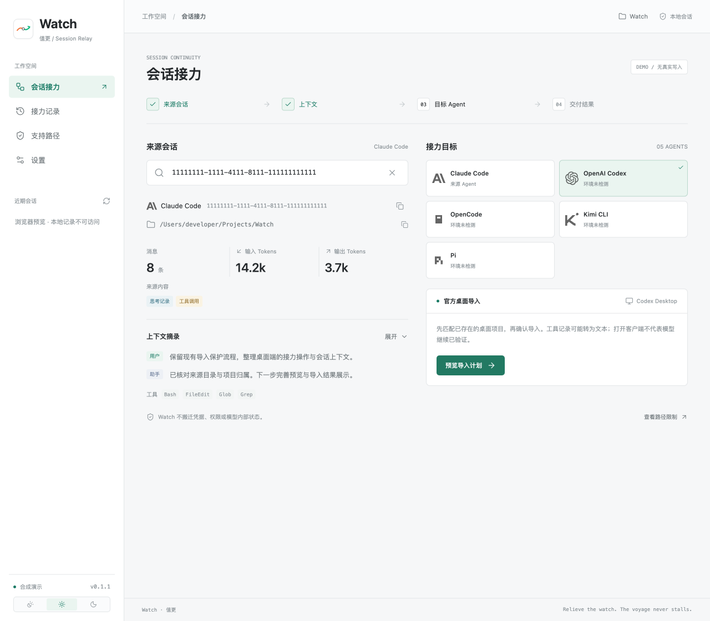
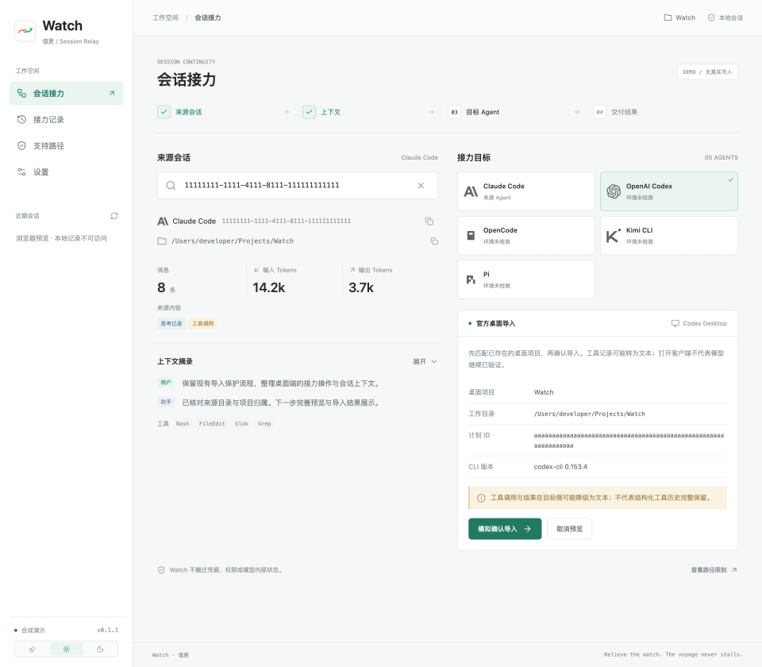
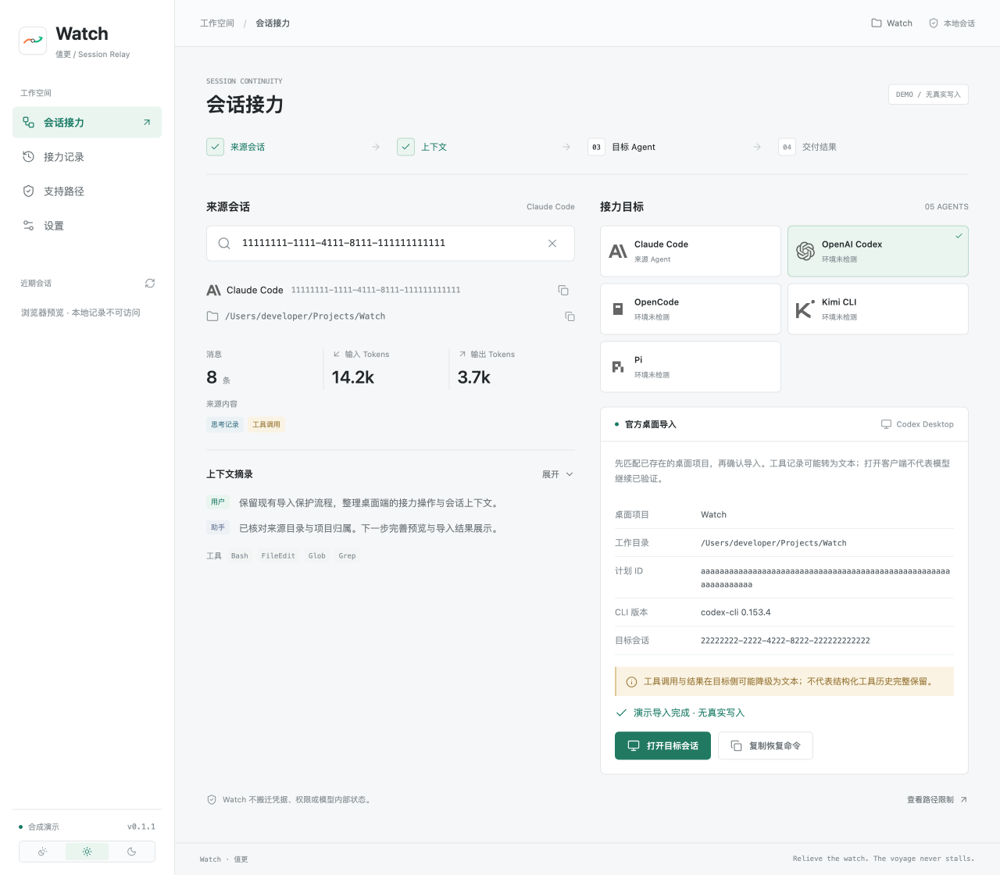
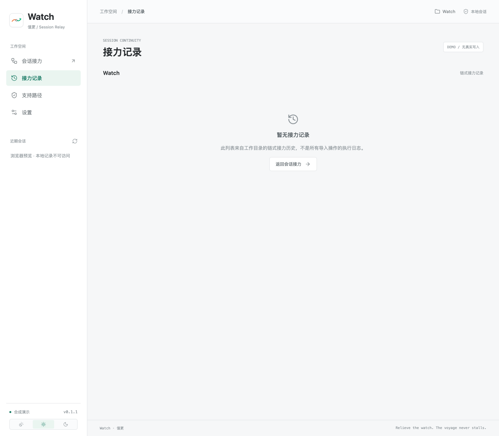
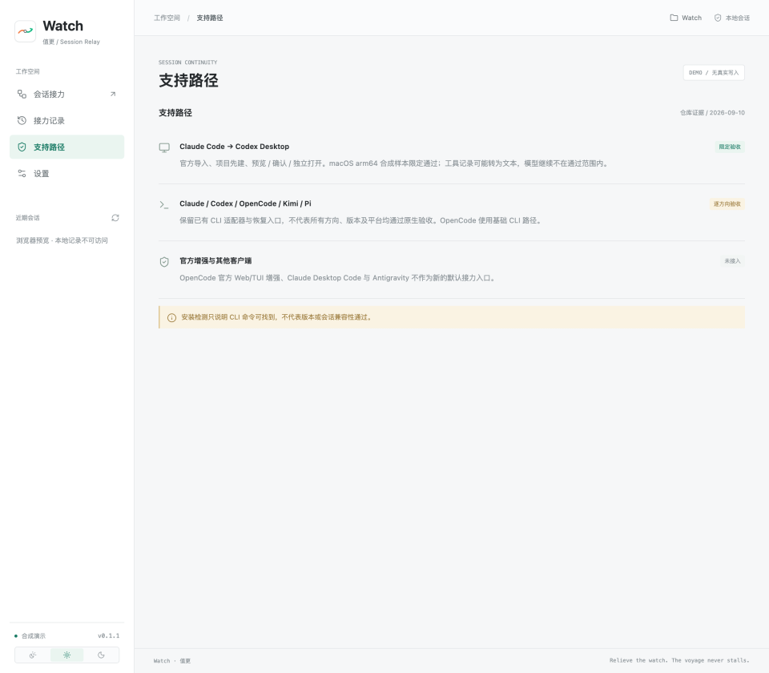
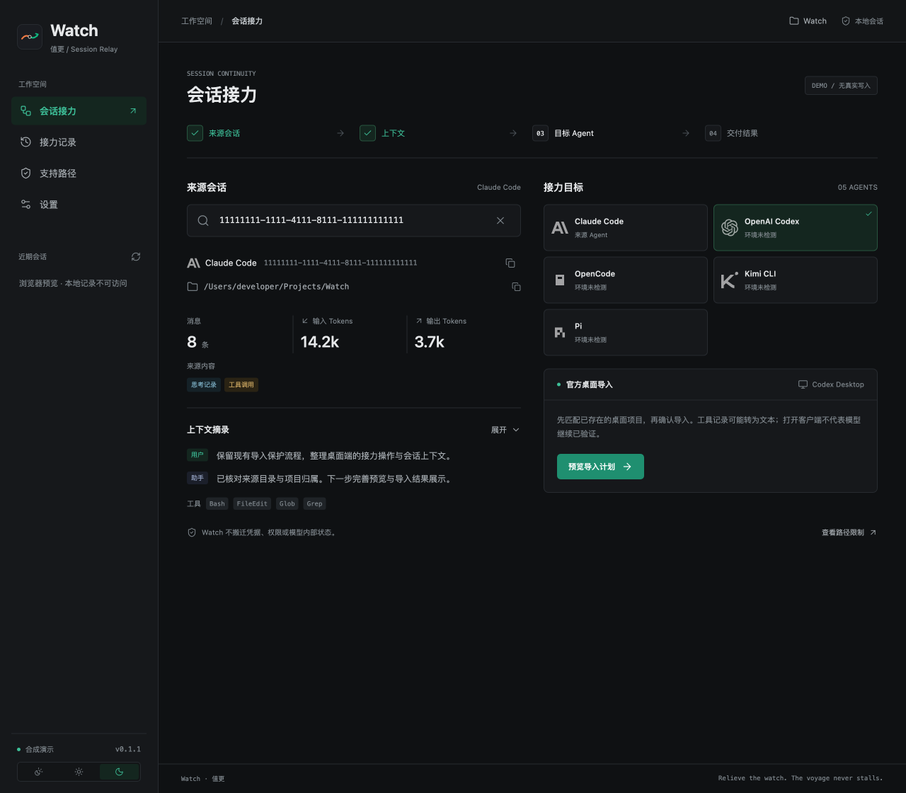

<div align="center">
  
  <h1>Watch · 值更</h1>
  <p><b>Relieving the watch. The voyage never stalls.</b></p>
  <a href="https://github.com/can4hou6joeng4/Watch/stargazers"></a>
  <a href="https://github.com/can4hou6joeng4/Watch/releases"></a>
  <a href="LICENSE"></a>
  
  <br>
  <a href="README.en.md">English</a> · 官网 <a href="https://relay.bobochang.cn/">relay.bobochang.cn</a> · 相关项目 <a href="https://github.com/can4hou6joeng4/Homeport">Homeport</a>
</div>

## 为什么

当当前 Agent 限额用完、上下文满了，或排查停滞想换一家时，已有的结论、失败的尝试和工具轨迹都留在原工具里。重述背景成本高，还容易漏掉关键约束。

Watch 只做一件事：**把已保存的会话记录连同工作目录交到目标工具，让同一项工作继续。**

操作说明在官网 [实操指南](https://relay.bobochang.cn/#guides)：[Claude Code 限额后转入 Codex](https://relay.bobochang.cn/guides/claude-code-limit-to-codex/)、[上下文满与账户限额](https://relay.bobochang.cn/guides/context-limit-vs-usage-limit-handoff/)、[OpenCode 与 SQLite 隔离](https://relay.bobochang.cn/guides/opencode-handover-sqlite-isolation/)、[Opus 5.5 与 5 小时限额](https://relay.bobochang.cn/guides/opus-5-5-five-hour-limit/)。

它不提供模型、不绕过配额、不代替原生 Agent 聊天，也不默认搬迁权限、凭据或插件；接力的是已有记录，不是模型未记录的内部状态。当前实现以 CLI 会话与终端恢复为主，产品方向包含经过验证的桌面端入口，但**官方支持互通不等于 Watch 已经集成**。

### 最新版本（[v0.1.23](https://github.com/can4hou6joeng4/Watch/releases/tag/v0.1.23)）

v0.1.23 阻止恢复命令里的控制字符进入终端和剪贴板。shell 引用能保护参数边界，但键入型终端还会把 Ctrl-C、Ctrl-U 等当作按键处理。桌面端与 Rust 桥现在先校验再交付；CLI 文本输出转义并披露限制，JSON 保留原值供程序核对。此前的 PowerShell 引用、交接头部展示和围栏修复继续保留。

- **含控制字符的恢复命令停止交付（v0.1.23）**：覆盖 C0、DEL 与 C1（包括换行、制表符、ESC），来源 ID / 目录、恢复命令复制、启动失败后的复制兜底及官方导入面板的复制按钮共用检查；原因持续显示。`open` / `switch` / `adopt` / `new` 的命令转义展示并在 warnings 中说明不能直接复制执行，JSON 原始字段不改。使用合成会话、隔离 PTY 与 Rust 单测验证；未启动原生终端 GUI，不增加原生客户端验收结论。

- **PowerShell 弯单引号保留为数据（v0.1.22）**：覆盖六家恢复命令的会话 ID，以及 CLI 和桌面端组合命令的工作目录。根据官方解析器源码核对字符范围与双写语义，合成回归检查原始值及字符串结束位置；本机没有 PowerShell，本次没有 Windows 原生终端验收。

- **交接头部的 ID 与路径按数据展示（v0.1.21）**：三个字段里的换行显示为可见的 `\n`，反引号使用更长的行内代码定界符；链接语法留在代码内，不再成为可点击的字段内容。自动挑选声明仍在 ID 引用之外。仅改变这三个字段的文档展示，JSON 原始字段与实际工作目录保持原值。

- **恢复命令保留原始参数（v0.1.20）**：空格、单引号、分号、美元符号、反引号和换行都留在一个会话 ID 参数内；桌面卡片接收原始 ID，只引用一次，避免重复引用把引号本身传给 Agent。CLI 缺省使用宿主平台，也支持显式选择平台进行检查。POSIX 已用系统 shell 验证参数还原；PowerShell 已检查生成字符串，尚未在 Windows 原生终端验收。

- **过程记录的围栏同样按内容选择（v0.1.19）**：`renderEvent()` 的 detail 来自工具入参 / 命令原文，围栏改为 `codeFence()`，长度至少三个反引号且必须长于内容里最长的连续反引号串；截断发生在选围栏之前，所以「截断后才出现的 ```」也不会破坏结构。清单侧的 `inlineCode()` / `singleLineText()` 与这里共用同一个模块，三处行为不会再分叉。控制字符转义与计数保持不变。

- **清单的 Markdown 结构不可被参数改写（v0.1.18）**：行内代码的定界符比内容里最长的连续反引号更长，内容首尾是反引号时补空格；多行命令的围栏长度同样按内容计算，脚本里的 ``` 不再提前闭合并把后续行漏成正文。单行条目（路径、命令、workdir）里的换行折成可见的 `\n`，不能另起一行冒充「另有 N 个文件未列出」或伪造小节。控制字符仍由现有的正文转义处理并计数披露，两处互不替代。

- **旧版 shell 数组命令进入清单（v0.1.17）**：`shell` 工具的非空纯字符串数组 `command` 按官方历史格式（`rust-v0.20.0` 的 `create_shell_tool`）格式化成可读命令，保留空参数、空格、单引号与 shell 元字符的引用边界；`bash` / `zsh` / `sh` 的 `-c` / `-lc` 三项形式直接展示脚本。只认精确工具名，外部命名空间与只读工具的同名参数不猜；`env` 等其他参数与工具输出都不复制。补丁路径只从 shell 脚本包装与 `apply_patch` 直传（`[apply_patch, 补丁正文]`）提取，普通 argv 里出现补丁标记只是数据，不会宣称改过文件。

- **直接补丁进入改动清单（v0.1.16）**：识别 `apply_patch` 字符串入参的新增、删除、更新与重命名前后路径，沿用编辑次数统计；补丁原文不当作 shell 命令。正文被 `--last` / 档位裁剪时，清单仍覆盖整条会话。读不出路径仍披露；统一事件中已有明确失败标记时，整份多文件补丁按一次失败调用计数，并提示可能已部分改动。只读工具、其他命名空间的同名工具与结果正文不触发此提取；不按结果文字猜测成败。

- **持久化工具结果只带走预览并披露（v0.1.15）**：判定要求包装在工具结果开头且带 `Full output saved to:`，正文里引用这段格式的普通结果不误报；多条合并成一条披露，预览正文原样保留。旁路文件属于来源会话目录的私有存储，会被清理、换机器后路径失效，因此不内联、也不声称可恢复。

- **对账只数目标写得出的事件（v0.1.14）**：`countPairedTurnsMissingEvents()` 按目标能力（`textEventSupport` / `attachmentSupport`）统计目标能写入并反解的事件——用户侧文本、与正文同文的助手文本、目标不支持的附件不再触发整份重写；thinking、工具调用与工具结果照旧计入。`handoff` 的整份重写判定与 `open --from` / `open --to` 的缺失事件警告共用同一口径，六家适配器都做了「真写入再读回」的回归。

- **工具结果媒体留占位并披露（v0.1.13）**：`tool_result.content` 的图片与文档写成 `[图片：image/png，1234B]`、`[文件：application/pdf，5678B]` 这类占位，外部链接只标「（外部链接）」，未识别块写有界类型名；多个文本块按换行连接。汇总披露数量，不复制 base64 / url，不产 attachment。占位随工具结果进入交接产物，Claude / Codex 写入读回保持。

- **较早正文仍可交接（v0.1.12）**：同一助手轮多条终稿或未标注 `phase` 的正文，除最后一条继续作为主正文外，前面的原文按出现顺序保留为带来源标记的过程文本，并汇总披露数量；同文记录也不会因等于主正文而消失。新版 `response_item` 与旧版 `event_msg` 回退采用同一规则。
- **迟到阶段不改写终稿（v0.1.12）**：显式终稿后的 `commentary` / `partial_answer` 保留标记原文，不覆盖终稿、终稿时间或完成状态；Watch 自己生成的思考与工具镜像仍跳过。Claude / Codex 合成往返可保留这些助手侧过程文本，其它目标按实际能力披露损失；可用 `watch prompt <来源会话 id> --profile full` 查看。已有目标不保证自动补回历史内容，本轮不新增原生客户端或模型继续验收。

- **Codex 工具记录更完整（v0.1.11）**：读取 `reasoning.content`、工具 `namespace` 与 `local_shell_call.action.command`；工具输出数组的文字按换行连接，图片、音频、密文与未知项留占位并计数披露，不复制这些媒体或密文载荷。无 ID 调用使用明确披露的稳定合成 ID。
- **外部上下文与过程标记（v0.1.11）**：有名称、无调用 ID 的独立输出标注为 Codex 注入的外部内容，不写入用户正文；上游网页搜索、协作消息和图片生成以带标记过程文本保留。未知 `response_item` 与加密压缩条目汇总披露，正常记账条目不误报。
- **转换边界（v0.1.11）**：合成记录已检查写回六家适配器，Claude / Codex 能保留助手侧过程文本；其它目标或用户侧过程文本仍可能丢失，由损失警告说明。用户侧事件无法保存时，链交接仍可能重复整份重写。旧目标不会自动修复已丢失的事件内容，本轮也不增加原生客户端或模型继续的验收结论。

- **未配对结果不再丢失或冒充完成（v0.1.10）**：Pi / Kimi / Codex / Grok 按日志顺序匹配唯一未完成调用。缺少 ID、未知 ID、歧义结果保留为带标记的过程文本；汇总披露只列原因与数量，不复制结果正文。明确的原生失败事实写进标记。Grok 原有的重放去重仍保留。
- **跨轮返回与重复交接（v0.1.10）**：用户插话之后到达的结果仍回到原调用轮；早于调用的结果不回填为完成。标记原文挂在结果出现位置附近的安全对话轮，后续新轮次不会把旧载荷搬到尾部重写。用户侧过程文本、或目标不支持的过程文本，仍可能无法写入目标，由现有损失警告披露；`watch prompt --profile full` 可查看原文。完全没有安全对话载体时明确拒绝解析。
- **Codex 同记录无 ID 配对仍可转换（v0.1.10）**：`command_execution` / `local_shell_call` / `web_search_call` 在同一记录内同时含调用和结果时，按记录位置与内容合成稳定 ID 并披露。六家适配器的合成记录写回检查通过；这不是新的原生客户端验收。

- **坏行披露在大会话上不再静默（v0.1.9）**：`open` / `handoff` / `prompt` / `doctor` / `search` / `usage` 共用的坏行计数以前把整个 JSONL 读成字符串，超过 V8 字符串上限（约 512 MB）时抛错并被吞成 0——解析早已是流式，坏行披露却在这类会话上全部消失。现在改为逐行流式，566 MB 合成会话可正常数出末尾半行。
- **「数不出来」与「没有坏行」分开（v0.1.9）**：扫描本身读不出文件时不再抛错打挂整条命令，也不再返回 0；各入口在 `warnings` / 正文里写明「坏行无法统计」与下一步。`search` 不把未知缓存成 0 行，权限恢复后会重新数出真实行数；`watch usage` 与 `watch prompt` 的用量行标注「下界且程度未知」。
- **缺失文件仍是正常事实（v0.1.9）**：Grok 的 `updates.jsonl` 不存在时照旧按「没有坏行」处理，不会被讲成读取失败。
- **失败标记丢失不再静默（v0.1.8）**：CLI `open --to codex/grok`（含 `--check`）、`open --from` 与链交接按本次实际写入的结果数给出警告，不复制错误正文。增量只计新增内容；零增量且不写入、目标拒绝写入或写入失败时不报本次损失。链交接零增量但整份重写时仍计数。这是现有文件适配器的转换披露，不改变 Codex 官方导入的文本降级约定。
- **能力矩阵明确失败标记（v0.1.8）**：`watch capabilities --json` 新增 `toolFailures`；Claude / Pi / Kimi / OpenCode 为 `assistant`，Codex / Grok 为 `none`，只描述当前写入实现。Pi 现在对缺少或空调用 ID 的统一结果也独立写回 `isError`；这不代表缺少 ID 的记录已通过原生客户端验收。
- **失败不代表文件完全没变（v0.1.7）**：失败命令内嵌补丁的路径也不再作为成功改动列出，命令本身仍保留；失败调用单独计入 `failedFileWrites`。披露明确说明「文件可能已部分改动，请核对实际内容」，避免多文件工具部分成功后报错却被描述成零改动。
- **调用 ID 复用不再漏掉成功编辑（v0.1.7）**：同一次调用结束后，原生记录可以复用 ID。清单现在按来源与尚未完成的具体调用配对；前一次失败不会把后一次成功编辑一起排除，后一次失败也不会抹掉先前成功的改动。
- **Kimi 与 OpenCode 实验导出保留失败（v0.1.7）**：Kimi wire 1.4/1.5 的 `result.isError` 现已读取并写回，缺省或 `false` 不猜失败。OpenCode 1.18.29 官方实验导出把失败结果写成原生 `status: "error"`，保留原因且不重复叠加显示前缀；该增强入口仍未接入产品 CLI / UI。
- **失败的工具写入单独披露（v0.1.6 起）**：读取 Claude 的 `tool_result.is_error`、Pi 的 `toolResult.isError`、OpenCode 的 `state.status === "error"`，明确失败的写入不作为成功改动计入文件清单，另行披露，并在 `--json` 里给出 `failedFileWrites`。
- **失败的命令仍算「运行过」（v0.1.6 起）**：测试失败同样是接手者需要知道的执行记录。命令清单保留这些调用；缺少原生失败字段的老记录不按结果文字猜测成败。
- **失败标记会跟着会话走（v0.1.6 起）**：写回支持的目标时同步 `isError` / `is_error` / `status: "error"`，Claude → Pi → Claude 往返后失败事实仍在。
- **OpenCode 的文件改动不再漏（v0.1.6）**：OpenCode 的工具入参是 camelCase（`filePath` / `oldString` / `newString`），而清单只认 snake_case——每条真实编辑都被记成「读不出路径的写入」，清单漏掉全部 OpenCode 文件改动，还冒一条假的「这段改动可能不全」。
- **大会话不再整份读进内存（v0.1.5）**：Claude 会话能长到超过 V8 的字符串上限（约 512 MB），`readFile(..., 'utf8')` 会抛 `Invalid string length`，而这个错误**没有 errno code**——于是「文件太大」被讲成「会话坏了，先修好它」。本机 539 个会话里有 2 个超限（最大 663 MB），此前 `open` / `watch usage` / 会话列表对它们全部失败。现在 cwd 探测只读头部 64 KB，解析 / 用量 / 列表预览 / 追加前扫描 / 身份探测一律逐行流式读取，峰值内存从「整个文件」降到「一行」；实测 663 MB 会话 3 秒解析出 1962 轮，列表预览 2 ms。
- **改动清单按命令频次排序（v0.1.5）**：长会话里同一条 `npm test` 会重复几十次，而早期命令多半是一次性探查。现在优先保留反复运行的基础设施命令，被略去的条数之外还会给出**被略去的调用次数**，让「这份清单少了多少」可判断。
- **`watch prompt` 的「改动概览」（v0.1.4）**：默认档位（`minimal` / `standard`）一条过程记录都不展开，正文只剩提问与助手最终答复——读者只能看到助手自述「已修复 X、新增 Y，测试通过」，无从核对，也看不出还有哪些文件被改过、实际跑了什么命令。现在从工具调用**参数**汇总出「改动过的文件（写入 / 编辑次数）」与「运行过的命令（含 `workdir`）」，放在正文「会话记录」之前，`--json` 另带结构化 `manifest`。清单覆盖**整条会话**，`--last` / 档位裁掉早期轮次也不会把改动一起甩掉。
- **只看参数结构，不猜文本**：文件路径只来自明确的路径键，或 Codex 补丁的固定行首标记（`*** Update File: ` 等，含 heredoc 里的 `apply_patch`）；命令只来自 `command` / `cmd`。工具结果只查看失败标记与调用 ID，不读输出正文，也不从 `summary` 里抠路径——否则会把「读过」说成「改过」。只读工具、`todo_write`、`write_stdin` 这类同族名字不会误收。
- **清单本身也要披露降级**：认得出写入类工具却读不出路径时说明「这段改动可能不全」；超出上限时给出被略去的条数与被略去的调用次数；干净会话不出现这一节，也不多一条 `findings`。
- **Grok 失败记录（v0.1.3）**：`updates.jsonl` 里 `turn_completed.stop_reason` 的 `error` / `cancelled` 与独立的 `retry_state`（含重试次数与是否耗尽）以前完全不读，现在按结构分类汇总成一条披露，**不复制上游错误原文**（那里的 `reason` 带完整上游 URL）。尾部失败会明确写成「以失败结束，不是仍在生成」，而不是笼统的「可能被中断」。
- **逐轮用量不再静默丢弃（v0.1.3）**：Grok 日志的轮次结束记录、带用量的记录与解析出的助手轮数量对不上时，这次交接不挂逐轮用量，并在结果里说明原因，不再让目标会话全为 0/0 却只写一句「已在对账中携带」。
- **失败记录单独披露**：识别 Claude Code 的 `system/api_error` 与 `isApiErrorMessage` 机器错误行、OpenCode 1.x/2.x 的 `Assistant.error`、Pi 的 `stopReason: "error" / "aborted"`、Grok 的 `stop_reason` 与 `retry_state`。Claude Code / Pi / Grok 汇总失败分类与次数，不复制错误原文；OpenCode 保留错误类型及消息文本。机器错误行不冒充最终答复，失败前已有的真实输出仍保留。
- **摘要交接 `watch prompt`**：只读、不写任何文件，把会话渲染成可粘贴的 Markdown；支持 `--profile` 档位、`--last <n>`、`--since-compact`，省略 id 时自动挑本目录最新的可读会话。裁剪会计数，读取失败与已识别的降级会明确报告。
- **诊断与检索**：新增 `watch doctor`（环境 / 本地库 / 索引 / 导入日志只读体检，硬失败退出码 1）、`watch capabilities`（读写能力矩阵）、`search --reset-index`，以及大量「读不出来 ≠ 没有」的降级披露。
- **桌面端**：六张目标卡齐全（含 Grok），点击前预检、目标被占用时的占用者与重试入口、来源与记录页的警告通道均已接通。

## 演示

下图为隔离环境中用合成会话生成的真实运行结果，**不是原生验收证据**。

<table>
<tr>
  <td align="center" colspan="3">
    
    <br><b>CLI 接力</b> · Claude Code → OpenCode
    <br><sub>status → sessions → switch opencode → status，按真实时序回放</sub>
  </td>
</tr>
<tr>
  <td align="center" width="33%" valign="top">
    
    <br><b>来源会话</b> · 反查 cwd 与上下文
    <br><sub>会话 ID、工作目录、用量与工具痕迹</sub>
  </td>
  <td align="center" width="33%" valign="top">
    
    <br><b>导入预览</b> · 确认前只读
    <br><sub>桌面项目、工作目录、CLI 版本与计划 ID</sub>
  </td>
  <td align="center" width="33%" valign="top">
    
    <br><b>导入完成</b> · 再独立打开
    <br><sub>目标线程保留，打开失败只重试打开</sub>
  </td>
</tr>
<tr>
  <td align="center" width="33%" valign="top">
    
    <br><b>接力记录</b> · 空态与口径说明
    <br><sub>这是工作目录的链式接力历史，不是导入执行日志</sub>
  </td>
  <td align="center" width="33%" valign="top">
    
    <br><b>支持路径</b> · 逐方向证据边界
    <br><sub>限定验收 / 逐方向验收 / 未接入</sub>
  </td>
  <td align="center" width="33%" valign="top">
    
    <br><b>暗色外观</b> · 亮色 / 暗色 / 跟随系统
    <br><sub>偏好保存在本地</sub>
  </td>
</tr>
</table>

**同类工具对照**

[catchup](https://github.com/wilbeibi/catchup) 以转录文本交接为主，也提供 `fork` 与 `fork --into`；[cross_agent_session_resumer](https://github.com/Dicklesworthstone/cross_agent_session_resumer) 与 [session-migrate](https://github.com/xhluca/session-migrate) 都提供原生会话格式转换。Watch 提供启动器、链式交接、Codex 官方导入三条独立入口，以及只读摘要导出和路径级写入防护。不同工具的适配与验收范围需要逐项核对；Watch 的实现边界见[架构说明](docs/ARCHITECTURE.md)，方向与版本限制见[兼容性记录](docs/COMPATIBILITY.md)。

## 安装

需要可运行 `node:sqlite` 与 tsx 的 Node（**≥ 22.13**），以及实际使用的 Agent CLI。桌面端另需 Rust / Tauri 环境。

**桌面端安装包**：从 [Releases](https://github.com/can4hou6joeng4/Watch/releases) 取当前平台的安装包。安装包在用户机器上依赖外部 Node。

**从源码运行**

```bash
npm install                                  # 仓库根
npm --prefix desktop install                 # 桌面端依赖另装

npm run watch -- status --json               # 直接使用 CLI
npm run desktop:dev                          # 本地运行桌面端（Vite 在 1420）
npm --prefix desktop run build               # 桌面前端构建
cd desktop && npx tauri build                # 打包当前平台
```

更多约定（代码风格、测试隔离、提交规范）见 [贡献指南](CONTRIBUTING.md)。

## 使用

1. 从原生 Agent 取得会话 ID，粘贴到 Watch。
2. 核对识别出的来源 Agent 和项目目录；**识别失败时不要直接按其他工具恢复**。
3. 选择来源 Agent 继续原会话，或选择另一家执行接力。选择目标本身不会写入；目标可能是新会话，也可能复用匹配的既有会话并补充增量。
4. 使用所选终端继续，或选择「仅复制命令」自行运行。终端打开失败时有复制回退。

常用命令（均支持 `--json`；成功与失败都向 stdout 输出单行 JSON，诊断走 stderr）：

```bash
npm run watch -- status --json                  # 当前目录的会话、链尾与切换历史
npm run watch -- sessions --json                # 该目录下各 Agent 的原生会话
npm run watch -- switch codex                   # 把链尾内容交接给 Codex，输出恢复命令
npm run watch -- adopt claude                   # 把已有 Claude 会话接入链
npm run watch -- new pi                         # 在链上新建另一侧会话（空链时直接起会话）
npm run watch -- open <session-id> --json       # 反查 cwd 并输出可粘贴的打开命令
npm run watch -- open <session-id> --to codex   # 直接把该会话内容转入 Codex 新会话
npm run watch -- prompt <session-id> > seed.md  # 目标工具没有适配器时，导出「摘要交接」文档
npm run watch -- prompt > seed.md               # 省略 id：取本目录按修改时间最新的可读会话
```

<details>
<summary>全部 CLI 子命令</summary>
<br>

```text
status   [--cwd <path>] [--chain <id|name>]                 会话、链尾与切换历史
sessions [--cwd <path>] [--chain <id|name>]                 各 Agent 在该目录的原生会话
switch   <provider> [--cwd <path>] [--chain <id|name>]      链尾内容交接给目标 provider
adopt    <provider> [--session <id>] [--cwd <path>] [--chain <id|name>]   把已有原生会话接入链
new      <provider> [--cwd <path>] [--chain <id|name>]      在链上新建另一侧会话
chain    list|new|rename|archive|use [--cwd <path>]         链的增删改与切换
search   <query> [--cwd <path>] [--reset-index]             本地全文检索（FTS5）；--reset-index 只清索引并压缩库文件（链与切换记录不动）
usage    [--cwd <path>] [--chain <id|name>]                 链上各会话的 token 用量
recent   [--cwd <path>] [--limit <n>]                       近期会话反查记录（默认 8 条，最多 50）
providers                                                   各 Agent 的本机安装检测
capabilities                                                各 Agent 的读写能力矩阵（代码事实，不探测本机 CLI）
doctor   [--cwd <path>] [--strict]                          只读环境诊断（Agent 检测 / 本地库 / 本地库体积与索引规模 / 导入日志）；发现硬失败时退出码 1，--strict 让警告也算失败
open     <session-id> [--from <id>] [--provider <name>] [--to <provider>] [--check]
prompt   [<session-id>] [--provider <name>] [--profile minimal|standard|verbose|full] [--last <n>] [--since-compact]   摘要交接：把会话渲染成可粘贴的 Markdown（降级方案，不写任何文件）
import-codex  prepare|confirm|status|project-prepare|project-confirm|project-status
```

`--check` 只与 `open ... --to <provider>` 同用：只读预检目标会话是否可写，不写入任何内容。

`usage` 的合计只是「读得出来的部分之和」：读取失败、没有 usage 字段、适配器不提供用量，都会在合计行括注；某个会话的用量数据源有无法解析的行时，合计后另起一行说明这轮是下界，按会话那一行也会就地标出「这个数是下界」——`--json` 对应 `totalExcluded` / `totalMissingUsage` / `byProvider[].usageBadLines`。

`search` 同理：某条会话的文件里有无法解析的行时，这些行的内容不会进索引，搜索会在 `warnings` 里说明（文件没变、复用索引时也照样说），而不是只回一句「无结果」。

目标工具还没有适配器（或那家的格式刚漂移、写回有风险）时用 `prompt`：它只读，把会话渲染成一份 Markdown，正文开头就写明「这是摘要交接、不是目标助手的原生会话」；`--profile` 控制保留多少内容，`--last <n>` 则只保留最近 n 个用户轮（显式窗口，此时不再强制保留首轮，文档里会写明）；`--since-compact` 从最近一次可识别的压缩摘要开始渲染（Claude Code、Pi、Kimi、OpenCode 的记录格式都认；Codex 的 compacted 记录与 OpenCode 2.x 的 provider 原生压缩只披露、不并入摘要）——摘要已概括更早的内容，不再重复带上摘要之前的原文（摘要本身标明由哪家生成、不是用户原话；来源没有可用摘要时不按它裁剪，并在正文写明未生效——另有 `--last` / 档位裁剪时也会如实说明还省略了多少轮）；任何被裁剪的部分都会进 `--json` 的 `findings` 并在 stderr 说明。省略会话 id 时，它在 `--cwd`（默认当前目录）里按修改时间挑最新的一条可读会话，`--provider` 可把范围收窄到一家；文档头部会标明「自动挑选」，`--json` 也会带 `autoPicked: true`——挑不到时不会输出半份文档，读不出来与确实没有会话分开说明。头部的时间范围会注明两端各取什么（起点是首条记录，终点可能是文件修改时间；grok 的记录行内没有逐轮时间戳，逐轮时间由 `summary.json` 的创建时间按顺序推定，缺这份摘要时以会话文件的修改时间为锚点，头部括注会写明这一点——那个时间不是逐轮的真实时间）；用量读不出来或用量数据源已被清空时，那一行写的是原因并说明「这不代表来源会话没有用量」，不会一律落回「没有用量记录」；数据源里有无法解析的行时，数字照印但会括注它只是下界；源文件本身有坏行时，正文会另起一行说明「可能缺少这些记录」；来源解析出 0 轮时，正文会说清是 0 字节（需要从备份恢复）还是文件可读但没有可交接的记录。

交接写完之后还会再比一次来源会话文件：你在原生 CLI 里继续对话、或另一条命令正往那条会话追加时，写进去的只是开始读取那一刻的内容——结果里的 `warnings` 会说明来源在这次交接期间变过（改前 / 改后字节数），并给出下一步：再执行一次同一条命令会把新增部分作为增量补上（改写 / 截短的那档不会——先确认文件没坏）。`prompt` 也做同样的复查，但说法不同：它不写文件，没有「增量补齐」，所以来源在渲染期间变过时，**文档正文**里会出现一行「生成期间有变化」，说明正文只代表开始读取那一刻、以及重新生成会重渲染一份新文档（这份不会被修正）——stderr 不跟着文档走，这条只能进正文。

</details>

桌面端提供**会话接力 / 接力记录 / 支持路径 / 设置**四个视图，支持亮色、暗色与跟随系统三种外观。浏览器预览不读取本地 Agent 记录；「载入演示」使用合成样本，不写入会话、不启动客户端、不调用模型。

YOLO 默认关闭。开启会在支持的 CLI 命令中加入免确认参数，从而放宽目标 Agent 的权限或沙箱；不应把它当成桌面端的权限设置。

**Claude Code → Codex Desktop（官方单会话导入）**

只有明确确认后才提交，导入成功后再单独打开目标线程。要进入桌面项目，必须先在 Codex Desktop 添加并保留该目录，再在准备阶段使用 `--desktop-project`。

```bash
npm run watch -- import-codex prepare <claude-id> --cwd /absolute/project --desktop-project --experimental --json
npm run watch -- import-codex confirm <plan-id> --experimental --json
npm run watch -- import-codex status <plan-id> --json
```

旧 `project-prepare` / `project-confirm` / `project-status` 仍可查看或更新 app-server 的后端 `projectId`，但不能解除 Desktop 已持久化的 `projectless` 排除，因此不是项目列表修复方案。不要通过反复移除项目或重复导入来刷新——这会改变项目 ID，并可能让对象继续处于排除状态。

## 能力与限制

| 入口 | 当前状态 |
|---|---|
| Claude Code、Codex、Kimi、OpenCode、Pi、Grok CLI | 有查找、转换和恢复实现，桌面六张目标卡与适配器恢复命令逐字一致；OpenCode 支持 SQLite 存储会话恢复与路径隔离、原生 ID 修复，具体版本与方向仍需验收 |
| Grok CLI 桌面入口 | 已接入第六张目标卡（`grok -r <id>`，YOLO `--always-approve`）；写入原生 ACP `updates.jsonl` 后，隔离验收通过 `sessions list` / `export` / ACP `session/load`；TUI 逐帧画面与模型继续未验证 |
| Codex 桌面端 | Claude Code 来源已接入项目先建的预览、确认、状态和独立打开流程；合成样本已通过真实 Watch Tauri 点击与两次同目标打开验收。当前本机 CodexPilot 的既有续写尝试仍记录为 503 |
| Claude Desktop Code | 官方 `/desktop` 流程已完成实现调查；它依赖当前 CLI 会话保存与 flush，尚未由 Watch 接入或原生验收 |
| OpenCode Web、TUI、IDE | Darwin arm64 / 1.18.29 的官方 JSON import/export、只读 server API、Web、独立 local TUI 与 attached TUI 历史可见已通过隔离原生验收；单次无工具继续请求因 provider 429 未生成回复，因此官方多客户端增强仍未接入。该结果不阻塞现有 OpenCode CLI 卡片；IDE 扩展复用集成终端 |
| Antigravity | 2.0 → CLI 的官方交互式 picker 已调研但未原生验收；没有跨 Agent 导入协议或 Watch 适配器 |

**历史格式、附件和工具事件可能降级**，结果提示仍需完善。新建文件、整文件替换与 Claude / Codex 的增量追加都走同目录原子写和 rename 前反解校验，写入前还比对目标指纹；Codex 目标另有 `preflight` 与协作写锁。OpenCode 以 SQLite 事务对账，其它 provider 按各自存储形态防护，覆盖面并不完全等价；**不承诺零损坏**。Watch 不自动创建 Worktree，不迁移代码，也不保证不同模型行为一致。

官方路径使用目标目录 / 配置绑定和 Watch 导入锁，**不因无关桌面应用运行而要求退出**；直接写文件路径使用目标指纹、原子写与（Codex）协作写锁，两者的防护面不同。原生证据只覆盖 macOS arm64 / Codex CLI 0.153.4 的合成样本及空闲服务并存，P2 真实 Tauri 点击另绑定 ChatGPT Desktop 26.903.61454 —— 两者都不保证所有并发场景、其他版本或模型继续。

打开成功与会话可继续是两个状态：转入成功但客户端打开失败时，只重试打开，不重复转换。

## 设计

- **TypeScript 承载业务逻辑**，Rust 只做 CLI 桥接与必须由 GUI 进程完成的系统操作。
- **每家 Agent 一个适配器**（`src/providers/<id>/`），统一时间线在适配器边界完成解析与写回。
- **写回安全三道防线**：写前比对目标指纹（TOCTOU）、同目录原子写、rename 前用自家 `parse` 反解对账。
- **两条官方路径各自隔离**：Codex 官方导入与 OpenCode 官方增强使用执行日志与目标锁，不经上述转换器。
- **降级必须披露**：任何「失败但继续」的分支都要记录在 warnings 或 findings 中，不静默丢弃内容。

细节与防护缺口见 [架构与安全边界](docs/ARCHITECTURE.md)。

## 缘起

编程 Agent 各自维护自己的会话记录。换工具本该是常态，但每换一次都要重新交代背景，前面的结论、失败的尝试和已确认的约束都留在旧工具里——而这些恰恰是最难重述的部分。

所以 Watch 不做聚合、不做代理、也不做另一层聊天界面，只把「已有记录 + 工作目录」这一段交接做扎实：先查得到，再核对得清，写回时守得住，交付后能继续。

## 环境与隐私

会话转译主要处理本地记录，但**不等于全过程离线**：Kimi 新建会话会调用其 CLI，部分 Codex 执行路径可能读取认证配置并调用模型，目标 Agent 继续时按其自身服务规则通信。

调用原生 Agent 的路径需要其正常认证。请先用专用测试会话验证，不要把真实凭据、聊天记录或 Agent 数据库提交到仓库。

**搜索会在本机建索引**：`watch search` 把当前目录下各 Agent 会话的轮次正文与工具调用 / 返回记录写进 `~/.watch/watch.db` 的全文索引（`messages_fts`），下次搜索不必重新解析文件。索引只留在本机：Unix 上库目录为 0700、库文件为 0600，Watch 不会上传；`WATCH_DB` 可以换位置，删掉库文件（连同 `-wal` / `-shm`）就清除了这些正文，代价是链与切换记录一并丢失。没跑过 `search` 的会话不会进库。

## 会话文件在哪

| Agent | 本机位置 | 恢复 |
|---|---|---|
| Claude Code | `~/.claude/projects/<编码目录>/<会话 id>.jsonl` | `claude --resume <id>` |
| Codex | `~/.codex/sessions/年/月/日/rollout-*.jsonl` | `codex resume <id>` |
| OpenCode | `~/.local/share/opencode/opencode.db` | `opencode -s <id>` |
| Kimi CLI | `~/.kimi-code/sessions/` 与 `session_index.jsonl` | `kimi -r <id>` |
| Pi | `~/.pi/agent/sessions/` | `pi --session <id>` |
| Grok CLI | `~/.grok/sessions/` | `grok -r <id>` |

路径以各 CLI 当前版本为准。Watch 按会话 ID 反查这些位置，并核对工作目录。限额和上下文的区别见 [上下文满与账户限额](https://relay.bobochang.cn/guides/context-limit-vs-usage-limit-handoff/)；OpenCode 的库路径与事务见 [OpenCode 与 SQLite 隔离](https://relay.bobochang.cn/guides/opencode-handover-sqlite-isolation/)。

## 文档

- [产品需求与实施计划](docs/PLAN.md)：当前范围与分阶段完成条件。
- [客户端兼容性证据](docs/COMPATIBILITY.md)：官方依据、实现状态和本机预检。
- [架构与安全边界](docs/ARCHITECTURE.md)：当前实现及缺口。
- [Codex 官方导入说明](docs/import-codex.md)：实验入口的完整流程与限制。
- [贡献指南](CONTRIBUTING.md)：环境要求、代码风格、测试隔离与提交规范。

## 支持

- 如果 Watch 对你有用，欢迎点一个 Star，或[分享给同样在多个 Agent 之间来回切换的人](https://twitter.com/intent/tweet?url=https://github.com/can4hou6joeng4/Watch&text=Watch%20-%20%E8%B7%A8%20CLI%20%E7%BC%96%E7%A8%8B%20Agent%20%E4%BC%9A%E8%AF%9D%E6%8E%A5%E5%8A%9B%E5%B7%A5%E5%85%B7)。
- 遇到问题或想扩展某条路径，欢迎开 issue 或 PR；提出前请先读 [贡献指南](CONTRIBUTING.md)。

## 许可

本仓库的代码与文档以 [MIT](LICENSE) 发布。

- 站点图标取自 [Lucide](https://lucide.dev)（ISC）。`site/agents/` 与 `desktop/public/` 下的 Agent 图标为各品牌自有资产，仅用于识别。
- 桌面安装包会把 `tsx` 与 `esbuild`（均为 MIT）一并带入 `watch-core`，运行时仍需用户自备 Node ≥ 22.13。
- 各 Agent CLI 受其自身许可与服务条款约束；Watch 不重新分发它们的模型或凭据。

---

## 相关项目

- 🧭 [Homeport](https://github.com/can4hou6joeng4/Homeport) —— 个人主页
- 🐋 [Sonar](https://github.com/can4hou6joeng4/Sonar) —— 封面取色驱动的 iOS 音乐播放器
- 🚩 [Semaphore](https://github.com/can4hou6joeng4/Semaphore) —— 浏览器本地 ASCII 艺术转换
- 🛟 [Buoy](https://github.com/can4hou6joeng4/Buoy) —— AnyRouter 多账号签到工具
- 🗼 [Beacon](https://github.com/can4hou6joeng4/Beacon) —— PDF 证件有效期审计
